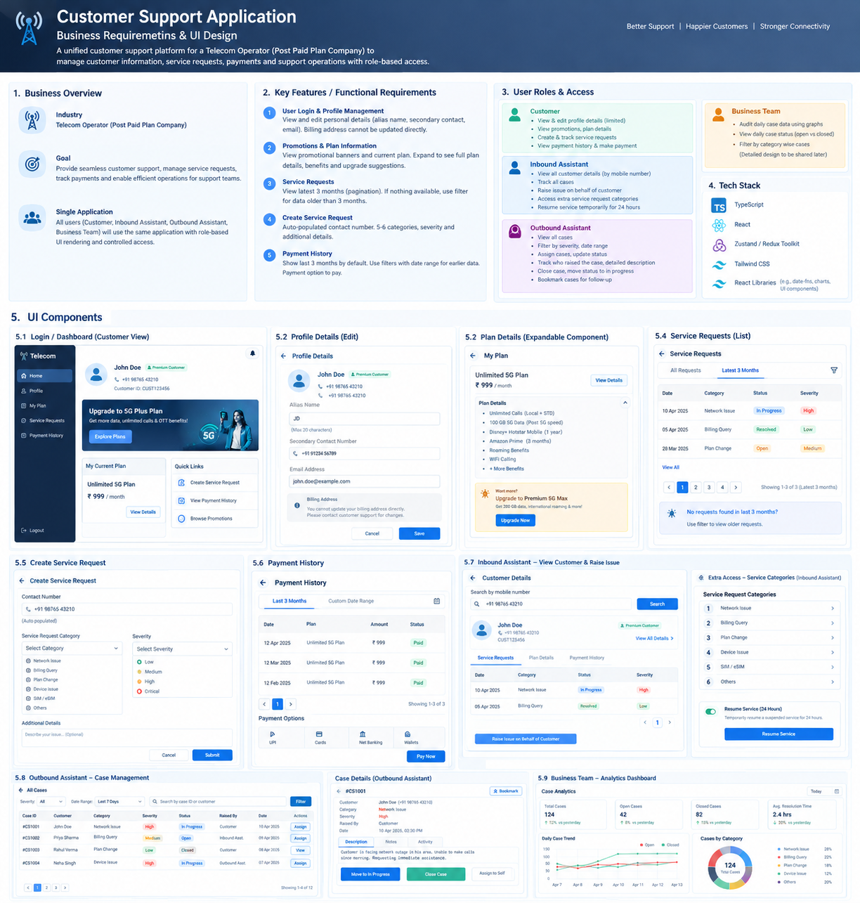
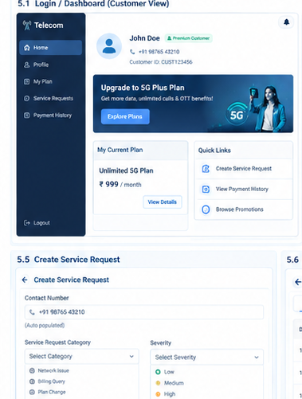
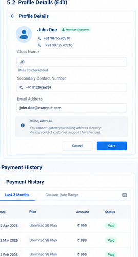
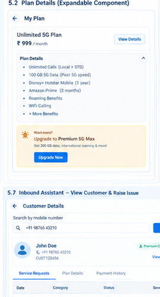
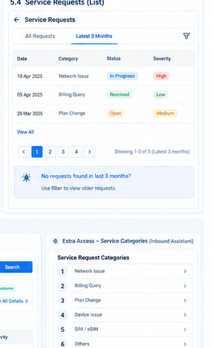
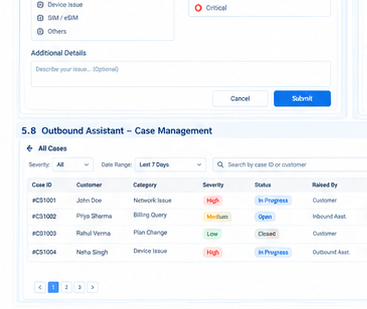
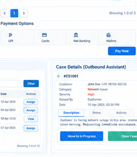
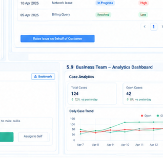
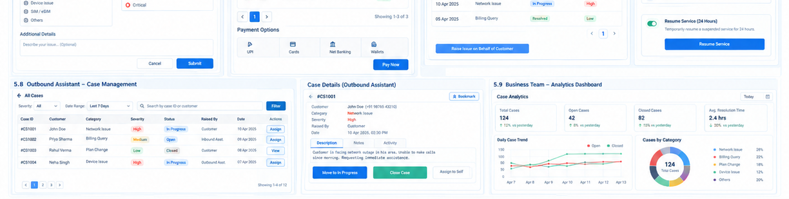

# Telecom Customer Support Application — Business Requirements & UI Specification

> Postpaid Telecom Operator · Version 1.0 · Draft for Business Validation
> Source: `Telecom_Customer_Support_BRD_UI_Specification(1).docx` (converted to Markdown so Claude can read and cite it by requirement ID).
> UI images are AI-generated conceptual references, not approved designs.



## Document control

| Attribute | Value |
|---|---|
| Purpose | Define business scope, user roles, functional requirements, UI components and acceptance criteria. |
| Product model | Single application with role-based experiences for customers and internal teams. |
| Frontend stack | React, TypeScript, Tailwind CSS, Zustand or Redux Toolkit; supporting libraries as needed. |
| Status | Initial BRD / UI specification – open decisions identified for stakeholder validation. |
| Audience | Product owner, business analysts, UX/UI designers, frontend/backend engineers, QA, operations and compliance. |

This document is a baseline for discovery and design. Requirements marked as proposed must be confirmed with the telecom operator. Backend authorization, integrations, regulatory interpretation and operational SLAs require separate validation.

## 1. Executive summary

Build one unified customer support application for a postpaid telecom operator. Customers use the application to view and manage permitted profile details, understand their current plan, browse promotions, create and track service requests, review payment history and pay outstanding bills. Internal teams use the same application through role-specific workspaces: inbound assistants support customers and create requests on their behalf; outbound assistants manage and follow up on cases; and the business team reviews operational performance.

### 1.1 Business objectives
- Increase customer self-service and reduce avoidable calls to support.
- Provide a consistent customer and case view to authorized support staff.
- Improve case ownership, status visibility, follow-up and resolution discipline.
- Enable management to monitor case volumes, status trends and categories.
- Protect customer and payment information through least-privilege access and auditable operations.
- Create a scalable frontend foundation that can integrate with billing, CRM, payment and telecom provisioning systems.

### 1.2 In scope

| Area | Included in initial scope |
|---|---|
| Customer | Dashboard, profile edit for allowed fields, plan details, promotions, service requests, payment history and payment initiation. |
| Inbound assistant | Customer lookup, customer/case view, create request on behalf, internal categories, eligible temporary reactivation. |
| Outbound assistant | Case listing, filters, self-assignment/assignment permissions, case details, status updates, bookmarks and follow-up. |
| Business team | Daily operational dashboard, open/closed analysis, category filters and drill-down/audit foundation. |
| Platform | Authentication, RBAC, responsive UI, audit trail, notifications and integration-ready API layer. |

### 1.3 Out of scope unless separately approved
- Full CRM replacement or customer master-data ownership.
- Billing calculation engine and invoice generation.
- Telecom network fault diagnosis or network management.
- Payment gateway implementation itself; the application integrates with a provider.
- Final regulatory policy, SLA values and legal approval workflows.
- Admin console for creating all roles, categories, plans and promotions (future scope).

## 2. User roles and access model

| Role | Primary goal | Core capabilities |
|---|---|---|
| Customer | Resolve common account needs without contacting support. | View own account, edit permitted contact fields, view plan/offers, raise and track requests, view/pay bills. |
| Inbound assistant | Resolve live customer queries and register issues accurately. | Search customer, verify identity, view permitted account data, create cases, use internal categories, request eligible temporary reactivation. |
| Outbound assistant | Own follow-up and progress cases to resolution. | View permitted case queue, filter, claim/assign according to policy, update status, add notes, bookmark and close eligible cases. |
| Business team | Understand operational performance and audit service trends. | View aggregate metrics, filter by date/category/status/severity, drill into authorized records and export approved reports. |

Access must be based on authenticated identity, role, granular permission, organizational scope and record-level rules. Hiding a UI element is not sufficient authorization; every protected API must enforce access independently.

## 3. Customer portal – screen and component requirements

### CUS-01 – Customer dashboard
Provide a single landing page showing customer identity, promotions, current plan summary, recent service requests, recent payment information and quick actions.

**Acceptance criteria**
- CUS-01.1 Show authenticated customer's name, primary mobile number and account reference.
- CUS-01.2 Load dashboard cards independently where possible and show skeleton, empty and error states.
- CUS-01.3 Only return data associated with the authenticated customer account.
- CUS-01.4 Provide direct navigation to plan details, all requests, payment history and Pay Now.



### CUS-02 – Profile management
Allow the customer to update alias name, secondary contact number and email address. Primary mobile number, customer identity and billing address are not directly editable in this screen.

**Acceptance criteria**
- CUS-02.1 Alias name, secondary contact and email are editable subject to validation.
- CUS-02.2 Verify changed contact channels using approved OTP or verification workflow.
- CUS-02.3 Billing address is read-only and displays instructions for the separate address-change process.
- CUS-02.4 Show save confirmation, field-level validation and API error messages.
- CUS-02.5 Maintain who/when/what audit history for profile changes.



### CUS-03 – Plan summary and expanded details
Show a compact current-plan card. Expanding it reveals full plan benefits, allowances, charges/limitations and eligible upgrade suggestions.

**Acceptance criteria**
- CUS-03.1 Show plan name, monthly rental, status, billing cycle and key allowances in collapsed view.
- CUS-03.2 Expanded view lists voice, data, SMS, roaming, OTT and other included benefits when available.
- CUS-03.3 Show usage only when a trusted usage source is integrated.
- CUS-03.4 Upgrade recommendations must be eligibility-checked and show price/benefit comparison.
- CUS-03.5 Plan change requires explicit confirmation and displays effective date and applicable charges.



### CUS-04 – Promotions
Display relevant promotional banners and offer cards on the dashboard and/or promotions page.

**Acceptance criteria**
- CUS-04.1 Each offer includes title, short description, validity, eligibility and terms.
- CUS-04.2 Only eligible and active offers are shown to the customer.
- CUS-04.3 CTA opens a detail/claim flow; no subscription is activated without confirmation.
- CUS-04.4 Expired or ineligible offers are not actionable.

### CUS-05 – Service request list
Display the customer's service requests with a default rolling three-month window, newest first, pagination and filters for older records.

**Acceptance criteria**
- CUS-05.1 Default query is created date within the last three months.
- CUS-05.2 If no results exist, show a clear empty state and a date-filter action.
- CUS-05.3 Older records are retrieved only when the customer applies a date range.
- CUS-05.4 Support pagination and search by request reference.
- CUS-05.5 Display request ID, category, created date, severity and status.



### CUS-06 – Create service request
Provide a guided form to create a service request against the authenticated customer's account.

**Acceptance criteria**
- CUS-06.1 Primary contact number and account reference are auto-populated and read-only.
- CUS-06.2 Customer selects one of the approved categories and applicable subcategory.
- CUS-06.3 Capture subject, description, optional attachment and preferred contact method where required.
- CUS-06.4 Severity is either system-calculated or selected within business policy; this decision remains open.
- CUS-06.5 On successful submission, generate a unique reference and show confirmation.
- CUS-06.6 Prevent duplicate submission on repeated clicks and network retries.



### CUS-07 – Payment history
Display payment transactions for the last three months by default, with custom date filtering for older history.

**Acceptance criteria**
- CUS-07.1 Show transaction reference, invoice reference, date/time, amount, method and status.
- CUS-07.2 Default period is the most recent three months.
- CUS-07.3 Older data requires a valid date range filter.
- CUS-07.4 Support pagination and receipt download for eligible successful transactions.
- CUS-07.5 Payment state must be reconciled with the billing/payment source.



### CUS-08 – Make payment
Allow a customer to initiate payment for an outstanding bill using an approved payment provider.

**Acceptance criteria**
- CUS-08.1 Display invoice and outstanding amount before payment.
- CUS-08.2 Redirect to or embed an approved secure payment experience.
- CUS-08.3 Verify payment result server-side; do not trust browser redirect alone.
- CUS-08.4 Handle success, failure, pending, timeout and duplicate-attempt scenarios.
- CUS-08.5 Provide receipt/reference for successful payment and reconciliation for delayed confirmation.

## 4. Inbound assistant workspace

### INB-01 – Customer lookup and details
Allow an inbound assistant to search by mobile number and view permitted customer details after identity verification.

**Acceptance criteria**
- INB-01.1 Search result must be scoped to authorized customer records.
- INB-01.2 Agent completes the operator's verification procedure before protected actions.
- INB-01.3 Display customer identity, account status, plan, contact details and relevant case/payment context according to permissions.
- INB-01.4 Log customer-record access where required by policy.

### INB-02 – Track customer cases
Provide a consolidated case view for the selected customer.

**Acceptance criteria**
- INB-02.1 Show request reference, category, severity, status, owner, created date and last update.
- INB-02.2 Allow the agent to inspect case description and activity timeline.
- INB-02.3 Show related/duplicate cases where the backend supports matching.
- INB-02.4 Do not expose internal notes to customers.

### INB-03 – Raise request on behalf of customer
Allow inbound agents to create a request for a verified customer, including internal-only categories and agent remarks.

**Acceptance criteria**
- INB-03.1 Customer mobile/account details are populated from the selected customer.
- INB-03.2 Internal categories and subcategories are permission-controlled.
- INB-03.3 Capture issue summary, customer statement, agent notes, severity and attachments as applicable.
- INB-03.4 Record created-by agent identity and creation channel as inbound.
- INB-03.5 Provide the reference number for communicating to the customer.



### INB-04 – Temporary service reactivation
Allow explicitly authorized inbound agents to request a temporary restoration for eligible suspended accounts for up to 24 hours.

**Acceptance criteria**
- INB-04.1 Check suspension reason and account eligibility before enabling action.
- INB-04.2 Fraud, legal, regulatory or other prohibited suspension reasons cannot be overridden.
- INB-04.3 Capture reason, agent identity, timestamp and approval evidence where required.
- INB-04.4 Provisioning is executed by a backend integration, not a frontend-only status change.
- INB-04.5 Expiry is enforced by backend scheduler/workflow after 24 hours or earlier if policy requires.
- INB-04.6 Prevent repeated extensions or abuse according to configurable policy.
- INB-04.7 Notify customer and create an immutable audit event.

## 5. Outbound assistant workspace

### OUT-01 – Case dashboard and queue
Provide an operational queue with counts for new, open, in-progress, pending, resolved, closed, critical and overdue cases.

**Acceptance criteria**
- OUT-01.1 Display case ID, customer, category, severity, created date, assigned agent, status and last updated.
- OUT-01.2 Use server-side pagination, sorting and filtering.
- OUT-01.3 Provide loading, error and no-result states.
- OUT-01.4 Queue visibility follows configured team/organization scope.

### OUT-02 – Advanced filters
Allow filtering by severity, status, category, created date, updated date, assigned agent, customer mobile and case ID.

**Acceptance criteria**
- OUT-02.1 Support custom date range and clear-all action.
- OUT-02.2 Show total matching records and preserve filters during pagination.
- OUT-02.3 Search and filtering execute server-side for scale.
- OUT-02.4 Validate date ranges and avoid unrestricted unbounded queries.

### OUT-03 – Case assignment
Allow agents to claim unassigned cases and perform other assignments only when granted the corresponding permission.

**Acceptance criteria**
- OUT-03.1 Claim operation must be atomic to prevent two agents claiming the same case.
- OUT-03.2 Reassignment captures old owner, new owner, actor, timestamp and reason.
- OUT-03.3 Agents cannot take another agent's case unless permitted.
- OUT-03.4 Assignment changes appear in case activity history.

### OUT-04 – Case details and activity
Show customer context, issue description, severity, category, originator, ownership, status and chronological activity timeline.

**Acceptance criteria**
- OUT-04.1 Separate customer-visible comments from internal notes.
- OUT-04.2 Show who created the request and the channel used.
- OUT-04.3 Record all material case updates in the activity timeline.
- OUT-04.4 Sensitive customer data is masked where not needed.

### OUT-05 – Case status and closure
Allow permitted agents to move cases through configured states such as Assigned, In Progress, Pending, Resolved and Closed; support Reopened when policy permits.

**Acceptance criteria**
- OUT-05.1 Validate allowed state transitions on the backend.
- OUT-05.2 Require resolution remarks before Resolved.
- OUT-05.3 Distinguish Resolved (issue addressed) from Closed (closure process complete).
- OUT-05.4 Require closure conditions such as customer confirmation or configured verification window where applicable.
- OUT-05.5 Capture actor, timestamp, prior state, new state and remarks.

### OUT-06 – Bookmarks and follow-up
Allow agents to bookmark cases for personal follow-up without changing ownership.

**Acceptance criteria**
- OUT-06.1 Bookmark state is specific to the authenticated agent.
- OUT-06.2 Provide a dedicated bookmarked-cases view.
- OUT-06.3 Show current status and latest updated timestamp.
- OUT-06.4 Notify the agent of changes to bookmarked cases where notification service is enabled.



## 6. Business operations and analytics

### BUS-01 – Daily case dashboard
Provide business users with aggregate daily case information and operational trends.

**Acceptance criteria**
- BUS-01.1 Show total cases created, open, resolved, closed, critical and overdue.
- BUS-01.2 Show open-versus-closed trend over selected period.
- BUS-01.3 Support today, yesterday, last 7 days, last 30 days and custom date range.
- BUS-01.4 Display data freshness timestamp and timezone.
- BUS-01.5 Define metric calculation rules consistently with case lifecycle.

### BUS-02 – Category and severity analysis
Allow category-wise and severity-wise filtering and visualization.

**Acceptance criteria**
- BUS-02.1 Provide distribution by service request category and severity.
- BUS-02.2 Allow authorized drill-down from chart to filtered case list.
- BUS-02.3 Avoid exposing unnecessary customer-identifying information in aggregate views.
- BUS-02.4 Show zero-data and partial-data states clearly.

### BUS-03 – Daily audit and export
Provide a controlled audit view and export capability for approved business users.

**Acceptance criteria**
- BUS-03.1 Allow date/category/status filters.
- BUS-03.2 Display case lifecycle timestamps and audit history according to permissions.
- BUS-03.3 Export only fields authorized for the user's role.
- BUS-03.4 Log report exports, including actor, time, filter scope and file type.

## 7. Shared workflows and business rules

### 7.1 Proposed case lifecycle
Created → Assigned → In Progress → Pending (Customer / External Team) → Resolved → Closed. Reopened is a controlled transition from a resolved/closed state where policy allows. Actual status names and transitions must be approved by operations.

| Rule ID | Business rule |
|---|---|
| BR-01 | Every service request/case receives a unique, non-reusable reference ID. |
| BR-02 | A case must have a customer/account association and creation channel. |
| BR-03 | Every status/assignment change records actor, timestamp, previous value, new value and reason where applicable. |
| BR-04 | Customer and internal notes must be stored and displayed separately. |
| BR-05 | Three-month default views are query/display defaults, not record-retention or deletion policies. |
| BR-06 | Older history is accessed through bounded date filters and server-side pagination. |
| BR-07 | SLA deadlines must be configurable by complaint category and applicable policy. |
| BR-08 | Payment and provisioning actions must be confirmed by backend/provider systems. |
| BR-09 | A single request may be linked to one or more internal work items if future operational design requires it. |
| BR-10 | Role-based UI controls must be backed by server-side authorization. |

## 8. Initial permission matrix

| Capability | Customer | Inbound | Outbound | Business |
|---|---|---|---|---|
| View own profile | Yes | After verification / scope | Restricted | No by default |
| Edit allowed contact fields | Yes | No | No | No |
| View plan / promotions | Own account | Authorized lookup | As needed | Aggregate only |
| Create service request | Own account | On behalf | No by default | No |
| View case | Own cases | Authorized customer cases | Queue/assigned scope | Aggregate / audited scope |
| Assign case | No | No | Permission-based | Optional supervisor permission |
| Update status | No | Limited actions | Permission-based | No |
| Bookmark case | No | No | Yes | No |
| Temporary reactivation | No | Special permission | No | No |
| View payment history | Own account | Authorized scope | Restricted | Aggregate only |
| Initiate payment | Yes | No | No | No |
| Analytics / export | No | No | Operational view | Permission-based |

Recommended permission identifiers: `customer.profile.read`, `customer.profile.update`, `case.create`, `case.read`, `case.assign`, `case.status.update`, `case.bookmark`, `service.reactivate`, `payment.read`, `payment.initiate`, `analytics.read`, `reports.export`.

## 9. Non-functional requirements

| ID | Category | Requirement |
|---|---|---|
| NFR-PERF | Performance | Server-side pagination/filtering; lazy-load dashboard modules; define performance budgets. |
| NFR-SEC | Security | Secure authentication, least privilege, server-side authorization, session controls, input validation, secure transport and encryption at rest. |
| NFR-PRIV | Privacy | Minimize personal data, mask where appropriate, log sensitive access, apply retention/deletion policies. |
| NFR-AVAIL | Availability | Graceful degradation when billing, payment, CRM or provisioning integrations are unavailable. |
| NFR-REL | Reliability | Idempotency for create/payment/reactivation operations and retry-safe API contracts. |
| NFR-A11Y | Accessibility | Semantic controls, keyboard navigation, visible focus, contrast and accessible validation messages. |
| NFR-RESP | Responsive design | Desktop-first agent workspaces and responsive customer experiences across tablet/mobile. |
| NFR-OBS | Observability | Frontend errors, API correlation IDs, performance metrics and backend audit events without logging secrets. |
| NFR-MAINT | Maintainability | Feature-based modules, shared design tokens, typed API contracts and reusable components. |
| NFR-INTEG | Data integrity | Validate state transitions, account ownership and payment/provisioning results server-side. |

Proposed targets: LCP ≤ 2.5 s for the primary customer page; P95 ≤ 500 ms for ordinary read APIs excluding external provider latency.

## 10. Recommended frontend technology and architecture

| Concern | Recommendation |
|---|---|
| Framework | React + TypeScript |
| Build | Vite |
| Styling | Tailwind CSS |
| Client/global state | Zustand initially |
| Server state | TanStack Query |
| Routing | React Router |
| Forms/validation | React Hook Form + Zod |
| Tables | TanStack Table |
| Charts | Recharts |
| UI primitives | shadcn/ui + Lucide React |
| Testing | Vitest, React Testing Library, Playwright |

### 10.1 Suggested feature-based structure
```
src/
  app/                 # providers, router, application shell
  components/ ui/ layout/ data-table/
  features/
    authentication/
    customer/  dashboard/ profile/ plans/ promotions/ service-requests/ payments/
    inbound/   customer-search/ customer-details/ case-creation/ reactivation/
    outbound/  dashboard/ case-management/ case-details/ bookmarks/
    business/  dashboard/ analytics/ reports/
  services/  stores/  permissions/  types/  utils/  styles/
```

### 10.2 State management principle
TanStack Query for server state; Zustand for small client state (session metadata, navigation preferences, dialogs). Do not duplicate server records in both.

## 11. Backend systems and integrations

| Integration | Responsibility | Key considerations |
|---|---|---|
| Identity provider | Login, MFA, session and identity | Role/permission claims; token lifecycle |
| CRM / Customer master | Customer profile, account relationship, contact data | Account-to-mobile cardinality; freshness |
| Billing / plan catalogue | Invoices, balances, subscription, plan benefits | Effective dates, proration, eligibility |
| Payment gateway | Secure payment processing and status | Webhook signature, idempotency, reconciliation, pending state |
| Case management | Creation, assignment, lifecycle, SLA, audit | Concurrency, allowed transitions, immutable activity |
| Telecom provisioning | Temporary reactivation and service status | Eligibility, async processing, expiry, failure recovery |
| Notification service | SMS, email, in-app | Consent, templates, delivery status, retry |
| Analytics store | Aggregated operational metrics | Metric definitions, freshness, privacy |

Frontend integrates through a documented API/BFF layer. It must not directly connect to databases or trust client-supplied role/permission values.

## 12. Compliance, privacy and operational investigation
- Distinguish ordinary service requests from formal complaints where regulatory handling differs.
- Capture complaint registration timestamp, reference, category, escalation route, SLA deadline and resolution evidence.
- Make SLA rules configurable by category and policy; do not hard-code unverified deadlines.
- Provide escalation and appellate workflows where required.
- Apply data minimization, access controls, retention schedules, privacy notices and data-principal request handling.
- Use a PCI-compliant payment provider experience; never store raw card numbers or CVV.
- Keep temporary reactivation ineligible for prohibited suspension reasons and record every privileged action.

References for stakeholder review: TRAI grievance redressal, TRAI complaint-redressal regulations, MeitY DPDP Act/Rules, RBI payment directions. Legal/compliance sign-off is required before production.

## 13. Cross-cutting acceptance criteria
- XC-01 Each authenticated role sees only the navigation and actions permitted to that role.
- XC-02 Direct navigation to a restricted route is denied and backend APIs independently enforce authorization.
- XC-03 Every screen supports loading, success, empty, validation and failure states.
- XC-04 Lists use server-side pagination and preserve active filters across pages.
- XC-05 Date filters validate start/end dates and use a documented timezone.
- XC-06 All high-risk actions require confirmation and produce audit events.
- XC-07 No payment, profile update, case transition or reactivation is considered successful until confirmed by the backend.
- XC-08 UI is keyboard-operable and tested at desktop/tablet/mobile breakpoints.
- XC-09 Critical workflows have automated tests and QA evidence before release.

## 14. Decisions required (with defaults adopted by this project)

| # | Question | Default adopted |
|---|---|---|
| 1 | Multiple mobile numbers per account? | Yes — account has many subscriptions. |
| 2 | Inbound search scope / verification? | Search allowed; protected details/actions require verification (OTP or KBA). |
| 3 | Outbound case visibility? | Team queue + assigned; reassignment needs `case.assign.any`. |
| 4 | Who sets severity? | System policy by category; agent override with permission. |
| 5 | Who approves temporary reactivation? | Eligibility rules by suspension reason; `service.reactivate` permission. |
| 6 | SLAs and escalation? | Configurable `sla_policies` table, seeded with placeholder values. |
| 7 | Customer reopen? | Allowed within configurable window (default 7 days). |
| 8 | Customer-visible statuses? | Public status mapping separate from internal status. |
| 9 | Payment gateway? | Mock hosted gateway with signed webhook behind a `PaymentGateway` port. |
| 10 | Backend APIs available? | Built in this monolith; OpenAPI is the typed contract. |
| 11 | Business drill-down/export? | Aggregate by default; PII columns need `reports.export.pii`. |
| 12 | Notification channels? | In-app + email (Mailpit in dev); SMS stub. |

## 15. Delivery sequence

| Phase | Scope | Exit criteria |
|---|---|---|
| 1 Foundation | Shell, design system, auth, role/permission routing | All roles authenticate and see correct navigation; route/API permission tests pass. |
| 2 Customer portal | Dashboard, profile, plan, promotions, requests, payments | Self-service flows work. |
| 3 Inbound | Search, verification, request-on-behalf, internal categories, reactivation | Agent workflows and privileged-action audit verified. |
| 4 Outbound | Queue, filters, assignment, details, status, bookmarks | Lifecycle, concurrency and assignment rules tested. |
| 5 Business analytics | KPIs, trends, category analysis, audit, exports | Metric definitions and drill-down permissions validated. |
| 6 Production readiness | Security, performance, accessibility, integration testing | Sign-offs obtained. |

## 16. UI component inventory

| Screen / component | Primary elements | Roles |
|---|---|---|
| Application shell | Header, sidebar, breadcrumbs, profile menu, notification center | All |
| Customer dashboard | Identity summary, promotion banner, current plan, recent requests, payment summary, quick actions | Customer |
| Profile edit | Alias, secondary phone, email, read-only billing address notice | Customer |
| Plan details | Collapsed summary, expandable benefit list, usage, upgrade comparison | Customer; read-only agent |
| Promotions | Offer cards, eligibility, validity, terms, CTA | Customer |
| Service request list | Date filter, search, status chips, pagination, empty state | Customer; inbound |
| Create request | Autofilled account, category, subcategory, severity, description, attachments | Customer; inbound variant |
| Payment history | Date filter, transaction table, receipt action | Customer; restricted inbound |
| Pay bill | Outstanding balance, bill summary, gateway action, result state | Customer |
| Inbound workspace | Mobile search, verification state, overview, case tabs, raise-on-behalf | Inbound |
| Reactivation panel | Suspension reason, eligibility, reason input, approval state, expiry | Authorized inbound |
| Outbound case queue | KPI cards, filters, sortable table, assignment and bookmark actions | Outbound |
| Case detail | Customer context, issue, status actions, notes, activity timeline | Outbound; inbound read |
| Business dashboard | KPI cards, open/closed trend, category/severity charts, date filters | Business |
| Audit/export | Filtered record view, lifecycle history, export controls | Business with permission |
