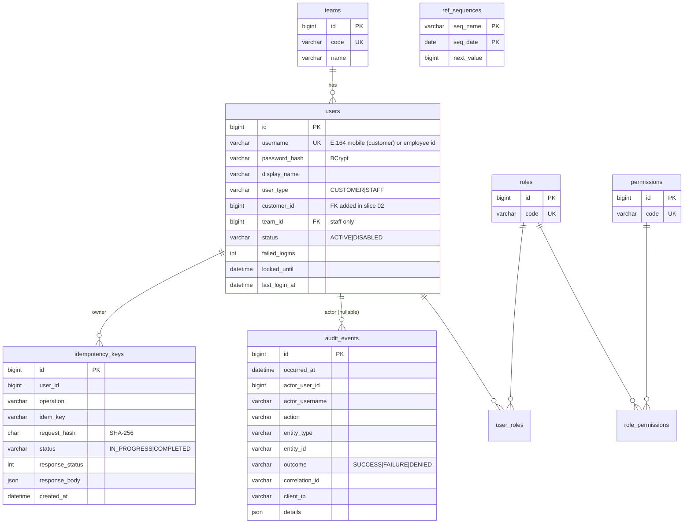
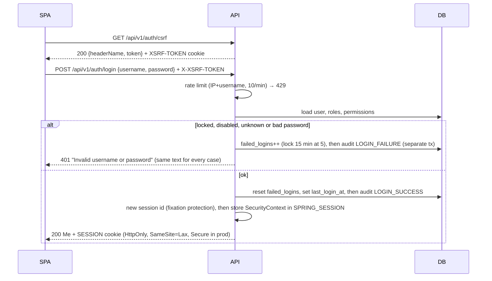

# 01 Foundation — backend design

- Status: **Proposed** (awaiting approval) · Date: 2026-11-24
- BRD: §2 roles, §8 permission matrix, BR-01, BR-03, BR-10, XC-02, XC-06, NFR-SEC, NFR-OBS, NFR-REL
- Conventions: [`../00-overview.md`](../00-overview.md) · Contract: [`openapi.yaml`](openapi.yaml) · ADRs 0001–0003

## 1. Scope

**In:** project skeleton, MySQL + Flyway, identity (users, teams), RBAC (roles, permissions), session login, logout and
lockout, CSRF, `/me`, error model, correlation id, audit trail, idempotency service, reference-ID generator, dev seed users.

**Out (later slices):** customer/account tables (02), so `users.customer_id` has no FK yet. Identity verification (03).
User administration UI or API (BRD §1.3, future). MFA (production readiness, 06).

## 2. Data model (Flyway V1 + V2)

| Migration | Content |
|---|---|
| `V1__baseline.sql` | `ref_sequences` |
| `V2__identity_rbac_audit.sql` | teams, users, roles, permissions, role_permissions, user_roles, audit_events plus the **no-update/no-delete triggers**, idempotency_keys, Spring Session JDBC tables, reference data: **roles + permissions + matrix** (needed in every environment) |
| `db/seed/R__01_identity.sql` (dev only) | 4 teams, 4 customers, 2 inbound, 3 outbound, 1 supervisor, 1 business, 1 auditor; shared dev password documented in the seed file |

Indexes: `users(username)` UK, `audit_events(occurred_at)`, `(entity_type, entity_id)`, `(actor_user_id, occurred_at)`,
`idempotency_keys(user_id, operation, idem_key)` UK, `(created_at)`. All tables use InnoDB, utf8mb4, `DATETIME(6)` UTC.

## 3. Roles and permissions (BRD §8, decisions §14)

Roles add up: a user can hold several. Special permissions are separate roles so they can be granted individually.

| Permission | CUSTOMER | INBOUND_AGENT | REACTIVATION_APPROVER | OUTBOUND_AGENT | OUTBOUND_SUPERVISOR | BUSINESS_ANALYST | BUSINESS_AUDITOR |
|---|:-:|:-:|:-:|:-:|:-:|:-:|:-:|
| customer.profile.read | ✔ own | ✔ verified | | | | | |
| customer.profile.update | ✔ | | | | | | |
| customer.lookup | | ✔ | | | | | |
| customer.verify | | ✔ | | | | | |
| plan.read | ✔ | ✔ | | | | | |
| plan.change | ✔ | | | | | | |
| promotion.read | ✔ | ✔ | | | | | |
| promotion.claim | ✔ | | | | | | |
| case.create | ✔ own | | | | | | |
| case.create.onbehalf | | ✔ | | | | | |
| case.category.internal | | ✔ | | | | | |
| case.read | ✔ own | ✔ verified | | ✔ queue scope | | | |
| case.read.queue | | | | ✔ | | | |
| case.assign | | | | ✔ claim | | | |
| case.assign.any | | | | | ✔ | | |
| case.status.update | | | | ✔ | | | |
| case.note.internal | | ✔ | | ✔ | | | |
| case.bookmark | | | | ✔ | | | |
| service.reactivate | | | ✔ | | | | |
| payment.read | ✔ own | ✔ verified | | | | | |
| payment.initiate | ✔ | | | | | | |
| analytics.read | | | | ✔ | | ✔ | |
| audit.read | | | | | | ✔ | |
| reports.export | | | | | | ✔ | |
| reports.export.pii | | | | | | | ✔ |

The scope notes ("own", "verified", "queue scope") are enforced in the services of later slices, not by the permission alone.
Slice 01 only seeds the matrix and enforces `@PreAuthorize`.

## 4. Authentication flow (ADR 0003)

- Session: Spring Session JDBC, 30 min idle timeout, expired rows cleaned every 5 min.
- `POST /api/v1/auth/logout` invalidates the session, writes audit `LOGOUT` and returns `204`.
- One generic 401 message, so the response doesn't reveal whether a user exists or is locked. The reason is recorded only in the audit `details`.
- Public paths: `/api/v1/auth/csrf`, `/api/v1/auth/login`, `/actuator/health/**`, static SPA assets. All other `/api/**` paths
  require a session. API docs are public only in the `dev` profile.
- An unauthenticated API call gets `401` ProblemDetail (no redirect). A 403 on the API writes audit `ACCESS_DENIED`.
- Login attempts are rate-limited in memory with Bucket4j. That is enough for a single instance; a distributed limiter is listed under §9.

## 5. Endpoints (details in `openapi.yaml`)

| Method | Path | Auth | Permission | Response |
|---|---|---|---|---|
| GET | `/api/v1/auth/csrf` | public | — | `200 CsrfToken` |
| POST | `/api/v1/auth/login` | public + CSRF | — | `200 Me` · 400 · 401 · 429 |
| POST | `/api/v1/auth/logout` | session + CSRF | — | `204` |
| GET | `/api/v1/auth/me` | session | — | `200 Me` · 401 |
| GET | `/actuator/health` | public | — | `200` |

`Me` = `{ id, username, displayName, userType, teamId?, customerId?, roles[], permissions[] }`. The frontend uses `permissions` only to
build navigation (XC-01). Every API still enforces permissions itself (XC-02).

## 6. Internal components

| Component | Responsibility |
|---|---|
| `SecurityConfig` | filter chain, CSRF (cookie repo + SPA handler), session fixation, JSON 401/403 entry points, public paths |
| `AuthService` | credential check, lockout, `last_login_at`, audit; `AppUserDetailsService` loads authorities = permission codes |
| `Permissions` | Java constants for every permission code (single source for `@PreAuthorize`) |
| `CurrentUser` | resolves the principal's user id, team id and customer id for services |
| `CorrelationIdFilter` | header ↔ MDC ↔ response |
| `GlobalExceptionHandler` | maps exceptions to the ProblemDetail table in 00-overview §4 |
| `AuditService` | `record(...)` in the caller's tx; `recordIndependently(...)` uses `REQUIRES_NEW` |
| `IdempotencyService` | `execute(userId, operation, key, request, supplier)` with the rules in 00-overview §7; a 24 h purge job |
| `ReferenceGenerator` | `next("SR")` → `SR-yyyyMMdd-000001` using `SELECT … FOR UPDATE` on `ref_sequences` |
| `AppClock` | `Clock` bean (UTC); tests replace it with a fixed clock |

Slice 01 has no business endpoint that uses idempotency or references. Integration tests exercise both directly so that
slice 02 can rely on them.

## 7. Audit actions introduced

`LOGIN_SUCCESS`, `LOGIN_FAILURE` (details.reason: `bad_password|unknown_user|locked|disabled`), `LOGOUT`, `ACCESS_DENIED`
(details: method, path, required authority when known).

## 8. Test plan (Testcontainers MySQL, `./mvnw verify`)

| Test | Proves | BRD |
|---|---|---|
| `AuthIT` | login ok returns Me with the right permissions; bad password → 401 generic; 5 failures → locked (fixed clock), unlock after 15 min; disabled → 401; logout → 204 and the old cookie gets 401; session id changes on login; POST without CSRF → 403 | NFR-SEC |
| `PermissionMatrixIT` | for every seeded role, `/me` permissions equal the §3 matrix exactly; a test-only probe endpoint per permission returns 200 for holders and **403 for every other role**; anonymous → 401 | §8, BR-10, XC-02 |
| `AuditTrailIT` | login, logout and denied calls write the expected rows with correlation id; UPDATE/DELETE on `audit_events` fail | BR-03, XC-06 |
| `IdempotencyServiceIT` | replay returns the stored response; different body → 422; concurrent same key → 409; purge after 24 h | NFR-REL |
| `ReferenceGeneratorIT` | 50 parallel calls → 50 unique, gap-free refs; the counter resets per day | BR-01 |
| `ErrorModelIT` | validation 400 has `errors[]`; every error has `correlationId`; an incoming `X-Correlation-Id` is echoed and an invalid one replaced | NFR-OBS |
| `ArchitectureTest` (ArchUnit) | no `jakarta.persistence`/Spring Data imports; repositories only reachable from their own module | ADR 0001/0002 |

## 9. Open questions (defaults used until answered)

| # | Question | Default |
|---|---|---|
| 1 | Password policy for real users? | Out of scope (users come from the IdP in production); dev seed only |
| 2 | Concurrent sessions per user? | Unlimited in slice 01; revisit in 06 |
| 3 | Rate limiter across several instances? | In-memory (single instance); replace in 06 if scaled out |
| 4 | Audit retention period? | Kept indefinitely; policy decided in 06 with compliance (BRD §12) |
