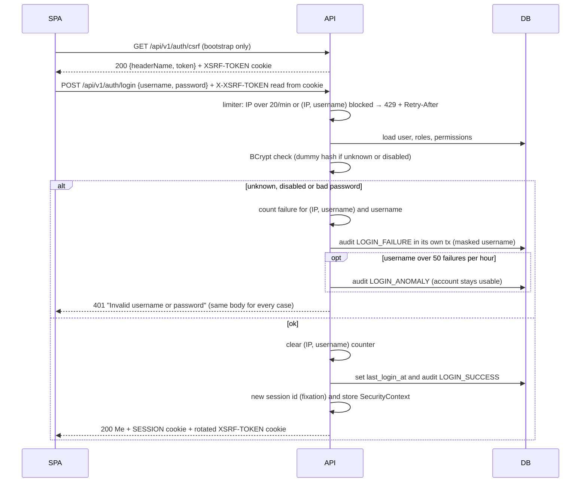

# 01 Foundation — backend design

- Status: **Approved** (revision 2) · Date: 2026-11-24
- BRD: §2 roles, §8 permission matrix, BR-01, BR-03, BR-10, XC-02, XC-05, XC-06, NFR-SEC, NFR-OBS, NFR-REL
- Conventions: [`../00-overview.md`](../00-overview.md) · Contract: [`openapi.yaml`](openapi.yaml) · ADRs 0001–0003
- Review input: [`../../slices/01-foundation/review.md`](../../slices/01-foundation/review.md) (changes listed in §10)

## 1. Scope

**In:** project skeleton, MySQL + Flyway, identity (users, teams), RBAC (roles, permissions), session login and logout, login
throttling, CSRF, `/me`, error model, correlation id, audit trail, idempotency service, reference-ID generator, dev seed users.
Idempotency and reference IDs stay in slice 01 although no slice-01 endpoint uses them: 00-overview §1 assigns them here and the user approved that.

**Out (later slices):** customer/account tables (02), so `users.customer_id` has no FK yet. Identity verification (03).
User administration UI or API (BRD §1.3, future). MFA and step-up challenges (production readiness, 06).

## 2. Data model (Flyway V1 + V2)

| Table | Columns (all `NOT NULL` unless marked `null`) | Keys and constraints |
|---|---|---|
| teams | `id BIGINT AI`, `code VARCHAR(32)`, `name VARCHAR(100)` | PK id, UK code |
| users | `id BIGINT AI`, `username VARCHAR(64)` (E.164 or employee id), `password_hash VARCHAR(100)` (BCrypt), `display_name VARCHAR(100)`, `user_type VARCHAR(16)` `CUSTOMER\|STAFF`, `customer_id BIGINT null` (FK in 02), `team_id BIGINT null`, `status VARCHAR(16)` `ACTIVE\|DISABLED`, `last_login_at DATETIME(6) null`, `created_at DATETIME(6)`, `updated_at DATETIME(6)` | PK id, UK username, FK team_id → teams, `CHECK (user_type = 'STAFF' OR team_id IS NULL)`, CHECKs on the two enum columns |
| roles, permissions | `id BIGINT AI`, `code VARCHAR(64)` | PK id, UK code |
| user_roles | `user_id`, `role_id` | PK (user_id, role_id), FKs |
| role_permissions | `role_id`, `permission_id` | PK (role_id, permission_id), FKs |
| audit_events | `id BIGINT AI`, `occurred_at DATETIME(6)`, `actor_user_id BIGINT null`, `actor_username VARCHAR(64) null`, `action VARCHAR(64)`, `entity_type VARCHAR(64) null`, `entity_id VARCHAR(64) null`, `outcome VARCHAR(16)` `SUCCESS\|FAILURE\|DENIED`, `correlation_id VARCHAR(64)`, `client_ip VARCHAR(45)` (IPv6), `details JSON null` | PK id; no-update/no-delete triggers; idx `(occurred_at)`, `(entity_type, entity_id)`, `(actor_user_id, occurred_at)` |
| idempotency_keys | `id BIGINT AI`, `user_id BIGINT`, `operation VARCHAR(64)`, `idem_key VARCHAR(100)`, `request_hash CHAR(64)` (hex SHA-256), `status VARCHAR(16)` `IN_PROGRESS\|COMPLETED`, `response_status INT null`, `response_body JSON null`, `created_at DATETIME(6)` | PK id, UK (user_id, operation, idem_key), idx (created_at), FK user_id |
| ref_sequences | `seq_name VARCHAR(8)`, `seq_date DATE` (Asia/Kolkata day), `next_value BIGINT` (last value issued) | PK (seq_name, seq_date) |

Login failure counters are **not** stored in `users`; they live in the in-memory limiter (§4.1). All tables: InnoDB, utf8mb4,
`DATETIME(6)` UTC.

| Migration | Content |
|---|---|
| `V1__baseline.sql` | `ref_sequences` |
| `V2__identity_rbac_audit.sql` | all other tables above, triggers, Spring Session JDBC tables, reference data **roles + permissions + matrix** (every environment) |
| `db/seed/R__01_identity.sql` (`dev` profile only) | 4 teams and the 12 users of §3.1; shared dev password documented in the file |
| `src/test/resources/db/test-data/*.sql` (tests only) | one user per role combination of §3.1, loaded by `AbstractMySqlIT` after Flyway; tests never read `db/seed` |

## 3. Roles and permissions (BRD §8, decisions §14)

Roles add up: a user can hold several. Special permissions are separate roles so they can be granted individually.

| Permission | CUSTOMER | INBOUND_AGENT | REACTIVATION_APPROVER | OUTBOUND_AGENT | OUTBOUND_SUPERVISOR | BUSINESS_ANALYST | BUSINESS_AUDITOR |
|---|:-:|:-:|:-:|:-:|:-:|:-:|:-:|
| customer.profile.read | ✔ own | ✔ verified | | | | | |
| customer.profile.update | ✔ | | | | | | |
| customer.lookup | | ✔ | | | | | |
| customer.verify | | ✔ | | | | | |
| plan.read | ✔ | ✔ | | | | | |
| plan.change | ✔ | | | | | | |
| promotion.read | ✔ | ✔ | | | | | |
| promotion.claim | ✔ | | | | | | |
| case.create | ✔ own | | | | | | |
| case.create.onbehalf | | ✔ | | | | | |
| case.category.internal | | ✔ | | | | | |
| case.read | ✔ own | ✔ verified | | ✔ queue scope | | | |
| case.read.queue | | | | ✔ | | | |
| case.assign | | | | ✔ claim | | | |
| case.assign.any | | | | | ✔ | | |
| case.status.update | | | | ✔ | | | |
| case.note.internal | | ✔ | | ✔ | | | |
| case.bookmark | | | | ✔ | | | |
| service.reactivate | | | ✔ | | | | |
| payment.read | ✔ own | ✔ verified | | | | | |
| payment.initiate | ✔ | | | | | | |
| analytics.read | | | | ✔ | | ✔ | |
| audit.read | | | | | | ✔ | |
| reports.export | | | | | | ✔ | |
| reports.export.pii | | | | | | | ✔ |

Scope notes ("own", "verified", "queue scope") are enforced in later slices' services. Slice 01 seeds the matrix and enforces `@PreAuthorize`.

### 3.1 Role composition and seed users

The special roles hold only their special permission and are **always granted together with a base role**:
OUTBOUND_SUPERVISOR with OUTBOUND_AGENT, BUSINESS_AUDITOR with BUSINESS_ANALYST, REACTIVATION_APPROVER with INBOUND_AGENT.

Dev seed users (`R__01_identity.sql`, teams `INBOUND`, `OUTBOUND_N`, `OUTBOUND_S`, `BUSINESS`): customers `+919800000001`…`04`
(CUSTOMER, no team) · `IN001` (INBOUND_AGENT) · `IN002` (INBOUND_AGENT + REACTIVATION_APPROVER) · `OUT001`, `OUT002` (`OUTBOUND_N`),
`OUT003` (`OUTBOUND_S`) (OUTBOUND_AGENT) · `SUP001` (`OUTBOUND_N`, OUTBOUND_AGENT + OUTBOUND_SUPERVISOR) · `BUS001` (BUSINESS_ANALYST) ·
`AUD001` (BUSINESS_ANALYST + BUSINESS_AUDITOR). Test data mirrors these role combinations.

### 3.2 Deviations from BRD §8

| BRD §8 cell | Design | Rationale | Follow-up |
|---|---|---|---|
| Assign case · Business "Optional supervisor permission" | `case.assign.any` sits on OUTBOUND_SUPERVISOR; Business gets none | §14 #3 ties reassignment to `case.assign.any` within the outbound team | OQ 6 (slice 05) |
| Update status · Inbound "Limited actions" | no status permission | BRD does not name the actions; a new permission would be guessed | OQ 7 (slice 03) |
| View plan/promotions · Outbound "As needed" | no `plan.read` / `promotion.read` | the need is undefined until the case screens exist | OQ 8 (slice 04) |
| View case · Business "Aggregate / audited scope" | no `case.read`; aggregates via `analytics.read`, audited view via `audit.read` | BUS-03.2 drill-down scope is designed with the business screens | slice 05 |
| `audit.read` placement | stays on BUSINESS_ANALYST (the auditor inherits it) | BUS-03 gives the audit view to "approved business users" and §2 gives the Business team "audit service trends"; the BRD gates only PII export (§14 #11) behind a special permission, so it gives no basis to restrict `audit.read` to auditors | — |

A later matrix change is a new Flyway migration plus an openapi `Permission` enum change.

## 4. Authentication flow (ADR 0003)

### 4.1 Login throttling (no hard account lock)

| Limit | Key | Rule | Effect |
|---|---|---|---|
| L1 | client IP (§4.4) | 20 attempts/min, all usernames, success or failure | 429 |
| L2 | (IP, normalised username) | 5 failures within 15 min | the pair gets 429 for 15 min; a successful login clears the pair |
| L3 | normalised username, all IPs | 50 failures per rolling hour | audit `LOGIN_ANOMALY` once per window; no block (step-up is OQ 5) |

- `LoginRateLimiter` (Bucket4j) keeps all counters in bounded, expiring in-memory maps; its time source is the injectable `AppClock`.
- L1/L2 are checked before the credential check. A 429 is a `too-many-requests` ProblemDetail with `Retry-After` (whole seconds
  until the bucket or block frees). 429s are logged at WARN, not audited (avoids write amplification).
- **Constant time:** unknown and DISABLED users still run `BCrypt.matches` against a fixed dummy hash (same cost factor), and
  every failure returns the same 401 status and body. The real reason goes only into the audit `details`.

### 4.2 CSRF

- `CookieCsrfTokenRepository.withHttpOnlyFalse()` with the plain `CsrfTokenRequestAttributeHandler` (no XOR masking): the header
  value is exactly the `XSRF-TOKEN` cookie value. **The cookie is the source of truth:** the SPA reads it before every mutating request.
- `GET /api/v1/auth/csrf` only bootstraps the cookie (its body token equals the cookie value). Spring rotates the token on login
  and logout; a `CsrfCookieFilter` after the CSRF filter loads the deferred token so both responses carry the rotated cookie.

### 4.3 Session

- Spring Session JDBC. Idle timeout 30 min (`spring.session.timeout`), absolute lifetime 12 h (`app.session.absolute-timeout`);
  expired rows cleaned every 5 min. Cookie `SESSION`: HttpOnly, SameSite=Lax, Secure in the `prod` profile.
- `SessionPolicyFilter` (after the security context is loaded) rejects a session older than the absolute lifetime and re-checks
  `users.status` on every request: a DISABLED user's session is invalidated and the request gets 401. Role changes apply at next login.
- Logout invalidates the session, writes `LOGOUT`, sets a rotated `XSRF-TOKEN` and returns 204.
- Public: `/api/v1/auth/csrf`, `/api/v1/auth/login`, `/actuator/health`, static SPA assets; API docs only in `dev`. All other
  `/api/**` need a session; unauthenticated calls get a 401 ProblemDetail, never a redirect.
- Actuator exposes only `health` (`management.endpoints.web.exposure.include=health`, `show-details=never`).

### 4.4 Client IP and filter order

- `server.forward-headers-strategy=framework` is used only behind a trusted proxy. `TrustedProxyFilter` applies forwarded headers
  only when the remote address matches `app.security.trusted-proxies` (CIDR list). Empty (dev default) → the remote address is used
  and `X-Forwarded-*` is ignored. `ClientIp.resolve(request)` is the one value used by the limiter and by audit `client_ip`.
- Servlet filter order: `TrustedProxyFilter` (HIGHEST_PRECEDENCE) → `CorrelationIdFilter` (HIGHEST_PRECEDENCE + 1) → Spring
  Security chain (-100). So every 401/403 from the chain already has the correlation id.
- The JSON `AuthenticationEntryPoint` (401) and `AccessDeniedHandler` (URL-level and CSRF 403) build the body with the same
  `ProblemDetailFactory` as `GlobalExceptionHandler`. A `@PreAuthorize` denial throws `AccessDeniedException` inside the
  controller call and is handled by `GlobalExceptionHandler` (403). Both 403 paths call `DeniedAccessRecorder` exactly once (§7).

## 5. Endpoints (details in `openapi.yaml`)

| Method | Path | Auth | Responses |
|---|---|---|---|
| GET | `/api/v1/auth/csrf` | public | `200 CsrfToken` · 500 |
| POST | `/api/v1/auth/login` | public + CSRF | `200 Me` (+ SESSION, rotated XSRF-TOKEN) · 400 · 401 · 403 (CSRF) · 413 · 415 · 429 (`Retry-After`) · 500 |
| POST | `/api/v1/auth/logout` | session + CSRF | `204` (+ rotated XSRF-TOKEN) · 401 · 403 · 500 |
| GET | `/api/v1/auth/me` | session | `200 Me` · 401 · 500 |
| GET | `/actuator/health` | public | `200 {status: UP}` · `503 {status: DOWN}` (in openapi, tag Operations) |

`Me` = `{ id, username, displayName, userType, teamId?, customerId?, roles[], permissions[] }`. The frontend uses `permissions` only
to build navigation (XC-01); every API enforces permissions itself (XC-02). `LoginRequest` ignores unknown JSON fields (Jackson default).

## 6. Internal components

| Component | Responsibility |
|---|---|
| `SecurityConfig` | filter chain, CSRF (§4.2), session fixation, JSON entry point / access-denied handler, public paths |
| `AuthService` | throttling calls, constant-time credential check, `last_login_at`, auth audit; `AppUserDetailsService` loads authorities = permission codes |
| `LoginRateLimiter`; `TrustedProxyFilter`, `ClientIp`, `CorrelationIdFilter`, `SessionPolicyFilter`, `CsrfCookieFilter` | §4.1; §4.2–§4.4 |
| `Permissions` / `CurrentUser` / `AppClock` | permission constants for `@PreAuthorize` / principal's user, team, customer id / UTC `Clock` bean (tests use a mutable fixed clock) |
| `ProblemDetailFactory` + `GlobalExceptionHandler` | 00-overview §4 table; any unmapped exception → 500 `internal` (generic detail, correlation id, stack trace logged only) |
| `AuditService` / `DeniedAccessRecorder` | `record(...)` in caller tx, `recordIndependently(...)` `REQUIRES_NEW` / sampled ACCESS_DENIED (§7) |
| `IdempotencyService` / `ReferenceGenerator` | §6.1 (hourly purge of keys older than 24 h) / §6.2 |

### 6.1 Idempotency (00-overview §7)

`execute(userId, operation, key, request, supplier)` is called from the controller, outside any business transaction; the
supplier owns its transaction.
1. **Claim** in its own `REQUIRES_NEW` tx: `INSERT` an `IN_PROGRESS` row. The unique key makes a concurrent duplicate fail at
   once → 409 `conflict`. An existing row: different `request_hash` → 422 `idempotency-mismatch`; `COMPLETED` → replay the stored
   status and body; `IN_PROGRESS` older than `app.idempotency.stale-after` (default 2 min) → delete and claim again, else 409.
2. Run the supplier. **2xx** → `REQUIRES_NEW` update to `COMPLETED` with status and body. **Exception or non-2xx** → delete the
   key (`REQUIRES_NEW`) so the client can retry; the error is returned unchanged.
3. `request_hash` = hex SHA-256 of the request DTO serialised by the app `ObjectMapper` with sorted properties and map keys.

### 6.2 Reference IDs (BR-01, 00-overview §8)

In a `REQUIRES_NEW` tx: `INSERT INTO ref_sequences (seq_name, seq_date, next_value) VALUES (?, ?, LAST_INSERT_ID(1)) ON DUPLICATE KEY
UPDATE next_value = LAST_INSERT_ID(next_value + 1)`, then `SELECT LAST_INSERT_ID()`. The day is today's Asia/Kolkata date from
`AppClock`. IDs are unique and never reused; gaps (from rolled-back callers) are allowed because BR-01 does not require gap-free
numbers. The sequence is zero-padded to 6 digits and simply grows past 999999.

## 7. Audit actions introduced

| Action | Outcome | Entity | Actor | `details` |
|---|---|---|---|---|
| `LOGIN_SUCCESS` | SUCCESS | `USER` / user id | the user | — |
| `LOGIN_FAILURE` | FAILURE | — | null | `reason` `bad_password\|unknown_user\|disabled`, `username` masked (first 3 + last 2 chars, rest `*`; ≤ 5 chars → `***`) |
| `LOGIN_ANOMALY` | FAILURE | — | null | masked `username`, `failures`, `windowMinutes` |
| `LOGOUT` | SUCCESS | `USER` / user id | the user | — |
| `ACCESS_DENIED` | DENIED | — | the user or null | `method`, `path`, `reason` `permission\|csrf`, required authority when known |

Failure and denied rows use `recordIndependently` so they survive the rollback. `ACCESS_DENIED` is sampled: at most one row per
(user, or client IP when anonymous, + path) per minute.

## 8. Test plan (Testcontainers MySQL, `./mvnw verify`)

Test users come from `src/test/resources/db/test-data`. Probe controllers live only in `src/test` (`T/support/*Probe*`) and are
imported by the ITs, so they can never ship.

| Test | Proves | BRD |
|---|---|---|
| `AuthIT` | login ok → Me with the right permissions; unknown user, bad password and disabled → identical 401 status and body; 21st attempt/min from one IP → 429 + `Retry-After`; 6th failure for an (IP, username) → 429 for 15 min, then allowed (mutable clock); same username from another IP still allowed; success clears the pair counter; 51st failure/hour → `LOGIN_ANOMALY` and a correct password still logs in; session id changes on login; cookie flags HttpOnly + SameSite=Lax (Secure under `prod`); `/api/**` without session → 401 with no `Location`; login then logout with the rotated cookie token → 204, with the pre-login token → 403; old cookie after logout → 401; idle expiry (back-dated `LAST_ACCESS_TIME`) → 401; 12 h absolute expiry (clock) → 401; user set DISABLED mid-session → next request 401; POST without CSRF → 403; logs contain no password or session id | NFR-SEC |
| `ClientIpIT` | forged `X-Forwarded-For` from an untrusted address is ignored by limiter and audit; from a trusted proxy it is used | NFR-SEC, XC-06 |
| `PermissionMatrixIT` | for every test-data role combination, `/me` permissions equal §3 exactly; a probe per permission returns 200 for holders and **403 for every other role**; anonymous → 401 | §8, BR-10, XC-02 |
| `AuditTrailIT` | login, logout and denied calls write the §7 rows with correlation id; LOGIN_FAILURE row survives the rollback with the right `reason` and a masked username; URL-level and `@PreAuthorize` 403 each write one row; a second denial on the same path within a minute writes none; UPDATE/DELETE on `audit_events` fail | BR-03, XC-06 |
| `IdempotencyServiceIT` | replay returns the stored 2xx; different body → 422 `idempotency-mismatch`; concurrent same key → immediate 409; supplier throws, then retry succeeds; non-2xx not stored; stale IN_PROGRESS reclaimed; purge after 24 h | NFR-REL |
| `ReferenceGeneratorIT` | 50 parallel calls (incl. first of the day) → 50 **unique** refs; counter restarts on the next Asia/Kolkata day | BR-01, XC-05 |
| `ErrorModelIT` | 400 has `errors[]`; 405, 413, 415 and an unmapped exception (500, generic detail) map per 00-overview §4; every error (incl. chain 401/403) has `correlationId`; incoming `X-Correlation-Id` echoed, invalid one replaced; `/actuator/env` not exposed | NFR-OBS |
| `ArchitectureTest` (ArchUnit) | no `jakarta.persistence`/Spring Data imports; repositories only reachable from their own module | ADR 0001/0002 |

## 9. Open questions (defaults used until answered)

| # | Question | Default |
|---|---|---|
| 1 | Password policy for real users? | Out of scope (users come from the IdP in production); dev seed only |
| 2 | Concurrent sessions per user? | Unlimited in slice 01; revisit in 06 |
| 3 | Rate limiter across several instances? | In-memory (single instance); replace in 06 if scaled out |
| 4 | Audit retention period? | Kept indefinitely; policy decided in 06 with compliance (BRD §12) |
| 5 | Step-up challenge (CAPTCHA/OTP) when `LOGIN_ANOMALY` fires? | Audit only, account stays usable; decide in 06 |
| 6 | Business "optional supervisor permission" to assign cases? | None; decide in 05 |
| 7 | Which "limited" status actions may Inbound take? | None; decide in 03 |
| 8 | Outbound plan/promotion view "as needed"? | None; decide in 04 |

## 10. Changes in revision 2

Finding (review.md) → section: #1 rejected, no change · #2/#4 §2, §4, §4.1, §8, OQ 5 · #3 §4.1, §8 · #5 §4, §4.2, §5, §8 ·
#6 §4.4, §8 `ClientIpIT`, OV§5 · #7/#8 §3.1, §3.2, OQ 6–8 · #9 §2 (test-data), §8 intro · #10 §4.4, §6, §8, OV§5 ·
#11 §6.1, §8, OV§4/§7 · #12 §6.2, §8, OV§8 · #13 §8 · #14 §5, openapi · #15 §6, §8, OV§4, openapi · #16 §5, openapi ·
#17 §2 · #18 §4.3, §8 · #19 §7 · #20 §1. (OV = 00-overview.)
