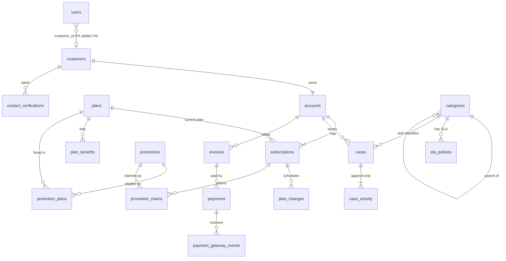
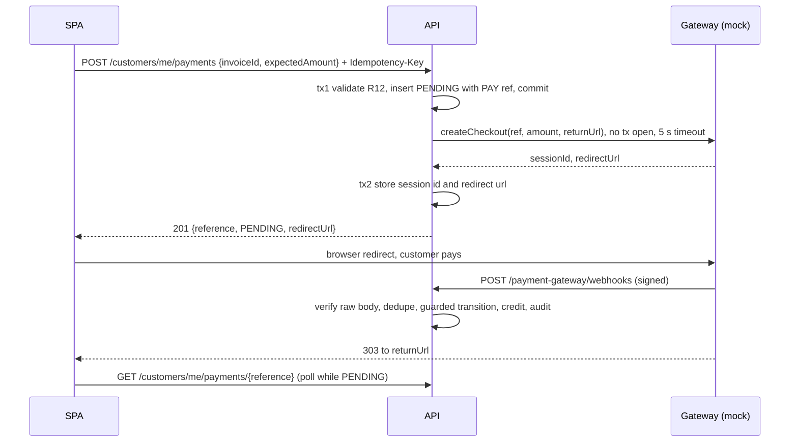

# 02 Customer portal — backend design

- Status: **Approved** (revision 2) · Date: 2026-11-25 · approved by user 2026-11-25 with OQ defaults (OQ 4, 10, 12 confirmed)
- BRD: CUS-01..CUS-08, BR-01, BR-02, BR-04..BR-08, BR-10, XC-02..XC-07, NFR-AVAIL, NFR-INTEG, NFR-PRIV, NFR-REL, NFR-SEC, §11, §12, §14 #1, #4, #6, #8, #9, #12
- Conventions: [`../00-overview.md`](../00-overview.md) (§1 revision 3, approved with this design) · Contract: [`openapi.yaml`](openapi.yaml) · Precedent: [`../01-foundation/backend.md`](../01-foundation/backend.md)
- Contract note: `openapi.yaml` **copies** 01's shared components (session/CSRF, `ProblemDetail`, `FieldViolation`, `CorrelationId`,
  `Problem`, `TooManyRequests`) verbatim instead of cross-file `$ref`, so each slice file generates types on its own; 01 stays the source.
- Review input: [`../../slices/02-customer/review-backend-design.md`](../../slices/02-customer/review-backend-design.md) (disposition at its end)

## 1. Scope

**In:** customer/account/subscription data, own profile read + alias edit + OTP-verified contact change, plan summary/benefits,
upgrade quotes and scheduled plan change (behind `PlanProvisioning`), eligible promotions + claim, case categories, own service-request
list + create, invoices, payment history/detail/receipt, payment initiation via the mock hosted `PaymentGateway`, signed webhook,
reconciliation job. The dashboard (CUS-01) has **no endpoint of its own**: each card calls its own endpoint so cards load and fail independently (CUS-01.2).

**Out (later slices):** inbound lookup/verification and on-behalf requests (03), case lifecycle, assignment, notes, reopen, escalation
route and case detail (04), notification delivery beyond the OTP port (03/04), **attachments CUS-06.3 (OQ 4, needs acceptance)**,
usage data (CUS-03.3, no trusted source), refunds, real gateway/provisioning/IdP (06).

**Module dependencies (one-way, ArchitectureTest `beFreeOfCycles`):** `servicecase → customer`, `payment → customer`,
`customer → catalog`; all may use `common` and `audit`. `catalog` only exposes plan and promotion data; quotes, promotion eligibility
and claims live in `customer`. `identity` implements the `common.security.CustomerScope` port. Applied to 00-overview §1 (rev 3, approved).

## 2. Data model (Flyway V3–V6)

All columns `NOT NULL` unless marked `null`; ids `BIGINT AI`; times `DATETIME(6)` UTC; money `DECIMAL(12,2)` INR; enums are
`VARCHAR` + `CHECK`. Every table has `created_at`; mutable ones also `updated_at`; `version INT` where marked (optimistic lock).

| Table (module) | Columns | Keys, constraints, indexes |
|---|---|---|
| plans (catalog) | `code VARCHAR(32)`, `name`, `plan_type` `PREPAID\|POSTPAID`, `monthly_rental`, `description null`, `status` `ACTIVE\|RETIRED` | UK code; CHECK rental ≥ 0 |
| plan_benefits (catalog) | `plan_id`, `benefit_type` `VOICE\|DATA\|SMS\|ROAMING\|OTT\|OTHER`, `label`, `value_text`, `is_key BOOL`, `sort_order` | FK; idx (plan_id, sort_order) |
| promotions (catalog) | `code VARCHAR(32)`, `title`, `short_description`, `eligibility_text`, `terms TEXT`, `valid_from`, `valid_to`, `status` `ACTIVE\|INACTIVE` | UK code; CHECK valid_from < valid_to; idx (status, valid_to) |
| promotion_plans (catalog) | `promotion_id`, `plan_id` (no rows = all plans) | PK (promotion_id, plan_id) |
| customers | `customer_ref VARCHAR(20)`, `full_name`, `alias_name null`, `email null`, `email_verified_at null`, `secondary_msisdn null`, `secondary_verified_at null`, `billing_address JSON`, `status` `ACTIVE\|INACTIVE`, `version` | UK customer_ref |
| accounts | `customer_id`, `account_ref VARCHAR(20)`, `billing_cycle_day TINYINT` 1–28, `status` `ACTIVE\|SUSPENDED\|CLOSED` | UK customer_id (1:1, OQ 1), UK account_ref. Primary MSISDN is **derived** from the primary subscription (no copy) |
| subscriptions | `account_id`, `msisdn VARCHAR(16)`, `plan_id`, `is_primary BOOL`, `status` `ACTIVE\|SUSPENDED\|TERMINATED`, `activated_at` | UK generated `live_msisdn = IF(status<>'TERMINATED', msisdn, NULL)` (numbers can be recycled); UK generated `primary_account_id = IF(is_primary, account_id, NULL)` |
| contact_verifications | `customer_id`, `channel` `EMAIL\|SECONDARY_MSISDN`, `new_value`, `code_hmac CHAR(64)`, `attempts TINYINT`, `status` `PENDING\|VERIFIED\|EXPIRED\|LOCKED\|SUPERSEDED`, `expires_at` | CHECK attempts BETWEEN 0 AND 10; idx (customer_id, created_at) |
| plan_changes | `subscription_id`, `from_plan_id`, `to_plan_id`, `effective_date DATE`, `charge_amount`, `status` `SCHEDULED\|APPLIED\|CANCELLED`, `cancel_reason null`, `apply_attempts TINYINT`, `requested_by_user_id` | UK generated `scheduled_sub_id = IF(status='SCHEDULED', subscription_id, NULL)`; CHECK charge ≥ 0; idx (status, effective_date) |
| promotion_claims (customer) | `promotion_id`, `subscription_id`, `terms_hash CHAR(64)`, `claimed_by_user_id`, `status` `CLAIMED` | UK (promotion_id, subscription_id) |
| categories | `code VARCHAR(32)`, `name`, `parent_id null`, `audience` `CUSTOMER\|INTERNAL`, `case_type` `REQUEST\|COMPLAINT`, `default_severity null` `LOW\|MEDIUM\|HIGH\|CRITICAL`, `active BOOL`, `sort_order` | UK code; FK parent_id; two levels (service check) |
| sla_policies | `category_id`, `severity`, `response_minutes`, `resolution_minutes`, `active BOOL` | UK (category_id, severity); CHECK minutes > 0 (BR-07) |
| cases | `reference VARCHAR(24)`, `account_id`, `subscription_id null`, `category_id` (**leaf**), `case_type`, `channel` `CUSTOMER_PORTAL\|INBOUND_AGENT`, `subject VARCHAR(150)`, `description TEXT`, `severity`, `status` `CREATED\|ASSIGNED\|IN_PROGRESS\|PENDING_CUSTOMER\|PENDING_EXTERNAL\|RESOLVED\|CLOSED\|REOPENED`, `preferred_contact` `PHONE\|SMS\|EMAIL`, `contact_msisdn`, `created_by_user_id`, `assigned_team_id null`, `assigned_user_id null`, `response_due_at`, `sla_due_at`, `version` | UK reference; FKs; idx (account_id, created_at) |
| case_activity | `case_id`, `activity_type` `CREATED\|STATUS_CHANGED\|ASSIGNED\|NOTE`, `visibility` `PUBLIC\|INTERNAL` (BR-04), `actor_user_id null`, `old_value null`, `new_value null`, `note_text null` | idx (case_id, created_at); no-update/no-delete triggers |
| invoices | `account_id`, `invoice_ref VARCHAR(24)`, `period_start DATE`, `period_end DATE`, `issue_date DATE`, `due_date DATE`, `amount_due`, `amount_paid`, `status` `OPEN\|PAID`, `version` | UK invoice_ref; CHECK amount_due ≥ 0, amount_paid ≥ 0; idx (account_id, issue_date) |
| payments | `reference VARCHAR(24)` (PAY, also the gateway merchant ref), `account_id`, `invoice_id`, `amount`, `currency CHAR(3)`, `status` `PENDING\|SUCCEEDED\|FAILED\|EXPIRED\|REVIEW`, `failure_reason null`, `method null` `UPI\|CARD\|NETBANKING\|WALLET`, `gateway_session_id null`, `redirect_url null`, `gateway_txn_id null`, `initiated_by_user_id`, `initiated_at`, `completed_at null`, `version` | UK reference; UK gateway_session_id; UK generated `open_invoice_id = IF(status IN ('PENDING','REVIEW'), invoice_id, NULL)`; CHECK amount > 0; idx (account_id, initiated_at), (status, initiated_at) |
| payment_gateway_events | `gateway_event_id VARCHAR(64)`, `payment_id null`, `event_type`, `outcome` `APPLIED\|IGNORED\|REJECTED` | UK gateway_event_id (webhook dedupe) |

| Migration / script | Content |
|---|---|
| `V3__catalog.sql` | plans, plan_benefits, promotions, promotion_plans |
| `V4__customer.sql` | customers, accounts, subscriptions, contact_verifications, plan_changes, promotion_claims; FK `users.customer_id → customers(id)` |
| `V5__servicecase.sql` | categories, sla_policies, cases, case_activity + triggers; **reference data**: placeholder CUSTOMER categories/subcategories, each leaf with a resolvable severity and an active SLA row for it (§14 #6, OQ 5) |
| `V6__payment.sql` | invoices, payments, payment_gateway_events |
| `db/seed/R__02_customer.sql` (dev; runs after `R__01_identity`) | 6 plans, 3 promotions (1 expired, 1 plan-restricted), 4 customers; **sets `users.customer_id`** for `+919800000001..04` (customer 4: 2 subscriptions; customer 3: no cases/payments), cases and payments inside and older than 3 months, open invoices |
| test-data `R__test_users_02_customer.sql` (sorts after `R__test_users.sql`) | same shape; **sets `users.customer_id`**; adds a CUSTOMER user with no linked customer and a CLOSED-account customer |

No card number, CVV or gateway payload is stored (§12). Plans/promotions/categories change only by migration until an admin flow exists.

## 3. Business rules and states

| # | Rule | Enforced where | BRD |
|---|---|---|---|
| R1 | Scope: `customerId` only from the principal (`CustomerScope`); account = that customer's account. Every `/customers/me/**` query filters by `account_id`. Another account's id/reference → 404. Unknown JSON fields (`accountId`, `customerId`) ignored | `CustomerScope`, repositories | CUS-01.3, BR-10, NFR-INTEG |
| R2 | Profile read: name, alias, primary MSISDN (primary subscription), account ref, contacts + verified flags, read-only billing address. Edit: `aliasName` only (required key, `null` clears; 1–60, letters/digits/space/`.'-`) with `version` → stale 409 | `CustomerService` | CUS-01.1, CUS-02.1/02.3/02.4 |
| R3 | Contact change only via verification (§3.2): 6-digit code (`SecureRandom`), stored as HMAC-SHA256, TTL 10 min, 5 attempts, max 5 starts per customer/hour → 429, new start supersedes the PENDING one of that channel; value written only on a correct confirm. Email ≤ 254 lower-cased; MSISDN E.164 ≠ primary | `ContactVerificationService` | CUS-02.2, NFR-SEC |
| R4 | Plan summary = name, rental, subscription status, billing-cycle day, `is_key` benefits; expanded = all benefits. No usage fields | `SubscriptionService` | CUS-03.1–03.3 |
| R5 | Upgrade eligible: subscription ACTIVE, no SCHEDULED change, target ACTIVE, same `plan_type`, higher rental. Quote `effectiveDate` = first billing-cycle day **strictly after** today (Asia/Kolkata); `charge` per OQ 10 (**user decision**, default 0.00) | `PlanQuoteService` | CUS-03.4/03.5 |
| R6 | Plan change: body echoes `expectedEffectiveDate` + `expectedCharge`; mismatch with a fresh quote or ineligible → 422; a second SCHEDULED change → 422 (UK). `PlanChangeApplyJob` (daily 00:05 IST): for each due row, guarded `UPDATE subscriptions SET plan_id=:to WHERE id=:sub AND plan_id=:from AND status='ACTIVE'` then `PlanProvisioning.apply`; guard fails → `CANCELLED` (`cancel_reason`) + audit; provider failure → stays SCHEDULED, `apply_attempts+1`, retried next run, audit | `PlanChangeService`, job | CUS-03.5, BR-08, XC-06/07 |
| R7 | Promotions shown: ACTIVE, `valid_from ≤ now < valid_to`, and (no `promotion_plans` rows or an ACTIVE subscription of the account on a listed plan); with `claimed`, `eligibleSubscriptionIds`, `termsHash` (SHA-256 of `terms`) | `PromotionEligibilityService` | CUS-04.1/04.2 |
| R8 | Claim: `acceptTerms=true` and `termsHash` = current hash (else 422); re-checks R7 for that subscription; expired/ineligible/already claimed → 422. Stores `terms_hash`; no fulfilment (OQ 7) | `PromotionEligibilityService` | CUS-04.3/04.4, XC-06 |
| R9 | Case list: `created_at` window (default 3 months, 00-overview §3); exact `reference` searched **inside** the window (OQ 6); sort whitelist `createdAt`; public status (below) | `CustomerCaseService` | CUS-05, BR-05/06, XC-04/05 |
| R10 | Case create: account from principal, `contact_msisdn` = primary MSISDN; `categoryCode` ACTIVE CUSTOMER top level, `subcategoryCode` required iff it has active children; stored `category_id` = the leaf. Severity = leaf `default_severity`, else parent's; SLA row = (leaf, severity), else (parent, severity); none → 422 `business-rule` (seed guarantees one). `case_type` from the leaf (else parent); `response_due_at`/`sla_due_at` = now + minutes (calendar time). Subject 5–150, description 10–4000; EMAIL contact needs a verified email; optional `subscriptionId` must be own. Channel `CUSTOMER_PORTAL`, status `CREATED`, `SR` ref, one CREATED/PUBLIC activity; idempotent | `CustomerCaseService` | CUS-06, BR-01/02/04/07, §12, §14 #4 |
| R11 | Payment list: `initiated_at` window (default 3 months), sort whitelist `initiatedAt` | `PaymentQueryService` | CUS-07.1–07.3 |
| R12 | Initiate (§3.1): own OPEN invoice, outstanding > 0 and = `expectedAmount` (full only, OQ 8); an open (PENDING/REVIEW) payment on the invoice → 409 (UK); a FAILED/EXPIRED payment of the invoice completed < 24 h ago is re-checked with `getStatus` first, and if the gateway says PENDING/SUCCEEDED it is applied and the call gets 409 (gateway unreachable → 503). `returnUrl` server-built; idempotent | `PaymentService` | CUS-08.1/08.2/08.4 |
| R13 | Payment status changes only through the guarded transitions of §3.1 from a signed webhook or the reconciliation job — never the browser return | `PaymentService` | CUS-08.3, BR-08, XC-07, NFR-INTEG |
| R14 | Credit on the winning SUCCEEDED transition only, same tx: one guarded `UPDATE invoices SET amount_paid = amount_paid + :amt, status = …PAID when ≥ amount_due` by id + version; overpayment still credited and audited `PAYMENT_OVERPAID` (refunds out) | `PaymentService` | CUS-07.5, CUS-08.4 |
| R15 | Receipt only for SUCCEEDED (else 422) | `PaymentQueryService` | CUS-07.4, CUS-08.5 |
| R16 | Account/customer state: reads always allowed. Customer INACTIVE or account CLOSED → every mutation 422. Account SUSPENDED → plan change and promotion claim 422; profile, cases and payments allowed (OQ 12) | each mutating service | NFR-INTEG |

Public case status (§14 #8): `CREATED`→`SUBMITTED` · `ASSIGNED`, `IN_PROGRESS`, `PENDING_EXTERNAL`, `REOPENED`→`IN_PROGRESS` ·
`PENDING_CUSTOMER`→`AWAITING_YOUR_REPLY` · `RESOLVED`→`RESOLVED` · `CLOSED`→`CLOSED`. Internal transitions are slice 04.

### 3.1 Payment transitions (D1, D2, D5, D13)

Every transition is one guarded statement `UPDATE payments SET status=:to, …, version=version+1 WHERE id=:id AND status IN (:from)`.
Side effects (invoice credit, audit) run in the same tx **only when exactly 1 row changed**; 0 rows → event `IGNORED` + `PAYMENT_EVENT_IGNORED`.
So webhook, reconcile and several app instances may race safely.

| Trigger | From | To | Notes |
|---|---|---|---|
| initiate tx1 (commits before the gateway call) | — | PENDING | reference generated (01 §6.2) and sent as merchant ref |
| tx2 after `createCheckout` ok | PENDING (no session) | PENDING | stores `gateway_session_id`, `redirect_url` → 201 |
| tx2 after gateway refused (connection refused / 5xx) | PENDING | FAILED `gateway_unavailable` | `PAYMENT_INITIATED` FAILURE → 503, idempotency key released |
| tx2 after client timeout (5 s) | PENDING | PENDING `gateway_timeout` | → 503; reconciled by reference |
| succeeded, amount + currency + session match | PENDING, FAILED, EXPIRED | SUCCEEDED | R14 credit; from FAILED/EXPIRED also `PAYMENT_LATE_CAPTURE` |
| succeeded, amount/currency/session mismatch | PENDING, FAILED, EXPIRED | REVIEW `amount_mismatch` | no credit; blocks new payments (UK); manual ops |
| failed / expired **reported by the gateway** | PENDING | FAILED / EXPIRED | never from an unknown or unreachable status |
| reconcile: gateway `NOT_FOUND` for a PENDING older than 10 min | PENDING | FAILED `not_created` | session was never created |
| reconcile: still unknown/unreachable after 24 h | PENDING | REVIEW `unreconciled` | never auto-EXPIRED |
| any event on SUCCEEDED or REVIEW, or any other pair | — | no change | `IGNORED` |

`PaymentReconciliationJob`: every 60 s polls PENDING older than 2 min; every 15 min polls FAILED/EXPIRED completed within 24 h (late
capture watch). Gateway unreachable → WARN log, retried next run.

### 3.2 OTP confirm (D3)

1. `REQUIRES_NEW`, committed before any comparison: `UPDATE contact_verifications SET attempts = attempts + 1 WHERE id=:id AND customer_id=:c AND status='PENDING' AND attempts < :max AND expires_at > :now`.
   0 rows → read the row: absent/other customer → 404; else 422 `expired` / `locked`.
2. Compare `HMAC(code)` with `code_hmac` using `MessageDigest.isEqual` (constant time).
3. Wrong → if `attempts` reached max, `REQUIRES_NEW` `UPDATE … SET status='LOCKED' WHERE id=:id AND status='PENDING'`; 422 with `attemptsRemaining`.
4. Right → business tx: `UPDATE … SET status='VERIFIED' WHERE id=:id AND status='PENDING'`; only on 1 row the contact is written + audited.

## 4. Authorization and scope

- Every endpoint has `@PreAuthorize` with the §8 permission (01 backend §3). `/customers/me/**` adds `and @customerScope.isCustomer()`
  (true only for `userType=CUSTOMER` with a non-null `customer_id`). INBOUND_AGENT (holds `customer.profile.read`, `plan.read`,
  `promotion.read`, `payment.read`) therefore gets 403 here; its scope is designed in 03. Denials go through `DeniedAccessRecorder` (01 §7).
- `CustomerScope` (port in `common.security`, implemented by `identity` from `CurrentUser`): `isCustomer()`, `requireCustomerId()`.
  `customer.AccountLookup.accountFor(customerId)` gives other modules the account id, ref and state.
- Webhook E18: public, CSRF-exempt, authenticated only by its HMAC (§8). Mock checkout `/mock-gateway/checkout/**`: registered only when
  `app.payment.mock.enabled` (dev/test), `permitAll`, CSRF-exempt; protection = 128-bit random `sessionId` (accepted for a dev-only mock).
  `SecurityConfig` adds exactly these two path sets.

## 5. Endpoints (details in openapi.yaml)

Prefix `/api/v1`. All mutating calls need `X-XSRF-TOKEN` except E18. Common errors: 401, 403, 500; with a body also 400, 413, 415.
Idempotent endpoints hash the canonical request `{pathVariables, body}` (D6), so a key reused on another path id → 422 `idempotency-mismatch`.

| # | Method | Path | Permission | Idem. | Response / extra errors |
|---|---|---|---|---|---|
| E1 | GET | `/customers/me/profile` | customer.profile.read | | 200 `Profile` |
| E2 | PATCH | `/customers/me/profile` | customer.profile.update | | 200 `Profile` · 409 stale · 422 (R16) |
| E3 | POST | `/customers/me/contact-verifications` | customer.profile.update | | 201 `ContactVerification` · 422 · 429 · 503 sender down |
| E4 | POST | `/customers/me/contact-verifications/{verificationId}/confirm` | customer.profile.update | | 200 `Profile` · 404 · 422 wrong (`attemptsRemaining`) / expired / locked |
| E5 | GET | `/customers/me/subscriptions` | plan.read | | 200 `Subscription[]` (primary first, `pendingPlanChange`) |
| E6 | GET | `/customers/me/subscriptions/{subscriptionId}/plan-options` | plan.read | | 200 `PlanOption[]` · 404 |
| E7 | POST | `/customers/me/subscriptions/{subscriptionId}/plan-changes` | plan.change | ✔ `PLAN_CHANGE` | 201 `PlanChange` · 404 · 409 · 422 |
| E8 | GET | `/customers/me/promotions` | promotion.read | | 200 `Promotion[]` |
| E9 | POST | `/customers/me/promotions/{promotionCode}/claims` | promotion.claim | ✔ `PROMOTION_CLAIM` | 201 `PromotionClaim` · 404 · 409 · 422 |
| E10 | GET | `/case-categories` | case.create | | 200 `Category[]` |
| E11 | GET | `/customers/me/cases?from&to&reference&page&size&sort` | case.read | | 200 `Page<CaseSummary>` · 400 |
| E12 | POST | `/customers/me/cases` | case.create | ✔ `CASE_CREATE` | 201 `CaseCreated` (no `Location` until case detail exists, slice 04) · 409 · 422 |
| E13 | GET | `/customers/me/invoices?status` | payment.read | | 200 `Invoice[]` (latest 12) |
| E14 | GET | `/customers/me/payments?from&to&page&size&sort` | payment.read | | 200 `Page<Payment>` · 400 |
| E15 | POST | `/customers/me/payments` | payment.initiate | ✔ `PAYMENT_INITIATE` | 201 `PaymentInitiated` · 404 · 409 · 422 · 503 |
| E16 | GET | `/customers/me/payments/{reference}` | payment.read | | 200 `Payment` · 404 |
| E17 | GET | `/customers/me/payments/{reference}/receipt` | payment.read | | 200 `Receipt` (JSON, OQ 9) · 404 · 422 |
| E18 | POST | `/payment-gateway/webhooks` | public, HMAC | dedupe by event id | 204 · 400 · 401 · 429 |

## 6. Components

| Component (module) | Responsibility |
|---|---|
| `CustomerScopeImpl` (identity) | implements `common.security.CustomerScope`, bean `customerScope` |
| `CustomerRepository`, `AccountRepository`, `AccountLookup`, `CustomerService`, `CustomerProfileController` (customer) | E1–E2, R1, R2, R16 |
| `ContactVerificationRepository`, `ContactVerificationService`, `ContactVerificationController`, `OtpProperties` (customer) | E3–E4, R3, §3.2 |
| `SubscriptionRepository`, `SubscriptionService`, `PlanQuoteService`, `PlanChangeRepository`, `PlanChangeService`, `PlanChangeApplyJob`, `SubscriptionController` (customer) | E5–E7, R4–R6 |
| `PromotionClaimRepository`, `PromotionEligibilityService`, `PromotionController` (customer) | E8–E9, R7–R8 |
| `PlanRepository`, `PromotionRepository`, `CatalogService` (catalog) | read-only plan/benefit/promotion data; depends on nothing in `customer` |
| `CategoryRepository`, `SlaPolicyRepository`, `CaseRepository`, `CaseActivityRepository`, `CustomerCaseService`, `CaseCategoryController`, `CustomerCaseController` (servicecase) | E10–E12, R9–R10 |
| `InvoiceRepository`, `PaymentRepository`, `GatewayEventRepository`, `PaymentTransitionService` (§3.1 guarded updates + R14 credit, the only writer of payment status), `PaymentQueryService`, `PaymentService`, `CustomerPaymentController`, `PaymentWebhookController`, `WebhookRateLimiter`, `PaymentReconciliationJob` (payment) | E13–E18, R11–R15, §3.1 |
| Ports + mocks: `PaymentGateway`/`MockPaymentGateway`, `MockCheckoutController` (payment); `PlanProvisioning`/`MockPlanProvisioning`, `VerificationCodeSender`/`MockVerificationCodeSender` (customer) | §8 |

Config (`@ConfigurationProperties`): `app.customer.otp.{ttl=10m, max-attempts=5, starts-per-hour=5, hmac-secret, dev-fixed-code}`,
`app.payment.gateway.{timeout=5s, webhook-secret, signature-tolerance=5m, session-ttl=15m, late-capture-window=24h}`,
`app.payment.webhook.ip-requests-per-minute=60`, `app.payment.return-url-base`, `app.payment.mock.{enabled, mode=NORMAL, webhook-url}`
(default `http://localhost:${server.port}/api/v1/payment-gateway/webhooks`). `ProfileGuard` (01 E2.5) fails `prod` when the mock is
enabled or `dev-fixed-code` is set.

## 7. Audit actions (00-overview §6)

| Action | Outcome | Entity | `details` (PII masked: email `ra***@ex***.com`, MSISDN last 4) |
|---|---|---|---|
| `PROFILE_UPDATED` | SUCCESS | CUSTOMER/id | `aliasName` old, new (CUS-02.5) |
| `CONTACT_VERIFICATION_STARTED` | SUCCESS | CUSTOMER/id | channel, masked new value |
| `CONTACT_VERIFICATION_FAILED` | FAILURE (independent tx) | CUSTOMER/id | channel, reason `wrong_code\|expired\|locked`, attemptsRemaining |
| `PROFILE_CONTACT_CHANGED` | SUCCESS | CUSTOMER/id | channel, masked old, masked new |
| `PLAN_CHANGE_SCHEDULED` / `PLAN_CHANGE_APPLIED` / `PLAN_CHANGE_CANCELLED` / `PLAN_CHANGE_APPLY_FAILED` | SUCCESS (last: FAILURE) | SUBSCRIPTION/id | from/to plan, effective date, charge, reason (job rows: actor null) |
| `PROMOTION_CLAIMED` | SUCCESS | PROMOTION/code | subscription id, terms hash |
| `CASE_CREATED` | SUCCESS | CASE/reference | category, case type, severity, channel |
| `PAYMENT_INITIATED` | SUCCESS / FAILURE | PAYMENT/reference | invoice ref, amount; reason `gateway_unavailable\|gateway_timeout` |
| `PAYMENT_SUCCEEDED` / `PAYMENT_FAILED` / `PAYMENT_EXPIRED` / `PAYMENT_REVIEW` / `PAYMENT_LATE_CAPTURE` | SUCCESS | PAYMENT/reference | source `webhook\|reconcile\|initiate`, from/to status, method, gateway txn id, reason |
| `PAYMENT_OVERPAID` | SUCCESS | INVOICE/ref | amount_due, amount_paid |
| `PAYMENT_EVENT_IGNORED` | FAILURE | PAYMENT/reference | event type, current status |
| `PAYMENT_WEBHOOK_REJECTED` | FAILURE (independent tx) | PAYMENT/reference or null | reason `bad_signature\|stale\|unknown_payment`; `bad_signature`/`stale` sampled 1 per client IP per minute (+ WARN log) |

## 8. Integrations / ports

| Port | Mock behaviour | Failure mode (NFR-AVAIL) |
|---|---|---|
| `PaymentGateway.createCheckout(paymentRef, amount, currency, returnUrl)` → `{sessionId, redirectUrl, expiresAt}` | session id 128-bit random, URL `/mock-gateway/checkout/{sessionId}`; `mode=UNAVAILABLE` refuses, `mode=TIMEOUT` sleeps past `timeout` | §3.1 rows tx2: refused → FAILED + 503; timeout → PENDING `gateway_timeout` + 503. Other dashboard cards are unaffected |
| `PaymentGateway.getStatus(paymentRef)` → `{status PENDING\|SUCCEEDED\|FAILED\|EXPIRED\|NOT_FOUND, sessionId, method, gatewayTxnId, amount, currency}` | in-memory sessions by merchant ref | unreachable → stays as is, retried; 24 h → REVIEW (§3.1) |
| `PaymentGateway.verifyWebhook(headers, rawBytes)` → `GatewayEvent` | header `X-Gateway-Signature: t=<epoch>,v1=<hex HMAC-SHA256(t + "." + raw body)>` | order: IP limit (429) → raw bytes → signature + 5 min tolerance (401) → parse/validate (400; `payment.succeeded` requires `gatewayTransactionId` + `method`) → dedupe → §3.1 |
| Mock checkout page (dev/test only, §4) | HTML Pay (UPI/CARD) / Fail / Leave pending; posts a signed webhook to `app.payment.mock.webhook-url`, then 303 to `returnUrl` | n/a |
| `PlanProvisioning.apply(msisdn, toPlanCode, effectiveDate)` | succeeds; `mode=FAIL` throws | R6: stays SCHEDULED, retried next run, `PLAN_CHANGE_APPLY_FAILED` |
| `VerificationCodeSender.send(channel, destination, code)` | keeps the last code per destination in memory (tests); optional dev fixed code. **Deviation from §14 #12** (Mailpit email in dev): swapped for the notification adapter in 03/04 | failure → 503, row `EXPIRED`; code never logged |

## 9. Test plan (Testcontainers MySQL, test data `R__test_users_02_customer.sql`)

| Test | Proves | BRD |
|---|---|---|
| `SchemaV3toV6IT` | tables, UKs (live MSISDN, one primary sub, one SCHEDULED change, one open payment per invoice, session id), money CHECKs, `users.customer_id` FK and linked test users, case_activity UPDATE/DELETE rejected, every CUSTOMER leaf resolves to an SLA row | BR-04, BR-07, NFR-INTEG |
| `CustomerScopeIT` | linked customer → id; staff and unlinked customer → `isCustomer()` false | BR-10 |
| `CustomerProfileIT` | E1 fields; E2 alias update + audit; `aliasName` missing 400, `null` clears; stale 409; CLOSED account 422; ignored `customerId` | CUS-01.1, CUS-02.1/02.3–02.5, R16 |
| `ContactVerificationIT` | start→confirm writes contact + audit; 5 wrong codes as separate requests → correct code 422 `locked`; 8 parallel wrong confirms → `attempts` = min(8, 5) and no success; 2 parallel correct confirms → one VERIFIED, one audit; expiry (clock); 6th start/hour 429; code absent from logs/audit | CUS-02.2, NFR-SEC |
| `SubscriptionPlanIT` | E5 summary/benefits/pending change; E6 eligible quotes, effective date strictly after today; E7 schedules + audit, quote mismatch 422, SUSPENDED 422, replay same key → same 201, same key + body on another subscription → 422 mismatch; job applies, guard failure → CANCELLED, provisioning failure → stays SCHEDULED | CUS-03, BR-08, NFR-REL |
| `PromotionIT` | hidden expired/inactive/other-plan; claim stores terms hash; stale `termsHash` or `acceptTerms=false` 422; double claim 422; same key on another promotion → 422 mismatch | CUS-04, XC-06 |
| `CaseCategoryIT` | only active CUSTOMER categories with active children; INBOUND_AGENT 403 | CUS-06.2 |
| `CustomerCaseIT` | list window, older only with from/to, > 366 days 400, reference search, paging, sort whitelist, public status; create → `SR-` ref, leaf stored, leaf-then-parent severity/SLA, both due times, case type; missing SLA row 422; internal/inactive category 422; EMAIL without verified email 422; same key twice → one case | CUS-05, CUS-06, BR-01/02/05/06/07, §12 |
| `PaymentHistoryIT` | E13 outstanding; E14 window + paging; E16; E17 SUCCEEDED only | CUS-07, CUS-08.1/08.5 |
| `PaymentInitiateIT` | 201 + redirectUrl + stored session; mismatch/paid 422; open payment 409; recent EXPIRED but gateway PENDING → 409; replay; UNAVAILABLE → FAILED + 503 + retry works; TIMEOUT → PENDING `gateway_timeout` + 503, then reconcile resolves it | CUS-08.1/08.2/08.4, NFR-AVAIL, NFR-REL |
| `PaymentWebhookIT` | valid → SUCCEEDED + PAID + audit; **webhook and reconcile concurrently → one credit**; **two distinct success events → one credit**; duplicate event no-op; failed after SUCCEEDED ignored; succeeded after FAILED → late capture; session/amount mismatch → REVIEW; succeeded without txn id 400; bad signature 401 before 400 on a malformed body; rejected-audit sampling; 61st call/min 429 | CUS-08.3/08.4, CUS-07.5, BR-08 |
| `PaymentReconciliationJobIT` | PENDING + gateway paid → SUCCEEDED; unreachable → stays PENDING; NOT_FOUND → FAILED; 24 h unknown → REVIEW (never EXPIRED); **lost webhook + late capture on EXPIRED → SUCCEEDED**; two job runs in parallel → one credit | CUS-07.5, CUS-08.4/08.5, NFR-AVAIL |
| `MockCheckoutIT` | page posts a correctly signed webhook and redirects; disabled → 404; `prod` + mock fails startup | CUS-08.2 |
| `CustomerPortalAuthzIT` | every E1–E17: anonymous 401; **OUTBOUND_AGENT and BUSINESS_ANALYST 403**; **INBOUND_AGENT 403** on `/customers/me/**`; unlinked CUSTOMER 403; customer 2xx; each 403 writes `ACCESS_DENIED` | BR-10, XC-02 |
| `CustomerIdorIT` | customer 1 with customer 2's `subscriptionId` (E6, E7, E9, E12), `verificationId` (E4), `invoiceId` (E15), payment `reference` (E16, E17) → 404, nothing changed; lists never show customer 2 data | CUS-01.3, NFR-INTEG |
| `ArchitectureTest` (extended) | no cycles incl. new modules; `catalog` has no dependency on `customer`; repositories only used in their own module | NFR-MAINT |

## 10. Open questions (defaults used until answered)

**Needs the user's decision at approval** (the default invents or drops a business rule):

| # | Question | Default |
|---|---|---|
| 10 | Plan change charge and effective date (CUS-03.5 "applicable charges", §11 proration) | Next billing-cycle day strictly after today, charge 0.00, no proration |
| 4 | Accept that CUS-06.3 attachments are deferred? | Deferred to 03/04 (no file storage designed); traceability marks CUS-06 partial |
| 12 | What may SUSPENDED / CLOSED accounts and INACTIVE customers do? | R16 |

Other questions:

| # | Question | Default |
|---|---|---|
| 1 | Several accounts per customer (§11 "account-to-mobile cardinality")? | One account per customer, many subscriptions (§14 #1) |
| 2 | Which subscription is "the" plan on the dashboard? | All returned, primary first |
| 3 | May a customer remove a verified email/secondary number? | Not in 02 |
| 5 | Approved categories, subcategories, complaint flag and SLA values? | Placeholder set in V5 (§14 #6), replaced by a later migration |
| 6 | Does an exact reference search bypass the 3-month window? | No (CUS-05.3) |
| 7 | What does a promotion claim trigger downstream? | Recorded + audited only |
| 8 | Partial payments / several invoices at once? | Full outstanding of one invoice |
| 9 | Receipt format? | JSON; the frontend renders a printable page |
| 11 | OTP channel in dev (§14 #12 says Mailpit)? | In-memory mock until 03/04 (stated deviation) |
| 13 | Escalation route for COMPLAINT cases (§12)? | Not captured in 02; designed with the lifecycle in 04 |

## 11. Errata

### E1 — REVIEW must not collide with the one-open-payment key (found in B16) · Status: **Approved** (user, 2026-11-25)
**Problem.** §2 makes `open_invoice_id` cover PENDING **and** REVIEW. R12 lets a new payment start on an invoice whose
earlier payment is FAILED/EXPIRED (after the gateway re-check). If that earlier payment later gets a mismatched capture,
§3.1 moves it to REVIEW while the new payment is PENDING → the UK throws, the transition rolls back, and the captured
money is never flagged for manual handling.
**Change.**
- §2 / V6 (not yet merged, edited in place): `open_invoice_id = IF(status = 'PENDING', invoice_id, NULL)` — the UK
  covers PENDING only, so a transition to REVIEW can never fail on it.
- R12: initiate locks the invoice row (`SELECT … FOR UPDATE`) and returns 409 if the invoice has any PENDING **or**
  REVIEW payment. All payment inserts go through this lock, so "no new payment while one is in REVIEW" still holds.
- §3.1: a transition to REVIEW is always applied, even when another payment on the invoice is PENDING (both then need ops).
- §9 tests: `PaymentTransitionIT` FAILED + sibling PENDING + mismatched capture → REVIEW, no credit, no exception;
  `PaymentInitiateIT` REVIEW on invoice → 409; `SchemaV3toV6IT` UK covers PENDING only.

### E2 — `/case-categories` requires a linked customer (review C2) · Status: **Approved** (user, 2026-11-25)
**Problem.** §4 lists E10 with `case.create` only, while §9 expects an unlinked customer login to get 403.
**Change.** E10 `@PreAuthorize` = `case.create` **and** `@customerScope.isCustomer()`, like every `/customers/me/**`
endpoint. §4 row and §9 `CaseCategoryIT` / `CustomerPortalAuthzIT`: unlinked customer → 403.

### E3 — bounded plan-change provisioning retries (review C3) · Status: **Approved** (user, 2026-11-25)
**Problem.** R6 retries a failed provisioning call daily without limit; the SCHEDULED row blocks any other plan change.
**Change.** R6 / `PlanChangeApplyJob`: after a failure `apply_attempts` + 1; when it reaches **3**, the change becomes
`CANCELLED` with reason `provisioning_failed`, audit `PLAN_CHANGE_CANCELLED` (outcome FAILURE, no actor), and the
subscription can be quoted/changed again. §9 `SubscriptionPlanIT`: 3 failing runs → CANCELLED + audit; a new change
can then be scheduled.

### E4 — payment return URL path (frontend review F1) · Status: **Approved** (user, 2026-11-25)
**Problem.** R12/§6 define only `app.payment.return-url-base`; the frontend needs a fixed return route.
**Change.** `returnUrl = {app.payment.return-url-base}/customer/payments/{reference}` (as built in B17).
`return-url-base` must equal the origin the user started from (Vite dev `http://localhost:5173`; e2e = the e2e base URL;
prod set explicitly — `ProfileGuard` refuses prod when blank). `MockCheckoutIT`/`PaymentInitiateIT` assert the path.

### E5 — e2e profile: fresh database and seed data for the customer portal (frontend design D2) · Status: **Approved** (user, 2026-11-25)
**Change.** The `e2e` profile sets `spring.flyway.clean-disabled=false` and runs Flyway clean → migrate at startup
(fresh DB per e2e run); `ProfileGuard` refuses startup when `e2e` is combined with `prod`, or clean is enabled under `prod`.
e2e seed (dev/e2e only, dates relative to `NOW()`): customer 1 has ≥ 21 cases and ≥ 21 payments in the last 3 months
(incl. ≥ 1 SUCCEEDED) and ≥ 1 OPEN invoice; new customer 5 (`+919800000005`, linked user) has exactly 2 OPEN invoices
and nothing else. A test asserts the guard.

### E6 — promotion claim state per subscription (frontend design D3) · Status: **Approved** (user, 2026-11-25)
**Change.** E8 response adds `claimedSubscriptionIds`; `eligibleSubscriptionIds` excludes subscriptions that already
claimed; `claimed` = claimed on at least one subscription. openapi.yaml + `PromotionIT` updated.
