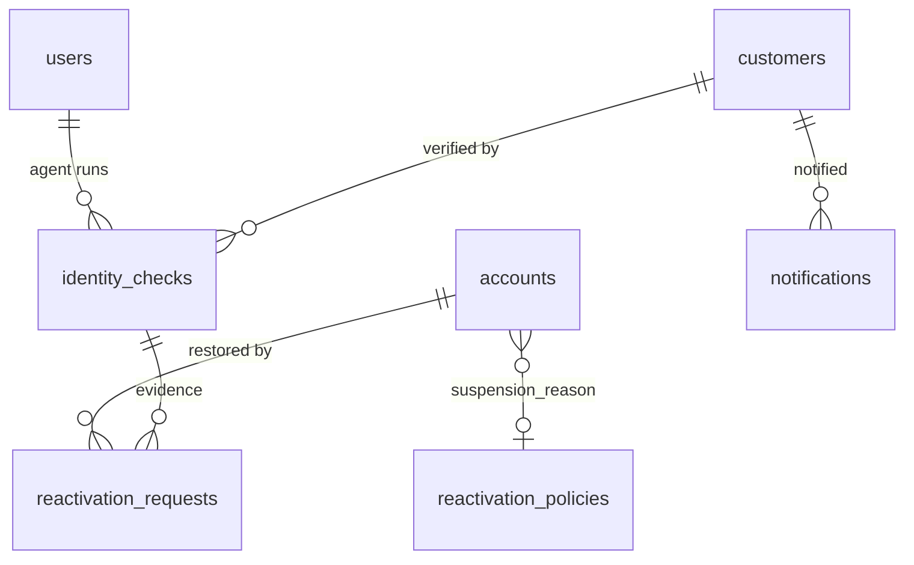
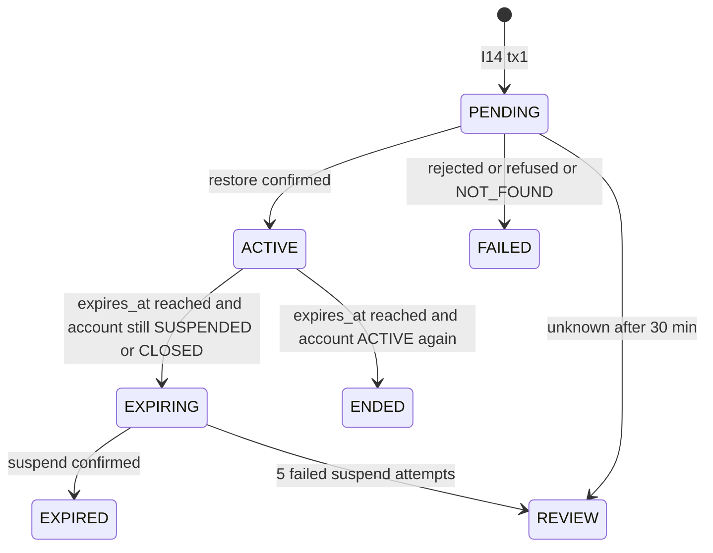

# 03 Inbound assistant workspace — backend design

- Status: **Proposed** (awaiting approval) · Date: 2026-11-26
- BRD: INB-01..INB-04, BR-01..BR-04, BR-07, BR-08, BR-10, XC-02, XC-04..XC-07, NFR-AVAIL, NFR-INTEG, NFR-OBS, NFR-PRIV, NFR-REL, NFR-SEC, §8, §11, §12, §14 #2, #4, #5, #12, §15 phase 3
- Conventions: [`../00-overview.md`](../00-overview.md) · Contract: [`openapi.yaml`](openapi.yaml) (shared components copied verbatim from 01, as in 02) · Precedent: [`../02-customer/backend.md`](../02-customer/backend.md) (rev 2 + errata E1–E6)

## 1. Scope

**In:** exact-mobile customer lookup with masked result, agent identity check (OTP to the primary mobile, or KBA), verified customer
view (profile, subscriptions/plan, invoices, payments, cases with activity and possible duplicates), case-on-behalf with internal
categories, agent notes and severity override, temporary reactivation (eligibility, provisioning port, expiry and reconcile jobs,
limits), customer notification outbox (`notification` module), audit of every privileged action.

**Out:** attachments (INB-03.3 "as applicable", OQ 4 of 02 still open → OQ 5), adding notes/status changes to existing cases (04;
01 OQ 7 → OQ 8), customer in-app inbox and a real email/SMS adapter (OQ 9), promotions for agents (OQ 12), ops tooling for REVIEW rows (06).

**Module dependencies (one-way, `ArchitectureTest`):** existing `servicecase → customer`, `payment → customer`, `customer → catalog`;
new `reactivation → customer`, `reactivation → notification`. `notification` depends only on `common`. The verified-access check
lives in `customer` (`VerifiedCustomerAccess`), so every module reaches it along an existing edge.

## 2. Data model (Flyway V7, V8)

Conventions as 02 §2 (`NOT NULL` unless `null`, `BIGINT AI` ids, UTC `DATETIME(6)`, enums `VARCHAR` + `CHECK`, `created_at`/`updated_at`).

| Table / change (module) | Columns | Keys, constraints, indexes |
|---|---|---|
| accounts (customer) **ALTER** | `+ suspension_reason null` `NON_PAYMENT\|CUSTOMER_REQUEST\|KYC_PENDING\|FRAUD\|LEGAL\|REGULATORY\|OTHER`, `+ suspended_at null` | backfill `OTHER`/`updated_at` for existing SUSPENDED rows, then CHECK `(status='SUSPENDED') = (suspension_reason IS NOT NULL)` |
| identity_checks (customer) | `agent_user_id`, `customer_id`, `method` `OTP\|KBA`, `status` `PENDING\|VERIFIED\|FAILED\|EXPIRED\|LOCKED\|SUPERSEDED`, `code_hmac CHAR(64) null` (OTP only), `attempts TINYINT`, `expires_at null` (OTP pending), `verified_at null`, `valid_until null`, `access_logged_at null` | FKs; CHECK attempts 0–10; CHECK `status<>'VERIFIED' OR valid_until IS NOT NULL`; idx (agent_user_id, customer_id, status), (customer_id, created_at) |
| reactivation_policies (reactivation) | `suspension_reason` PK, `eligible BOOL`, `max_hours TINYINT` | CHECK max_hours 1–24; CHECK `NOT (suspension_reason IN ('FRAUD','LEGAL','REGULATORY') AND eligible)` (INB-04.2 at DB level) |
| reactivation_requests (reactivation) | `reference VARCHAR(24)` (REA), `account_id`, `suspension_reason` (snapshot), `msisdns JSON` (suspended subs, snapshot), `requested_hours TINYINT`, `reason_text VARCHAR(500)`, `approval_reference VARCHAR(64) null`, `identity_check_id`, `requested_by_user_id`, `status` `PENDING\|ACTIVE\|EXPIRING\|EXPIRED\|ENDED\|FAILED\|REVIEW`, `failure_reason VARCHAR(64) null`, `provider_ref VARCHAR(64) null`, `activated_at null`, `expires_at null`, `ended_at null`, `attempts TINYINT`, `version` | UK reference; UK generated `open_account_id = IF(status IN ('PENDING','ACTIVE','EXPIRING','REVIEW'), account_id, NULL)`; CHECK requested_hours 1–24; CHECK `expires_at IS NULL OR expires_at <= activated_at + INTERVAL 24 HOUR`; idx (status, expires_at), (status, created_at), (account_id, created_at), (requested_by_user_id, created_at) |
| notifications (notification) | `customer_id`, `channel` `SMS\|EMAIL`, `template` `REACTIVATION_STARTED\|REACTIVATION_ENDED`, `destination VARCHAR(254)`, `params JSON`, `source_ref VARCHAR(24)`, `status` `PENDING\|SENT\|FAILED`, `attempts TINYINT`, `last_error VARCHAR(200) null`, `sent_at null` | UK (source_ref, template, channel) (outbox dedupe); idx (status, created_at) |

| Migration / script | Content |
|---|---|
| `V7__inbound.sql` | accounts ALTER + backfill; identity_checks; permission `case.severity.override` granted to INBOUND_AGENT (OQ 1; 01 §3.2 procedure); **placeholder INTERNAL categories** `INT_BACKOFFICE` (children `INT_BILL_ADJUST`, `INT_PROVISIONING`) and `INT_ESCALATION` (no children), customer-safe names (OQ 6); SLA rows for **all four severities** on every active top-level category without one (`INSERT … SELECT … WHERE NOT EXISTS`), so any override resolves an SLA (R11) |
| `V8__reactivation_notification.sql` | reactivation_policies (seed: NON_PAYMENT eligible 24 h; all other reasons `eligible=false`, OQ 2), reactivation_requests, notifications |
| `db/seed/R__03_inbound.sql` (dev) | customer 6 `+919800000006` SUSPENDED `NON_PAYMENT` (2 suspended subs, verified email); customer 7 `+919800000007` SUSPENDED `FRAUD`; customer 8 INACTIVE; INTERNAL-category cases with INTERNAL notes on customer 1 |
| `db/seed/R__03_inbound_e2e.sql` (e2e, as 02 E5) | same shape; customer 6 has no reactivation history; known KBA answers documented in the file |
| test-data `R__test_users_03_inbound.sql` | same shape plus customer with SUSPENDED `NON_PAYMENT` and an ENDED reactivation 10 days ago (limit case) |

## 3. Business rules

| # | Rule | Enforced where | BRD |
|---|---|---|---|
| R1 | **Lookup** by exact E.164 `msisdn` on `subscriptions.live_msisdn` (ACTIVE or SUSPENDED); 0 or 1 match. Scope = every customer of the operator (no org partition exists, OQ 3). Result is masked: name initials (`R*** K***`), MSISDN last 4, refs, customer/account status, `verifiedUntil` for this agent. 30 lookups per agent per minute → 429 (in-memory, per instance). Each call audited (hit or miss) | `CustomerLookupService`, `LookupRateLimiter` | INB-01.1, INB-01.4, NFR-PRIV |
| R2 | **Identity check, OTP**: 6-digit code to the primary MSISDN via `VerificationCodeSender` (new channel `PRIMARY_MSISDN`); HMAC-SHA256 stored; TTL 10 min; 5 attempts; 5 OTP starts per **customer** per hour (all agents, DB count) → 429; a new start supersedes this agent's PENDING/VERIFIED check for the customer. Confirm uses 02 §3.2 verbatim (attempt committed `REQUIRES_NEW` before a constant-time compare; LOCKED/VERIFIED by guarded updates). No primary MSISDN → 422 `no_otp_destination` | `IdentityCheckService`, `OtpCodec` (extracted from `ContactVerificationService`) | INB-01.2, §14 #2, NFR-SEC |
| R3 | **Identity check, KBA** (OQ 4): agent submits `postalCode` + `registeredContact`; both must equal the billing postal code and the verified email or verified secondary MSISDN (normalised: trimmed, lower-case, digits only for numbers), compared constant-time. No verified contact → 422 `kba_unavailable`. Wrong → row FAILED, 422; 3 failed KBA per customer per hour → 429. Answers are never stored or audited | `IdentityCheckService` | INB-01.2, §14 #2 |
| R4 | **Verified scope**: a check is valid for (agent, customer) while `status=VERIFIED` and `valid_until > now`; `valid_until = verified_at + 30 min` (`app.inbound.identity-check.validity`), not extended. Every customer-data endpoint (I5–I10, I12–I15) calls `VerifiedCustomerAccess.require(customerId)` **before** any read; none → 403 `verification-required` (existence of the id is not checked first, so nothing leaks). The agent id always comes from `ActorProvider` | `VerifiedCustomerAccess` | INB-01.1/01.2, BR-10, NFR-INTEG |
| R5 | **Record access log**: on the first protected read under a check, guarded `UPDATE identity_checks SET access_logged_at=:now WHERE id=:id AND access_logged_at IS NULL` + `CUSTOMER_RECORD_ACCESSED` in one `REQUIRES_NEW` tx (1 row per check, OQ 10) | `VerifiedCustomerAccess` | INB-01.4, NFR-PRIV |
| R6 | **Verified view** I5: identity (name, alias, refs), customer/account status, suspension reason + since, primary MSISDN, email/secondary + verified flags. Billing address is **not** returned (minimisation; it is a KBA answer). I6 = 02 R4 data for the account. I7/I8 = 02 R11 data for the account (window default 3 months). No receipts | `AgentCustomerService`, `SubscriptionService`, `PaymentQueryService` | INB-01.3, NFR-PRIV, BR-05/06 |
| R7 | **Case list** I9: account's cases, `created_at` window (00-overview §3), filters `status` (internal, multi), exact `reference` inside the window, sort whitelist `createdAt`, `updatedAt`; item = reference, category/subcategory, subject, case type, severity, internal + public status, channel, owner (assigned user display name, else team name, else null), created, updated | `AgentCaseQueryService` | INB-02.1, XC-04/05 |
| R8 | **Case detail** I10 by `reference` within the account (else 404): description, preferred contact, contact MSISDN, creator (display name + channel), activity timeline oldest first. `INTERNAL` entries only when the caller has `case.note.internal` (BR-04); the customer endpoints never return them (02 E11 has no activity; 04 keeps it so) | `AgentCaseQueryService` | INB-02.2, INB-02.4, BR-04 |
| R9 | **Possible duplicates** in I10: up to 5 other cases of the same account with the same leaf category created within ±30 days (`app.inbound.related-window`), newest first; label only, no link table (OQ 11) | `AgentCaseQueryService` | INB-02.3 |
| R10 | **Categories** I11: active CUSTOMER top levels with active children, plus INTERNAL ones when the caller has `case.category.internal`; each with `audience` and resolved default severity. Audience is the top level's; children inherit | `CategoryRepository`, `AgentCaseService` | INB-03.2 |
| R11 | **Create on behalf** I12: 02 R10 rules via the extracted `CaseCreationService`, with: INTERNAL category without `case.category.internal` → 403; `subscriptionId` optional, must be the account's non-TERMINATED sub, default primary; `contact_msisdn` = that sub's MSISDN (INB-03.1); `subject` = issue summary, `description` = customer statement; optional `agentNotes` (≤ 4000) → one `NOTE`/`INTERNAL` activity; optional `severity` ≠ derived needs `case.severity.override` (else 403) and `severityReason` (5–200, else 400); SLA row resolved for the final severity (leaf, then parent; none → 422). Channel `INBOUND_AGENT`, `created_by_user_id` = agent, `SR` ref returned (INB-03.5). Customer INACTIVE / account CLOSED → 422 (02 R16); SUSPENDED allowed. Idempotent | `AgentCaseService`, `CaseCreationService` | INB-03.1..03.5, BR-01/02/04/07, §14 #4 |
| R12 | **Reactivation eligibility** I13 (all must hold; else reason codes): customer ACTIVE (`CUSTOMER_INACTIVE`); account SUSPENDED (`NOT_SUSPENDED`); reason not FRAUD/LEGAL/REGULATORY — hard-coded, independent of the table (`PROHIBITED_REASON`); policy row `eligible` (`REASON_NOT_ELIGIBLE`); ≥ 1 SUSPENDED subscription (`NO_SUSPENDED_SERVICE`); no open request (`OPEN_REQUEST`); requests not FAILED on the account in the last 30 days < 1 (`ACCOUNT_LIMIT_REACHED`); agent's requests today (Asia/Kolkata) < 10 (`AGENT_LIMIT_REACHED`). Returns `maxHours` = policy `max_hours` (≤ 24) | `ReactivationEligibilityService` | INB-04.1, INB-04.2, INB-04.6, §14 #5 |
| R13 | **Reactivation create** I14: body `hours` (1..maxHours, default 24), `reason` (10–500), `approvalReference` (optional ≤ 64, OQ 7). tx1 locks the account (`SELECT … FOR UPDATE` on accounts), re-runs R12, inserts PENDING with REA ref + `identity_check_id` + snapshot, audits, commits. Ineligible → 422 `business-rule` with `reasons[]` and `REACTIVATION_REJECTED` (independent tx); `OPEN_REQUEST` or UK race → 409. No extension endpoint exists: a second request while one is open is 409, after it ends the 30-day limit applies (INB-04.6). Idempotent (`REACTIVATION_CREATE`, path-aware hash) | `ReactivationService` | INB-04.1..04.4, INB-04.6, NFR-REL, XC-06/07 |
| R14 | State changes only via §3.1 guarded transitions; our `accounts`/`subscriptions` rows are never changed by a reactivation (billing owns them). "Temporarily restored" = a request in ACTIVE | `ReactivationTransitionService` (single writer) | INB-04.4, BR-08, NFR-INTEG |
| R15 | **Notify** (INB-04.7): on → ACTIVE enqueue `REACTIVATION_STARTED`, on → EXPIRED/ENDED enqueue `REACTIVATION_ENDED`, in the same tx (outbox): SMS to primary MSISDN, EMAIL if verified email. `NotificationDispatchJob` (every 30 s, paged, 25 s run budget) sends via `NotificationSender`; failure → `attempts+1`; 3rd failure → FAILED + WARN. Delivery never changes reactivation state | `NotificationService`, `NotificationDispatchJob` | INB-04.7, §14 #12, NFR-AVAIL |

### 3.1 Reactivation transitions (guarded, as 02 §3.1)

Every transition is `UPDATE reactivation_requests SET status=:to, …, version=version+1 WHERE id=:id AND status=:from`; side effects
(audit, notifications) only when exactly 1 row changed, else no-op + DEBUG log. Provider calls run **outside** any DB tx (02 review C6),
timeout 5 s; the adapter must be idempotent by `requestRef` (the mock is).

| Trigger | From → To | Effects / response |
|---|---|---|
| I14 after `restore` ok | PENDING → ACTIVE | `provider_ref`, `activated_at`=now, `expires_at`=now + hours; notify; audit → **201** |
| `restore` rejected by provider (business) | PENDING → FAILED `provider_rejected` | audit FAILURE → **422**; key released |
| `restore` connection refused | PENDING → FAILED `provider_unavailable` | audit FAILURE → **503**; key released, agent may retry |
| `restore` timeout or 5xx (outcome unknown) | PENDING stays, `failure_reason=provider_unknown` | → **503** with the reference; reconcile resolves it; a retry gets 409 (open) |
| `ReactivationReconcileJob` (60 s): PENDING older than 1 min, `getStatus(ref)` = RESTORED | PENDING → ACTIVE | `activated_at` = provider `restoredAt`, `expires_at` = restoredAt + hours (24 h cap holds); notify; audit |
| reconcile: `NOT_FOUND` and older than 2 min | PENDING → FAILED `not_created` | audit FAILURE |
| reconcile: unreachable/unknown, `attempts+1`; created > 30 min ago | PENDING → REVIEW `unreconciled` | audit FAILURE + ERROR log; stays open (blocks new requests) |
| `ReactivationExpiryJob` (60 s): ACTIVE with `expires_at ≤ now`, account ACTIVE | ACTIVE → ENDED `account_reinstated` | no provider call; notify; audit |
| expiry job: same, account SUSPENDED/CLOSED | ACTIVE → EXPIRING (claim tx) | then `suspend(ref, msisdns)` outside tx |
| `suspend` ok | EXPIRING → EXPIRED | `ended_at`; notify; audit |
| `suspend` fails | EXPIRING stays, `attempts+1` | retried each run (EXPIRING rows are picked up again, also after a crash); 5th failure → REVIEW `expiry_failed`, audit FAILURE + ERROR log |

Jobs page through rows (100 per page), stop at a 50 s run budget (02 review C15/C17), are safe in parallel and across instances (guards).
Expiry is enforced within one job interval (≤ 60 s late). Crons `app.reactivation.{reconcile,expiry}-cron` and
`app.notification.dispatch-cron`; `-` disables (tests only).

## 4. Authorization and scope

- Every endpoint: `@PreAuthorize("hasAuthority('customer.lookup') and hasAuthority('<perm>')")`. `customer.lookup` is held only by
  INBOUND_AGENT, so CUSTOMER (has `case.read`, `payment.read`, `customer.profile.read`) and OUTBOUND_AGENT (has `case.read`,
  `case.note.internal`) are 403 on every `/agent/**` path. Denials go through `DeniedAccessRecorder` (01 §7, sampled).
- Record scope: R4 (verified agent + customer), then account from `AccountLookup.accountFor(customerId)`; case reference and
  subscription id are matched **within** that account (404 otherwise). Request bodies never carry account/customer ids (ignored).
- 403 `verification-required` is a new problem type (proposed addition to 00-overview §4, applied on approval) so the SPA can open the
  verification step; it is also passed to `DeniedAccessRecorder` (reason `verification_required`).
- `service.reactivate` comes only with REACTIVATION_APPROVER (01 §3.1, always on top of INBOUND_AGENT); I15 (history) needs only
  `customer.profile.read` so every inbound agent sees a temporary restoration (INB-01.3 account status).

## 5. Endpoints (prefix `/api/v1`; details in openapi.yaml)

Common errors 401, 403, 500; with a body also 400, 413, 415. POSTs need `X-XSRF-TOKEN`. Idempotent endpoints hash `{pathVariables, body}` (02 D6).
"✔V" = requires a valid identity check (R4).

| # | Method | Path | Permission (+ `customer.lookup`) | V | Idem. | Response / extra errors |
|---|---|---|---|---|---|---|
| I1 | GET | `/agent/customers?msisdn=` | customer.lookup | | | 200 `CustomerMatch[]` (0–1) · 400 · 429 |
| I2 | POST | `/agent/customers/{customerId}/identity-checks` | customer.verify | | | 201 `IdentityCheck` (OTP → PENDING, KBA → VERIFIED) · 404 · 422 (`no_otp_destination`, `kba_unavailable`, KBA wrong) · 429 · 503 sender |
| I3 | POST | `/agent/customers/{customerId}/identity-checks/{checkId}/confirm` | customer.verify | | | 200 `IdentityCheck` · 404 (other agent's check too) · 422 wrong (`attemptsRemaining`) / expired / locked |
| I4 | GET | `/agent/customers/{customerId}/identity-checks/current` | customer.verify | | | 200 `IdentityCheck` (valid VERIFIED) · 404 none |
| I5 | GET | `/agent/customers/{customerId}/profile` | customer.profile.read | ✔ | | 200 `AgentCustomerProfile` |
| I6 | GET | `/agent/customers/{customerId}/subscriptions` | plan.read | ✔ | | 200 `Subscription[]` |
| I7 | GET | `/agent/customers/{customerId}/invoices?status` | payment.read | ✔ | | 200 `Invoice[]` (latest 12) |
| I8 | GET | `/agent/customers/{customerId}/payments?from&to&page&size&sort` | payment.read | ✔ | | 200 `PaymentPage` · 400 |
| I9 | GET | `/agent/customers/{customerId}/cases?from&to&status&reference&page&size&sort` | case.read | ✔ | | 200 `AgentCasePage` · 400 |
| I10 | GET | `/agent/customers/{customerId}/cases/{reference}` | case.read | ✔ | | 200 `AgentCaseDetail` · 404 |
| I11 | GET | `/agent/case-categories` | case.create.onbehalf | | | 200 `AgentCategory[]` |
| I12 | POST | `/agent/customers/{customerId}/cases` | case.create.onbehalf | ✔ | ✔ `CASE_CREATE_ONBEHALF` | 201 `AgentCaseCreated` · 403 (internal category / override) · 404 sub · 409 · 422 |
| I13 | GET | `/agent/customers/{customerId}/reactivation-eligibility` | service.reactivate | ✔ | | 200 `ReactivationEligibility` |
| I14 | POST | `/agent/customers/{customerId}/reactivations` | service.reactivate | ✔ | ✔ `REACTIVATION_CREATE` | 201 `Reactivation` · 409 · 422 (`reasons[]`) · 503 |
| I15 | GET | `/agent/customers/{customerId}/reactivations?from&to&page&size` | customer.profile.read | ✔ | | 200 `ReactivationPage` (sort `createdAt,desc`) · 400 |

## 6. Components

| Component (module) | Responsibility |
|---|---|
| `OtpCodec` (customer) | code generation, HMAC, constant-time compare — extracted from `ContactVerificationService` (behaviour unchanged) |
| `CustomerLookupService`, `LookupRateLimiter`, `IdentityCheckRepository`, `IdentityCheckService`, `VerifiedCustomerAccess`, `AgentCustomerService`, `AgentCustomerController`, `IdentityCheckController`, `InboundProperties` (customer) | I1–I6, R1–R6 |
| `AgentPaymentController` + account-id overloads in `PaymentQueryService` (payment) | I7–I8 |
| `CaseCreationService` (shared R10/R11 core, used by `CustomerCaseService` and `AgentCaseService`), `AgentCaseQueryService`, `AgentCaseService`, `AgentCaseController` (servicecase) | I9–I12 |
| `ReactivationPolicyRepository`, `ReactivationRepository`, `ReactivationEligibilityService`, `ReactivationService`, `ReactivationTransitionService`, `ReactivationReconcileJob`, `ReactivationExpiryJob`, `ReactivationController`, `ReactivationProperties`, `ProvisioningClient` + `MockProvisioningClient` (reactivation) | I13–I15, R12–R14, §3.1 |
| `NotificationService` (enqueue), `NotificationRepository`, `NotificationDispatchJob`, `NotificationSender` + `MockNotificationSender` (notification) | R15 |

Config: `app.inbound.{lookups-per-minute=30, identity-check.validity=30m, kba-failures-per-hour=3, related-window=30d}` (OTP values reuse
`app.customer.otp.*`, incl. `dev-fixed-code`); `app.reactivation.{account-limit=1, account-window=30d, agent-daily-limit=10,
reconcile-cron, expiry-cron, provisioning.timeout=5s, provisioning.mock.{enabled, mode}}`; `app.notification.{dispatch-cron, max-attempts=3,
mock.enabled}`. Mock adapters are `@ConditionalOnProperty(...mock.enabled)` (02 review C8). `ProfileGuard` refuses `prod` when
any mock is enabled, when a reactivation/notification cron is `-`, or when no real adapter bean exists (02 review C1/C18 pattern).

## 7. Audit actions (00-overview §6; MSISDN last 4, email masked as in 02 §7)

| Action | Outcome | Entity | `details` |
|---|---|---|---|
| `CUSTOMER_LOOKUP` | SUCCESS | CUSTOMER/ref or null | masked msisdn, `matched` |
| `IDENTITY_CHECK_STARTED` / `IDENTITY_CHECK_PASSED` | SUCCESS | CUSTOMER/ref | method, check id, `validUntil` |
| `IDENTITY_CHECK_FAILED` | FAILURE (independent tx) | CUSTOMER/ref | method, reason `wrong_code\|expired\|locked\|kba_mismatch`, attemptsRemaining (never answers or code) |
| `CUSTOMER_RECORD_ACCESSED` | SUCCESS | CUSTOMER/ref | check id, first path |
| `CASE_CREATED` (02 action) | SUCCESS | CASE/reference | + channel `INBOUND_AGENT`, customer ref, check id, `internalCategory`, severity derived/final + `severityReason`, `agentNote` true/false |
| `REACTIVATION_REQUESTED` | SUCCESS | REACTIVATION/ref | account ref, suspension reason, hours, reason text, approval ref, check id |
| `REACTIVATION_REJECTED` | FAILURE (independent tx) | ACCOUNT/ref | `reasons[]` |
| `REACTIVATION_ACTIVATED` / `REACTIVATION_EXPIRED` / `REACTIVATION_ENDED` | SUCCESS | REACTIVATION/ref | from/to, source `request\|reconcile\|expiry`, activated/expires/ended at (job rows: actor null) |
| `REACTIVATION_FAILED` / `REACTIVATION_REVIEW` | FAILURE | REACTIVATION/ref | reason (`provider_rejected\|provider_unavailable\|not_created\|unreconciled\|expiry_failed`), attempts |

## 8. Integrations / ports

| Port | Mock behaviour | Failure mode (NFR-AVAIL) |
|---|---|---|
| `ProvisioningClient.restore(requestRef, msisdns, until)` → `{providerRef}` | in-memory by ref, idempotent; `mode=REJECT\|UNAVAILABLE\|TIMEOUT` | §3.1: reject → 422, refused → 503 + FAILED, timeout/5xx → 503 + PENDING + reconcile |
| `ProvisioningClient.suspend(requestRef, msisdns)` | idempotent; `mode=SUSPEND_FAIL` throws | stays EXPIRING, retried, 5th → REVIEW |
| `ProvisioningClient.getStatus(requestRef)` → `RESTORED{restoredAt, providerRef}\|SUSPENDED\|NOT_FOUND` | from the in-memory map | unreachable → `attempts+1`, retried; 30 min → REVIEW |
| `VerificationCodeSender.send(PRIMARY_MSISDN, msisdn, code)` (02 port, new enum value) | as 02 (last code per destination in memory) | → 503, check EXPIRED; code never logged |
| `NotificationSender.send(channel, destination, template, params)` | in-memory list + masked INFO log. **Deviation from §14 #12** (in-app + Mailpit email): SMS/EMAIL mock only (OQ 9) | `attempts+1`, 3rd → FAILED + WARN; never blocks the workflow |

Inbound pages degrade per card: a failing payment or provisioning dependency affects only its own endpoint.

## 9. Test plan (Testcontainers MySQL, test data `R__test_users_03_inbound.sql`, mutable test `Clock`)

| Test | Proves | BRD |
|---|---|---|
| `SchemaV7toV8IT` | suspension CHECK both ways; prohibited-eligible CHECK rejects `FRAUD eligible=true`; open-request UK (2nd PENDING/ACTIVE/REVIEW on an account fails, FAILED/EXPIRED don't count); 24 h expiry CHECK; notification dedupe UK; every active top level × 4 severities resolves an SLA; `case.severity.override` on INBOUND_AGENT only | INB-04.2/04.5, BR-07 |
| `CustomerLookupIT` | exact match on live sub (ACTIVE + SUSPENDED); TERMINATED/unknown → `[]`; masking (no full name/MSISDN in body); bad E.164 400; 31st lookup/min 429 + `Retry-After`; audit per call (hit and miss) | INB-01.1, INB-01.4, NFR-PRIV |
| `IdentityCheckIT` | OTP start→confirm → VERIFIED with `validUntil`; 5 wrong → locked; 8 parallel wrong confirms → attempts = 5, no success; expiry (clock); 6th OTP start/customer/hour 429 across 2 agents; supersede; another agent's check id → 404; KBA right → VERIFIED; KBA wrong 422 and 4th failure/hour 429; no verified contact → `kba_unavailable`; code/answers absent from audit and logs | INB-01.2, NFR-SEC |
| `VerifiedCustomerAccessIT` | I5–I10, I12–I15 without a check → 403 `verification-required` (also for a non-existent id); after 30 min (clock) → 403 again; agent B can't use agent A's check; `CUSTOMER_RECORD_ACCESSED` exactly once per check over several reads | INB-01.1/01.2/01.4, BR-10 |
| `AgentCustomerViewIT` | I5 fields incl. suspension, no billing address; I6 plan data; I7/I8 window + paging | INB-01.3 |
| `AgentCaseQueryIT` | I9 window, status filter, reference, sort whitelist, owner; I10 activity incl. INTERNAL for INBOUND_AGENT; other customer's reference → 404; duplicates rule (same leaf ±30 d, max 5); customer E11 for the same case shows public status only | INB-02.1..02.4, BR-04, XC-04/05 |
| `AgentCaseCreateIT` | channel `INBOUND_AGENT`, creator = agent, contact = chosen/primary sub; INTERNAL note activity; internal category without permission 403 (test principal with a reduced authority set; no seeded role lacks it); override without reason 400, without permission 403, with → SLA of final severity; foreign/terminated `subscriptionId` 404; CLOSED account 422; same key twice → one case; same key on another customer → 422 mismatch; `CustomerCaseIT` still green after extraction | INB-03.1..03.5, BR-01/02/04/07, NFR-REL |
| `ReactivationEligibilityIT` | each reason code (INACTIVE, ACTIVE account, FRAUD/LEGAL/REGULATORY even with a policy row forced eligible in-test via a mock repository, ineligible reason, no suspended sub, open, 30-day limit, agent daily limit); `maxHours` | INB-04.1, INB-04.2, INB-04.6 |
| `ReactivationCreateIT` | 201 ACTIVE + `expires_at` = now + hours + notifications + audit; hours 25 → 400; ineligible → 422 `reasons[]` + `REACTIVATION_REJECTED`; 2 parallel requests (2 agents) → one 201, one 409; replay same key → same 201; REJECT → 422 FAILED; UNAVAILABLE → 503 FAILED, retry works; TIMEOUT → 503 PENDING, retry 409, reconcile → ACTIVE; I15 history | INB-04.1..04.4, INB-04.6/04.7, NFR-REL, NFR-AVAIL |
| `ReactivationJobsIT` | expiry at `expires_at` (clock) → EXPIRED + suspend called + notify; account reinstated → ENDED without suspend; SUSPEND_FAIL × 5 → REVIEW; crash after claim (EXPIRING) → next run completes; reconcile RESTORED/NOT_FOUND/30-min REVIEW; two job runs in parallel → one transition, one audit; run budget stops a long run | INB-04.5, BR-08, XC-07 |
| `NotificationDispatchIT` | outbox rows sent; sender failure × 3 → FAILED; dedupe UK; reactivation state unchanged by failures | INB-04.7 |
| `InboundAuthzIT` | every I1–I15: anonymous 401; **CUSTOMER, OUTBOUND_AGENT, OUTBOUND_SUPERVISOR, BUSINESS_ANALYST, BUSINESS_AUDITOR → 403**; INBOUND_AGENT without REACTIVATION_APPROVER → 403 on I13/I14; missing CSRF on POSTs → 403. **Audit per the 01 §7 recorder:** the first 403 of a user on a path writes one `ACCESS_DENIED` row; a repeat by the same user on the same path within 1 minute writes none; after the clock moves 61 s it writes one again | BR-10, XC-02 |
| `InboundIdorIT` | verified for customer A: B's case reference (I10), B's subscription id (I12), A's path with B's check id (I3) → 404; nothing changed | NFR-INTEG |
| `ProfileGuardIT` (extended) / `ArchitectureTest` (extended) | prod + any mock / `-` cron / no real adapter fails startup; no cycles, `notification` depends only on `common` | NFR-SEC, NFR-MAINT |

## 10. Open questions (defaults used until answered)

**Needs the user's decision at approval:**

| # | Question | Default |
|---|---|---|
| 1 | Severity override (§14 #4 "with permission"): which permission, which role? | New `case.severity.override` (V7) on INBOUND_AGENT; reason required; openapi `Permission` enum updated (01 §3.2) |
| 2 | Suspension reasons and which are eligible / max hours (INB-04.1, §14 #5) | 7 placeholder reasons; only `NON_PAYMENT` eligible, 24 h; FRAUD/LEGAL/REGULATORY never (schema + code) |
| 4 | Operator verification procedure (INB-01.2): KBA questions? validity? | OTP to primary, or KBA = billing postal code + verified email/secondary; valid 30 min per agent+customer |
| 13 | Abuse limits (INB-04.6) | 1 non-failed reactivation per account per 30 days, no extension, 10 per agent per day |

**Other questions:**

| # | Question | Default |
|---|---|---|
| 3 | Organisational scope of inbound search (INB-01.1) | All customers; exact MSISDN only; no partial/name search |
| 5 | Attachments (INB-03.3) | Deferred, as 02 OQ 4 |
| 6 | Should a customer see an INTERNAL category name in CUS-05? | Yes; internal categories get customer-safe names |
| 7 | When is "approval evidence" required (INB-04.3)? | Never mandatory; optional `approvalReference`; the `service.reactivate` holder + identity check id are the evidence |
| 8 | Inbound "limited actions" on case status (§8, 01 OQ 7) | None in 03; revisit in 04 |
| 9 | §14 #12 in-app + Mailpit email | Mock SMS/EMAIL sender; Mailpit adapter and in-app inbox in 04 (stated deviation) |
| 10 | Record-access logging granularity (INB-01.4) | Lookup per call + first read per identity check |
| 11 | Duplicate matching (INB-02.3) | Same account + leaf category ± 30 days, display only |
| 12 | Promotions in the inbound view (§8 "authorized lookup") | Not in 03 (INB-01.3 does not list them) |
| 14 | Align 02 §9 `CustomerPortalAuthzIT` wording "each 403 writes `ACCESS_DENIED`" with the 01 §7 recorder (one row per user+path per minute) | Docs-only erratum E7 on 02 using the §9 `InboundAuthzIT` wording above; no code change |
| 15 | Lookup rate limiter is per instance (in-memory) | Accepted until multi-instance deployment (06) |
