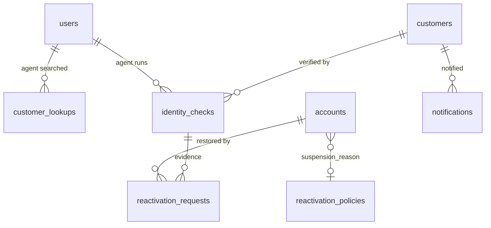
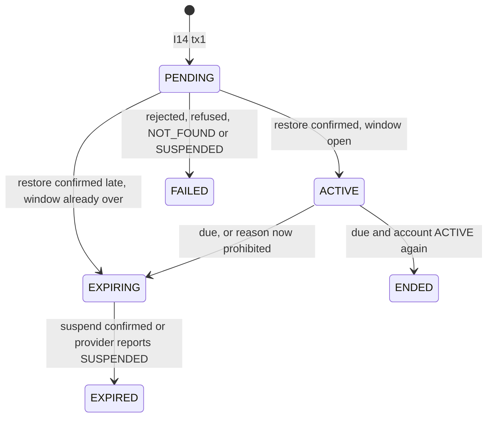

# 03 Inbound assistant workspace — backend design

- Status: **Approved** (revision 2) · Date: 2026-11-26 · approved by user 2026-11-26 with OQ defaults (OQ 1, 2, 4, 13, 17 confirmed)
- BRD: INB-01..INB-04, BR-01..BR-04, BR-07, BR-08, BR-10, XC-02, XC-04..XC-07, NFR-AVAIL, NFR-INTEG, NFR-OBS, NFR-PRIV, NFR-REL, NFR-SEC, §8, §11, §12, §14 #2, #4, #5, #12, §15 phase 3
- Conventions: [`../00-overview.md`](../00-overview.md) (rev 4 §1/§4 **proposed with this design**) · Contract: [`openapi.yaml`](openapi.yaml) (shared components copied verbatim from 01, as in 02) · Precedent: [`../02-customer/backend.md`](../02-customer/backend.md) (rev 2 + errata E1–E6; E7 proposed with this design)
- Approved-doc changes in this PR (approved together with this design): 00-overview rev 4 (§1 modules/edges, §4 `verification-required`), 01 backend §13 E3 + 01 openapi `Permission` enum (`case.severity.override`), 02 backend §11 E7 (ACCESS_DENIED wording)
- Review input: [`../../slices/03-inbound/review-backend-design.md`](../../slices/03-inbound/review-backend-design.md) (disposition at its end)

## 1. Scope

**In:** exact-mobile customer search with masked result and a lookup token, agent identity check (OTP to the primary mobile, or KBA),
verified customer view (profile, subscriptions/plan, invoices, payments, cases with activity and possible duplicates), case-on-behalf
with internal categories, agent notes and severity override, temporary reactivation (eligibility, provisioning port, reconcile and
expiry jobs that never give up, limits), customer notification outbox (`notification` module), audit of every privileged action.

**Out:** attachments (INB-03.3 "as applicable" → OQ 5), notes/status changes on existing cases (04; 01 OQ 7 → OQ 8), customer in-app
inbox and a real email/SMS adapter (OQ 9), promotions for agents (OQ 12), an ops UI for reactivations flagged `needs_attention` (06).

**Module dependencies (one-way, `ArchitectureTest`):** existing `servicecase → customer`, `payment → customer`, `customer → catalog`;
new `servicecase → identity`, `reactivation → customer`, `reactivation → notification`, `reactivation → identity` (identity imports no
feature module). `notification` depends only on `common`. Cross-module calls use only the APIs in §6.1.

## 2. Data model (Flyway V7–V9)

Conventions as 02 §2 (`NOT NULL` unless `null`, `BIGINT AI` ids, UTC `DATETIME(6)`, enums `VARCHAR` + `CHECK`, `created_at`/`updated_at`).

| Table / change (module) | Columns | Keys, constraints, indexes |
|---|---|---|
| accounts (customer) **ALTER** | `+ suspension_reason null` `NON_PAYMENT\|CUSTOMER_REQUEST\|KYC_PENDING\|FRAUD\|LEGAL\|REGULATORY\|OTHER`, `+ suspended_at null` | backfill `OTHER`/`updated_at` for SUSPENDED rows, then CHECK `(status='SUSPENDED') = (suspension_reason IS NOT NULL AND suspended_at IS NOT NULL)`. **Every writer of `accounts.status` (seeds, tests) sets or clears both columns in the same statement** |
| customer_lookups (customer) | `agent_user_id`, `customer_id`, `token_hash CHAR(64)` (SHA-256 of a 128-bit random token), `expires_at` (+15 min) | UK token_hash; idx (agent_user_id, customer_id, expires_at); purged after 24 h by the identity-check job |
| identity_checks (customer) | `agent_user_id`, `customer_id`, `method` `OTP\|KBA`, `status` `PENDING\|CHECKING\|VERIFIED\|FAILED\|EXPIRED\|LOCKED\|SUPERSEDED`, `code_hmac CHAR(64) null`, `attempts TINYINT`, `expires_at null`, `verified_at null`, `valid_until null`, `access_logged_at null` | FKs; CHECK attempts 0–10; CHECK `(method='OTP') = (code_hmac IS NOT NULL)`; CHECK `status<>'PENDING' OR (method='OTP' AND expires_at IS NOT NULL)`; CHECK `method<>'KBA' OR status IN ('CHECKING','VERIFIED','FAILED','SUPERSEDED')`; CHECK `status<>'VERIFIED' OR valid_until IS NOT NULL`; idx (agent_user_id, customer_id, status), (customer_id, method, created_at), (agent_user_id, method, created_at) |
| reactivation_policies (reactivation) | `suspension_reason` PK, `eligible BOOL`, `max_hours TINYINT` | CHECK max_hours 1–24; CHECK `NOT (suspension_reason IN ('FRAUD','LEGAL','REGULATORY') AND eligible)` |
| reactivation_requests (reactivation) | `reference VARCHAR(24)` (REA), `account_id`, `suspension_reason` (snapshot), `msisdns JSON` (snapshot), `requested_hours TINYINT`, `reason_text VARCHAR(500)`, `approval_reference VARCHAR(64) null`, `identity_check_id`, `requested_by_user_id`, `status` `PENDING\|ACTIVE\|EXPIRING\|EXPIRED\|ENDED\|FAILED`, `failure_reason VARCHAR(64) null`, `end_reason VARCHAR(32) null`, `provider_ref VARCHAR(64) null`, `activated_at null`, `expires_at null`, `ended_at null`, `attempts SMALLINT`, `next_attempt_at null`, `needs_attention BOOL`, `attention_reason VARCHAR(32) null`, `overdue_alerted_at null`, `version` | UK reference; UK generated `open_account_id = IF(status IN ('PENDING','ACTIVE','EXPIRING'), account_id, NULL)`; CHECK requested_hours 1–24; CHECK `expires_at IS NULL OR expires_at <= activated_at + INTERVAL 24 HOUR`; idx (status, next_attempt_at), (status, expires_at), (account_id, created_at), (requested_by_user_id, created_at) |
| notifications (notification) | `customer_id`, `channel` `SMS\|EMAIL`, `template` `REACTIVATION_STARTED\|REACTIVATION_ENDED`, `destination VARCHAR(254)`, `params JSON` (reference, times; no PII), `source_ref VARCHAR(24)`, `status` `PENDING\|SENDING\|SENT\|FAILED`, `attempts TINYINT`, `next_attempt_at`, `claimed_at null`, `last_error VARCHAR(200) null`, `sent_at null` | UK (source_ref, template, channel); idx (status, next_attempt_at). `destination` is replaced by its masked form on SENT/FAILED |

| Migration / script | Content |
|---|---|
| `V7__account_suspension.sql` | accounts ALTER + backfill + CHECK (alone, so the 02 IT updates ship with it, B1) |
| `V8__inbound.sql` | customer_lookups, identity_checks; permission `case.severity.override` → INBOUND_AGENT (01 §13 E3); placeholder INTERNAL categories: `INT_BACKOFFICE` REQUEST MEDIUM (children `INT_BILL_ADJUST` REQUEST null, `INT_PROVISIONING` REQUEST HIGH), `INT_ESCALATION` COMPLAINT HIGH (no children), customer-safe names (OQ 6); SLA rows for every **(active top-level category, severity) pair** that has none (`INSERT … SELECT … WHERE NOT EXISTS` per pair), so every leaf × 4 severities resolves (R11) |
| `V9__reactivation_notification.sql` | reactivation_policies (NON_PAYMENT eligible 24 h; others `eligible=false`, OQ 2), reactivation_requests, notifications |
| `db/seed/R__03_inbound.sql` (dev), `R__03_inbound_e2e.sql` (e2e, as 02 E5) | customer 6 `+919800000006` SUSPENDED `NON_PAYMENT` (2 suspended subs, verified email); 7 SUSPENDED `FRAUD`; 8 INACTIVE; INTERNAL-category cases with INTERNAL notes on customer 1; KBA answers documented in the file |
| test-data `R__test_users_03_inbound.sql` | same shape + a NON_PAYMENT account with an ENDED reactivation 10 days ago (limit case) |

## 3. Business rules

| # | Rule | Enforced where | BRD |
|---|---|---|---|
| R1 | **Search** I1 (`POST`, MSISDN in the body, not the URL): exact E.164 on `subscriptions.live_msisdn`; 0 or 1 match. Scope = every customer of the operator (OQ 3). Result masked (name initials, MSISDN last 4, refs, statuses, `verifiedUntil`) plus an opaque `lookupToken` (15 min, this agent only, stored hashed). 30 searches per agent per minute → 429 (per instance, OQ 15). Audited per call, hit or miss, never the full MSISDN | `CustomerLookupService`, `LookupRateLimiter` | INB-01.1, INB-01.4, NFR-PRIV |
| R2 | **Lookup binding**: I2 requires `lookupToken` from a hit for (this agent, this customer) not yet expired. Unknown id, wrong/expired/other agent's token → the same 404 `not-found` (no id enumeration, no OTP to arbitrary ids) | `IdentityCheckService` | INB-01.1, NFR-PRIV |
| R3 | **OTP start**: in one tx: `CustomerRepository.lockForUpdate(customerId)`, count OTP rows of the customer in the last hour (≥ 5 → 429, all agents), supersede this agent's PENDING/VERIFIED check, insert PENDING (HMAC of a 6-digit code, TTL 10 min), commit; then send to the primary MSISDN (`VerificationCodeSender`, channel `PRIMARY_MSISDN`); send failure → row EXPIRED, 503. No primary → 422 `no_otp_destination`. **Confirm** = 02 §3.2 verbatim (attempt committed `REQUIRES_NEW` before a constant-time compare; LOCKED/VERIFIED by guarded updates; 5 attempts) | `IdentityCheckService`, `OtpCodec` | INB-01.2, §14 #2, NFR-SEC |
| R4 | **KBA** (OQ 4): `postalCode` + `registeredContact` vs billing postal code and verified email / verified secondary MSISDN (normalised). tx A (`REQUIRES_NEW`): lock customer row, count KBA rows in `CHECKING\|FAILED` in the last hour (customer ≥ 3 or agent ≥ 10 → 429), insert `CHECKING`, **commit**. Then compare HMAC-SHA256 of the normalised answers with `MessageDigest.isEqual`. tx B: guarded `UPDATE … SET status = VERIFIED\|FAILED WHERE id=:id AND status='CHECKING'`. A crash leaves `CHECKING`, which counts as a failure. No verified contact → 422 `kba_unavailable` (no row). Answers never stored, logged or audited | `IdentityCheckService` | INB-01.2, NFR-SEC |
| R5 | **Verified scope** (central): `VerifiedCustomerInterceptor` runs for every `/api/v1/agent/customers/{customerId}/**` route except `/identity-checks/**`, **before** the controller (so before `@PreAuthorize`'d logic and `IdempotencyService.execute`). If the caller holds `customer.lookup` it calls `VerifiedCustomerAccess.require(customerId)`: a check with `status=VERIFIED`, `valid_until > now` for (agent from `ActorProvider`, customer) → `VerifiedCustomer(customerId, accountId, checkId, agentUserId)` (final class, package-private constructor) stored as request attribute; none → 403 `verification-required` (existence not checked first). Without `customer.lookup` it does nothing and `@PreAuthorize` denies. Controllers receive it as a `VerifiedCustomer` argument; every by-customer API in §6.1 takes that type, never a raw id. `valid_until = verified_at + 30 min`, not extended. An idempotent replay after expiry → 403 | `VerifiedCustomerInterceptor`, `VerifiedCustomerAccess`, `AgentRouteCoverageTest` | INB-01.1/01.2, BR-10, NFR-INTEG |
| R6 | **Record access log**: first protected read under a check → guarded `UPDATE identity_checks SET access_logged_at=:now WHERE id=:id AND access_logged_at IS NULL` + `CUSTOMER_RECORD_ACCESSED`, one `REQUIRES_NEW` tx, only when 1 row changed (exactly once, also under parallel reads) | `VerifiedCustomerAccess` | INB-01.4, NFR-PRIV |
| R7 | **Verified view** I5: identity, statuses, suspension reason + since, primary MSISDN, email/secondary + verified flags; no billing address (minimisation, it is a KBA answer). I6 = 02 R4 data; I7/I8 = 02 R11 data (window default 3 months; `to`-only → `to` − 3 months). No receipts | `CustomerService.profileOf`, `SubscriptionService.subscriptionsOf`, `PaymentQueryService` | INB-01.3, NFR-PRIV, BR-05/06 |
| R8 | **Case list** I9: `created_at` window, filters `status` (multi), exact `reference` inside the window, sort whitelist `createdAt`, `updatedAt`; owner = assigned user's display name, else team name, else null (names via `UserDirectory`) | `AgentCaseQueryService` | INB-02.1, XC-04/05 |
| R9 | **Case detail** I10 by `reference` within the account (else 404): description, preferred contact, contact MSISDN, creator name + channel, activity oldest first; `INTERNAL` entries only with `case.note.internal` (BR-04); customer endpoints never return them | `AgentCaseQueryService` | INB-02.2, INB-02.4, BR-04 |
| R10 | **Possible duplicates** in I10: ≤ 5 other cases of the account with the same leaf category created within ±30 days, newest first; display only (OQ 11) | `AgentCaseQueryService` | INB-02.3 |
| R11 | **Categories** I11: active top levels (with their active children, if any) of audience CUSTOMER, plus INTERNAL when the caller has `case.category.internal`; audience = the top level's | `CategoryRepository`, `AgentCaseService` | INB-03.2 |
| R12 | **Create on behalf** I12 = 02 R10 via the extracted `CaseCreationService`, plus: INTERNAL category without `case.category.internal` → 403; `subscriptionId` optional, must be the account's non-TERMINATED sub (else 404), default primary; no primary and none given → 422; `contact_msisdn` = that MSISDN; `subject` = issue summary, `description` = customer statement; optional `agentNotes` → one `NOTE`/`INTERNAL` activity; `preferredContact=EMAIL` needs a verified email (422); `severity` ≠ derived needs `case.severity.override` (403) and `severityReason` 5–200 (400); SLA row for the final severity, leaf then parent (none → 422). Channel `INBOUND_AGENT`, creator = agent, `SR` ref returned. Customer INACTIVE / account CLOSED → 422. Service-level 403s go to `DeniedAccessRecorder` (reason `permission`). Idempotent | `AgentCaseService`, `CaseCreationService` | INB-03.1..03.5, BR-01/02/04/07, §14 #4 |
| R13 | **Eligibility** I13 (all must hold, else reason codes): customer ACTIVE (`CUSTOMER_INACTIVE`); account SUSPENDED (`NOT_SUSPENDED`); reason not FRAUD/LEGAL/REGULATORY, hard-coded (`PROHIBITED_REASON`); policy `eligible` (`REASON_NOT_ELIGIBLE`); ≥ 1 SUSPENDED sub (`NO_SUSPENDED_SERVICE`); no open request (`OPEN_REQUEST`); non-FAILED requests of the account in 30 days < 1 (`ACCOUNT_LIMIT_REACHED`); non-FAILED requests by the agent today (Asia/Kolkata) < 10 (`AGENT_LIMIT_REACHED`). Returns `maxHours` (policy, ≤ 24) | `ReactivationEligibilityService` | INB-04.1/04.2/04.6, §14 #5 |
| R14 | **Create** I14: `hours` optional (default `min(24, maxHours)`), 1–24 else 400, > `maxHours` → 422 `HOURS_EXCEED_POLICY`; `reason` 10–500 (UI hint: no personal data); `approvalReference` ≤ 64 optional (OQ 7). tx1 locks the agent's `users` row (`UserDirectory.lockForUpdate`) then the account (`AccountLookup.lockForUpdate`) — fixed order — re-runs R13, inserts PENDING (REA ref, check id, snapshot), audits, commits. Ineligible → 422 `reasons[]` + `REACTIVATION_REJECTED` (independent tx); `OPEN_REQUEST`/UK race → 409. No extension endpoint. Idempotent (`REACTIVATION_CREATE`) | `ReactivationService` | INB-04.1..04.4, INB-04.6, NFR-REL, XC-06/07 |
| R15 | State changes only via §3.1; `accounts`/`subscriptions` are never changed by a reactivation (billing owns them). "Temporarily restored" = a request in ACTIVE or EXPIRING. Expiry is authoritative in this backend: the `until` passed to the provider is advisory (provider record only) | `ReactivationTransitionService` (single writer) | INB-04.4/04.5, BR-08, NFR-INTEG |
| R16 | **Notify**: on → ACTIVE enqueue `REACTIVATION_STARTED`, on → EXPIRED/ENDED `REACTIVATION_ENDED`, same tx (outbox): SMS to primary, EMAIL if verified. `NotificationDispatchJob` (30 s, 25 s budget): claim `UPDATE … SET status='SENDING', claimed_at=:now WHERE id=:id AND status='PENDING' AND next_attempt_at <= :now` (1 row = owned), commit, send outside any tx, then SENT (+ mask destination) or PENDING with `attempts+1`, backoff 1/5/15 min; 3rd failure → FAILED + WARN. SENDING older than 5 min is reset to PENDING (at-least-once after a crash, accepted). Never changes reactivation state | `NotificationService`, `NotificationDispatchJob` | INB-04.7, §14 #12, NFR-AVAIL |

### 3.1 Reactivation transitions (guarded, as 02 §3.1; no terminal give-up)

Every transition is `UPDATE … SET status=:to, …, version=version+1 WHERE id=:id AND status=:from`; side effects only when 1 row changed.
Provider calls run outside any tx, timeout 5 s; the adapter is idempotent by `requestRef`. Retries use `next_attempt_at` backoff
1, 2, 5, 15 min, then every 60 min, **without limit**. `needs_attention` is an alert flag, not a state: set (with `REACTIVATION_ATTENTION`
audit + ERROR log, once) when PENDING is unresolved for 30 min or a suspend failed 5 times; cleared by the next transition.

| Trigger | From → To | Effects / response |
|---|---|---|
| I14 after `restore` ok | PENDING → ACTIVE | `provider_ref`, `activated_at`=now, `expires_at`=now + hours; notify; audit → **201** |
| `restore` rejected (business) | PENDING → FAILED `provider_rejected` | audit → **422**; key released |
| `restore` connection refused | PENDING → FAILED `provider_unavailable` | audit → **503**; key released, retry allowed |
| `restore` timeout / 5xx | PENDING stays (`failure_reason=provider_unknown`, `next_attempt_at`) | → **503** with reference; retry gets 409 |
| `ReactivationReconcileJob`: `getStatus` RESTORED, `restoredAt + hours > now` | PENDING → ACTIVE | `activated_at`=restoredAt, `expires_at`=restoredAt + hours; notify; audit |
| reconcile: RESTORED but window already over | PENDING → EXPIRING | `activated_at`=restoredAt, `expires_at`=restoredAt + hours (CHECK holds); expiry job suspends next |
| reconcile: `NOT_FOUND` (older than 2 min) / `SUSPENDED` | PENDING → FAILED `not_created` / `not_restored` | audit |
| reconcile: unreachable/unknown | PENDING stays, `attempts+1`, backoff | 30 min → `needs_attention` (alert, still reconciled) |
| `ReactivationExpiryJob`: due (`expires_at ≤ now`), account ACTIVE | ACTIVE → ENDED `account_reinstated` | no provider call; notify; audit |
| expiry: due and account SUSPENDED/CLOSED, **or** reason now FRAUD/LEGAL/REGULATORY (early, `end_reason=policy_prohibited`) | ACTIVE → EXPIRING | claim tx; then `getStatus` → SUSPENDED ⇒ EXPIRED; else `suspend` |
| `suspend` ok | EXPIRING → EXPIRED | `ended_at`; notify; audit |
| `suspend` fails | EXPIRING stays, `attempts+1`, backoff | 5th → `needs_attention`; retries continue until it succeeds |
| restored past `activated_at + 24 h` (EXPIRING not yet EXPIRED) | — | once: `REACTIVATION_OVERDUE` FAILURE audit + ERROR log, `overdue_alerted_at` set |

Every non-terminal row therefore always has a next automated step; the open-request UK frees the account as soon as the provider
confirms suspension or reports SUSPENDED. Jobs page (100 rows), stop at a 50 s budget, and are safe in parallel/across instances
(guards). Expiry precision ≤ 60 s. Crons `app.reactivation.{reconcile,expiry}-cron`, `app.notification.dispatch-cron`; `-` only in tests.

## 4. Authorization and scope

- Every endpoint: `@PreAuthorize("hasAuthority('customer.lookup') and hasAuthority('<perm>')")`. `customer.lookup` is only on INBOUND_AGENT,
  so CUSTOMER and OUTBOUND/BUSINESS roles are 403 on every `/agent/**` path. Denials go through `DeniedAccessRecorder` (01 §7, sampled).
- Verified scope is central (R5) and route coverage is tested (`AgentRouteCoverageTest`: every `/agent/customers/{customerId}/**` handler
  except identity-checks declares a `VerifiedCustomer` parameter). Case reference and subscription id are matched within the account (404).
- 403 `verification-required`: 00-overview §4 rev 4 (proposed with this design); recorded by `DeniedAccessRecorder` (reason `verification_required`).
- `service.reactivate` only via REACTIVATION_APPROVER (01 §3.1). I15 needs only `customer.profile.read` (every inbound agent sees a restoration).

## 5. Endpoints (prefix `/api/v1`; details in openapi.yaml)

Common errors 401, 403, 500; with a body also 400, 413, 415. POSTs need `X-XSRF-TOKEN`. Idempotent endpoints hash `{pathVariables, body}` (02 D6).
"✔V" = verified (R5).

| # | Method | Path | Permission (+ `customer.lookup`) | V | Idem. | Response / extra errors |
|---|---|---|---|---|---|---|
| I1 | POST | `/agent/customer-searches` `{msisdn}` | customer.lookup | | | 200 `CustomerMatch[]` (0–1, with `lookupToken`) · 400 · 429 |
| I2 | POST | `/agent/customers/{customerId}/identity-checks` | customer.verify | | | 201 `IdentityCheck` · 404 (unknown id or bad token, same body) · 422 · 429 · 503 |
| I3 | POST | `/agent/customers/{customerId}/identity-checks/{checkId}/confirm` | customer.verify | | | 200 · 404 · 422 wrong/expired/locked |
| I4 | GET | `/agent/customers/{customerId}/identity-checks/current` | customer.verify | | | 200 valid VERIFIED · 404 none |
| I5 | GET | `/agent/customers/{customerId}/profile` | customer.profile.read | ✔ | | 200 `AgentCustomerProfile` |
| I6 | GET | `/agent/customers/{customerId}/subscriptions` | plan.read | ✔ | | 200 `Subscription[]` |
| I7 | GET | `/agent/customers/{customerId}/invoices?status` | payment.read | ✔ | | 200 `Invoice[]` (latest 12) |
| I8 | GET | `/agent/customers/{customerId}/payments?from&to&page&size&sort` | payment.read | ✔ | | 200 `PaymentPage` · 400 |
| I9 | GET | `/agent/customers/{customerId}/cases?from&to&status&reference&page&size&sort` | case.read | ✔ | | 200 `AgentCasePage` · 400 |
| I10 | GET | `/agent/customers/{customerId}/cases/{reference}` | case.read | ✔ | | 200 `AgentCaseDetail` · 404 |
| I11 | GET | `/agent/case-categories` | case.create.onbehalf | | | 200 `AgentCategory[]` |
| I12 | POST | `/agent/customers/{customerId}/cases` | case.create.onbehalf | ✔ | ✔ `CASE_CREATE_ONBEHALF` | 201 `AgentCaseCreated` · 403 · 404 · 409 · 422 |
| I13 | GET | `/agent/customers/{customerId}/reactivation-eligibility` | service.reactivate | ✔ | | 200 `ReactivationEligibility` |
| I14 | POST | `/agent/customers/{customerId}/reactivations` | service.reactivate | ✔ | ✔ `REACTIVATION_CREATE` | 201 `Reactivation` · 409 · 422 · 503 |
| I15 | GET | `/agent/customers/{customerId}/reactivations?from&to&page&size` | customer.profile.read | ✔ | | 200 `ReactivationPage` · 400 |

## 6. Components

| Component (module) | Responsibility |
|---|---|
| `OtpCodec` (customer) | code generation, HMAC, constant-time compare — extracted from `ContactVerificationService` |
| `CustomerLookupService`, `LookupRateLimiter`, `CustomerLookupRepository`, `IdentityCheckRepository`, `IdentityCheckService`, `IdentityCheckCleanupJob` (expire PENDING, purge lookups), `VerifiedCustomer`, `VerifiedCustomerAccess`, `VerifiedCustomerInterceptor` + argument resolver, `AgentCustomerController`, `IdentityCheckController`, `InboundProperties` (customer) | I1–I6, R1–R7 |
| `AgentPaymentController` (payment) | I7–I8 via §6.1 |
| `CaseCreationService` (shared core of 02 R10 / R12), `AgentCaseQueryService`, `AgentCaseService`, `AgentCaseController` (servicecase) | I9–I12 |
| `ReactivationPolicyRepository`, `ReactivationRepository`, `ReactivationEligibilityService`, `ReactivationService`, `ReactivationTransitionService`, `ReactivationReconcileJob`, `ReactivationExpiryJob`, `ReactivationController`, `ReactivationProperties`, `ProvisioningClient` + `MockProvisioningClient` (reactivation) | I13–I15, R13–R15, §3.1 |
| `NotificationService`, `NotificationRepository`, `NotificationDispatchJob`, `NotificationSender` + `MockNotificationSender` (notification) | R16 |
| `ProdAdapterCheck` (common, `@Profile("prod")`, `SmartInitializingSingleton`) | fails startup when only `Mock*` beans implement `ProvisioningClient`, `NotificationSender`, `VerificationCodeSender`, `PaymentGateway`, `PlanProvisioning` |

### 6.1 Cross-module APIs (only these; repositories stay module-private)

| API (owner) | Used by | Notes |
|---|---|---|
| `VerifiedCustomerAccess.require(customerId)` → `VerifiedCustomer` (customer) | interceptor | R5 |
| `CustomerService.profileOf(VerifiedCustomer)`, `contactsOf(VerifiedCustomer)` (primary MSISDN, verified email) (customer) | customer, servicecase | I5, R12 |
| `SubscriptionService.subscriptionsOf(VerifiedCustomer)`, `liveSubscription(VerifiedCustomer, subId)` (customer) | customer, servicecase | I6, R12 |
| `AccountLookup.lockForUpdate(accountId)` (`MANDATORY` tx) → `CustomerAccount`; `CustomerAccount` + `suspensionReason`, `suspendedAt`; `suspendedMsisdns(accountId)`; `notificationContacts(accountId)` (customer) | reactivation | R13, R14, R16, jobs (no agent) |
| `PaymentQueryService.invoicesOf/paymentsOf(VerifiedCustomer, …)` (payment) | payment controller | I7, I8 |
| `UserDirectory.displayNames(ids)`, `teamNames(ids)`, `lockForUpdate(userId)` (`MANDATORY`) (identity) | servicecase, reactivation | R8, R9, R14 |
| `NotificationService.enqueue(customerId, template, params, contacts)` (notification) | reactivation | R16 |

Config: `app.inbound.{searches-per-minute=30, lookup-token-ttl=15m, identity-check.validity=30m, kba-customer-per-hour=3,
kba-agent-per-hour=10, related-window=30d}` (OTP reuses `app.customer.otp.*` incl. `dev-fixed-code`); `app.reactivation.{account-limit=1,
account-window=30d, agent-daily-limit=10, attention-after=30m, attention-failures=5, reconcile-cron, expiry-cron, provisioning.timeout=5s,
provisioning.mock.{enabled, mode}}`; `app.notification.{dispatch-cron, max-attempts=3, mock.enabled}`. Mocks are
`@ConditionalOnProperty`. `ProfileGuard` (an `EnvironmentPostProcessor`) refuses `prod` when a mock is enabled or a cron is `-`;
bean-level checks are `ProdAdapterCheck`'s.

## 7. Audit actions (00-overview §6; MSISDN last 4, email masked as in 02 §7)

| Action | Outcome | Entity | `details` |
|---|---|---|---|
| `CUSTOMER_LOOKUP` | SUCCESS | CUSTOMER/ref or null | masked msisdn, `matched` |
| `IDENTITY_CHECK_STARTED` / `IDENTITY_CHECK_PASSED` | SUCCESS | CUSTOMER/ref | method, check id, `validUntil` |
| `IDENTITY_CHECK_FAILED` | FAILURE (independent tx) | CUSTOMER/ref | method, reason `wrong_code\|expired\|locked\|kba_mismatch\|rate_limited`, attemptsRemaining |
| `CUSTOMER_RECORD_ACCESSED` | SUCCESS | CUSTOMER/ref | check id, first path |
| `CASE_CREATED` (02 action) | SUCCESS | CASE/reference | + channel, customer ref, check id, `internalCategory`, severity derived/final + `severityReason`, `agentNote` |
| `REACTIVATION_REQUESTED` | SUCCESS | REACTIVATION/ref | account ref, suspension reason, hours, reason text (≤ 500, accepted risk OQ 16), approval ref, check id |
| `REACTIVATION_REJECTED` | FAILURE (independent tx) | ACCOUNT/ref | `reasons[]` |
| `REACTIVATION_ACTIVATED` / `_EXPIRED` / `_ENDED` | SUCCESS | REACTIVATION/ref | from/to (BR-03), source `request\|reconcile\|expiry`, times, end reason (job rows: actor null) |
| `REACTIVATION_FAILED` | FAILURE | REACTIVATION/ref | reason `provider_rejected\|provider_unavailable\|not_created\|not_restored` |
| `REACTIVATION_ATTENTION` / `REACTIVATION_OVERDUE` | FAILURE | REACTIVATION/ref | reason `unresolved_restore\|suspend_failing` / restored hours, attempts |

## 8. Integrations / ports

| Port | Mock behaviour | Failure mode (NFR-AVAIL) |
|---|---|---|
| `ProvisioningClient.restore(requestRef, msisdns, until)` → `{providerRef}`; `until` advisory | in-memory by ref, idempotent; `mode=REJECT\|UNAVAILABLE\|TIMEOUT` | §3.1 |
| `ProvisioningClient.suspend(requestRef, msisdns)` | idempotent; `mode=SUSPEND_FAIL` | EXPIRING, backoff, unlimited |
| `ProvisioningClient.getStatus(requestRef)` → `RESTORED{restoredAt, providerRef}\|SUSPENDED\|NOT_FOUND` | in-memory map | unreachable → backoff, unlimited |
| `VerificationCodeSender.send(PRIMARY_MSISDN, msisdn, code)` (02 port, new value) | as 02 | 503, check EXPIRED; code never logged |
| `NotificationSender.send(channel, destination, template, params)` | in-memory + masked INFO log. **Deviation from §14 #12** (OQ 9) | backoff, 3rd → FAILED + WARN |

## 9. Test plan (Testcontainers MySQL, `R__test_users_03_inbound.sql`, mutable test `Clock`)

| Test | Proves | BRD |
|---|---|---|
| `SchemaV7toV9IT` | suspension CHECK; identity_checks CHECKs (OTP↔hmac, PENDING needs expiry, KBA never PENDING); prohibited CHECK; open-request UK (PENDING/ACTIVE/EXPIRING only); 24 h CHECK; outbox UK; every active leaf × 4 severities resolves an SLA; `PermissionMatrixIT` 26 permissions | INB-04.2/04.5, BR-07 |
| `CustomerLookupIT` | POST search; masking; token issued only on a hit; `[]` for TERMINATED/unknown; 31st/min 429; audit per call without full MSISDN | INB-01.1/01.4, NFR-PRIV |
| `IdentityCheckIT` | I2 without/expired/other agent's token and unknown id → identical 404; OTP start→confirm; 8 parallel wrong confirms → attempts = 5; **10 parallel OTP starts → exactly 5 rows, 5 × 429**; **10 parallel wrong KBA → exactly 3 rows evaluated (FAILED), 7 × 429**; agent KBA limit; KBA right → VERIFIED; crash-left `CHECKING` counts; `kba_unavailable`; no code/answers in audit or logs | INB-01.1/01.2, NFR-SEC |
| `VerifiedCustomerAccessIT` | every ✔V route without a check → 403 `verification-required` (also unknown id); 30 min expiry; agent B can't use A's check; `CUSTOMER_RECORD_ACCESSED` once under 5 **parallel** first reads; **I12/I14 replay with the same key after expiry → 403** | INB-01.2/01.4, BR-10 |
| `AgentRouteCoverageTest` | every `/agent/customers/{customerId}/**` handler except identity-checks takes `VerifiedCustomer` | BR-10 |
| `AgentCustomerViewIT` | I5 (no billing address), I6, I7/I8 window + paging | INB-01.3 |
| `AgentCaseQueryIT` | I9 filters/sort/owner; I10 INTERNAL only with `case.note.internal`; other account 404; duplicates; customer E11 shows public status only | INB-02, BR-04 |
| `AgentCaseCreateIT` | channel/creator/contact; INTERNAL note; I11 hides INTERNAL without `case.category.internal` and I12 → 403 (reduced-authority principal); override 400/403/SLA; EMAIL without verified email 422; no primary 422; foreign sub 404; CLOSED 422; replay + mismatch; `CustomerCaseIT` green | INB-03, BR-01/02/04/07, NFR-REL |
| `ReactivationEligibilityIT` | every reason code incl. FRAUD/LEGAL/REGULATORY with a forced-eligible policy stub; `maxHours` | INB-04.1/04.2/04.6 |
| `ReactivationCreateIT` | 201 ACTIVE + notify + audit; hours 25 → 400, > maxHours → 422 `HOURS_EXCEED_POLICY`; default hours; 2 agents in parallel on one account → 201 + 409; one agent, 11 parallel on 11 accounts → 10 succeed; replay; REJECT 422; UNAVAILABLE 503 + retry; TIMEOUT 503 + retry 409 | INB-04.1..04.4/04.6/04.7, NFR-REL |
| `ReactivationJobsIT` | expiry → EXPIRED; reinstated → ENDED; reason changed to FRAUD → early EXPIRING → EXPIRED; **suspend fails 10× then succeeds → EXPIRED** (attention after 5, never terminal); provider reports SUSPENDED → EXPIRED; **unknown 40 min then RESTORED with an elapsed window → EXPIRING → EXPIRED**; RESTORED within window → ACTIVE with `expires_at = restoredAt + hours`; NOT_FOUND/SUSPENDED → FAILED; overdue alert once; parallel runs → one transition; run budget | INB-04.5, BR-03, BR-08, XC-07 |
| `NotificationDispatchIT` | sent + destination masked; 3 failures → FAILED; **two parallel runs → one send per row**; stale SENDING reset | INB-04.7, NFR-PRIV |
| `InboundAuthzIT` | every I1–I15: anonymous 401; CUSTOMER, OUTBOUND_AGENT, OUTBOUND_SUPERVISOR, BUSINESS_ANALYST, BUSINESS_AUDITOR → 403 (`forbidden`, not `verification-required`); INBOUND_AGENT without REACTIVATION_APPROVER → 403 on I13/I14; POST without CSRF → 403. ACCESS_DENIED per 01 §7: first 403 of a user on a path → one row; repeat within 1 min → none; after 61 s → one again | BR-10, XC-02 |
| `InboundIdorIT` | verified for A: B's case ref (I10), B's sub (I12), B's check id (I3), A's lookup token on B's id (I2) → 404; nothing changed | NFR-INTEG |
| `ProfileGuardIT`, `ProdAdapterCheckIT`, `ArchitectureTest` (extended) | prod + mock / `-` cron refused; prod with only mock adapters fails; new edges only, no cycles | NFR-SEC, NFR-MAINT |

## 10. Open questions (defaults used until answered)

**Needs the user's decision at approval:**

| # | Question | Default |
|---|---|---|
| 1 | Severity override permission/role (§14 #4) | `case.severity.override` on INBOUND_AGENT, reason required (01 §13 E3) |
| 2 | Suspension reasons, eligibility, max hours (INB-04.1, §14 #5) | 7 placeholders; only `NON_PAYMENT`, 24 h; FRAUD/LEGAL/REGULATORY never |
| 4 | Operator verification procedure (INB-01.2) | OTP to primary, or KBA = billing postal code + verified email/secondary; 30 min per agent+customer |
| 13 | Abuse limits (INB-04.6) | 1 non-failed reactivation per account per 30 days, no extension, 10 per agent per day |

**Other questions:**

| # | Question | Default |
|---|---|---|
| 3 | Organisational scope of search | All customers; exact MSISDN only |
| 5 | Attachments (INB-03.3) | Deferred, as 02 OQ 4 |
| 6 | Customer sees an INTERNAL category name in CUS-05? | Yes; customer-safe names |
| 7 | When is approval evidence mandatory (INB-04.3)? | Never; optional `approvalReference`; approver role + check id are the evidence |
| 8 | Inbound "limited actions" on case status (§8, 01 OQ 7) | None in 03 |
| 9 | §14 #12 in-app + Mailpit email | Mock SMS/EMAIL sender; Mailpit and in-app inbox in 04 (deviation) |
| 10 | Record-access logging granularity | Search per call + first read per check |
| 11 | Duplicate matching (INB-02.3) | Same account + leaf ± 30 days, display only |
| 12 | Promotions in the inbound view | Not in 03 |
| 15 | Search rate limiter per instance | Accepted until multi-instance (06) |
| 16 | Free-text reactivation reason goes into the immutable audit row | Accepted; ≤ 500 chars, UI hint "no personal data" |
| 17 | Ops actions on `needs_attention` reactivations (force end, mark resolved) | Alert only (audit + ERROR log); automation never stops; ops UI in 06 |

## 11. Errata

### E1 — per-agent KBA limit serialised (code review C1, C6) · Status: **Approved** (user, 2026-11-27)
**Problem.** R4 counts the 10-per-hour agent KBA limit under the customer row lock only, so one agent running parallel
KBA checks on different customers can exceed it; KBA/OTP and reactivation also take locks in different orders (C6).
**Change.** New table (V10, `customer` module) `agent_kba_windows(agent_user_id, window_start, attempts, PK(agent_user_id, window_start))`.
A KBA attempt first upserts and locks (`SELECT … FOR UPDATE`) the agent's current-hour row, then locks the customer row,
counts and commits as R4 already describes. Lock order everywhere: agent-scoped row → customer/account row (§3.1 updated).
Tests: one agent, 15 parallel KBA attempts on 15 customers → exactly 10 evaluated, 5 × 429; no deadlock under the mixed
KBA + reactivation parallel test.

### E2 — late provider restore never left unsuspended (code review C2) · Status: **Approved** (user, 2026-11-27)
**Problem.** When the provider restores a line after our request was marked FAILED (NOT_FOUND → `not_created`, or a
restore confirmed while the row is already FAILED), no job suspends it again (INB-04.5, BR-08).
**Change.** §3.1: the reconcile job keeps re-checking FAILED requests for 24 h after they failed. Whenever the provider
reports the line RESTORED, the request moves FAILED → EXPIRING (or straight to suspension if its window has passed),
audited `REACTIVATION_LATE_RESTORE`; the expiry job then suspends it with the normal never-give-up retries.
Tests: NOT_FOUND → FAILED, provider restores at +5 min → EXPIRING → EXPIRED; restore confirmed on an already FAILED
row → suspended; parallel reconcile runs act once.
