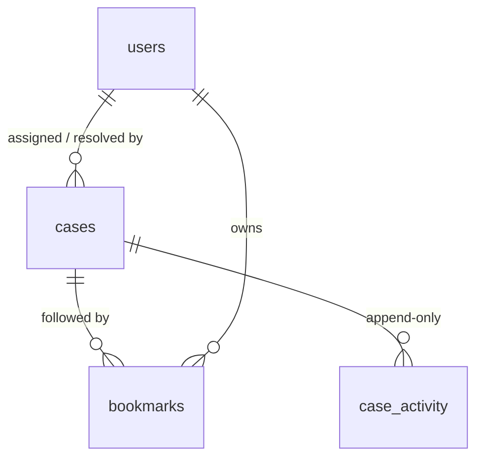
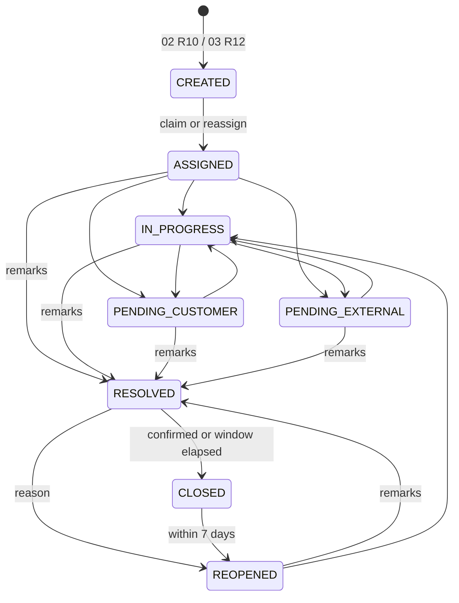

# 04 Outbound assistant workspace — backend design

- Status: **Approved** (revision 1) · Date: 2026-11-28 · approved by user 2026-11-28 with all open-question defaults (design review skipped at the user's choice)
- BRD: OUT-01..OUT-06, BR-03..BR-07, BR-10, XC-02..XC-07, NFR-INTEG, NFR-OBS, NFR-PERF, NFR-PRIV, NFR-REL, NFR-SEC, §7.1, §8, §14 #3, #6, #7, #8, #12, §15 phase 4
- Conventions: [`../00-overview.md`](../00-overview.md) rev 4 (no change needed) · Contract: [`openapi.yaml`](openapi.yaml) (shared components copied verbatim from 01/03, as 02/03 did) · Precedents: [`../02-customer/backend.md`](../02-customer/backend.md) (R9, R10, public status, E1–E7), [`../03-inbound/backend.md`](../03-inbound/backend.md) (R8, R9, §6.1, E1–E2), `guarded-transition` skill

## 1. Scope

**In:** operational queue with counts and server-side filters, atomic claim, permissioned reassignment, case detail with customer
context and timeline, internal notes and customer-visible comments, guarded status lifecycle (resolve, close, reopen) with an
auto-close job for the verification window, personal bookmarks with an in-app "changed since seen" indicator.

**Out:** automatic routing of new cases to teams (OQ 2), customer reopen and a customer case-detail screen (OQ 13), SLA pause and
escalation (OQ 12), email/Mailpit agent notifications (OQ 8), unassign/release (OQ 18), analytics (05).

**Module dependencies:** unchanged (`ArchitectureTest` edges as 00-overview rev 4): `servicecase → customer`, `servicecase → identity`.
No new edge, no new module. New cross-module APIs are listed in §6.1; repositories stay module-private.

## 2. Data model (Flyway V11)

Conventions as 02 §2. Times UTC `DATETIME(6)`, read as `LocalDateTime` then `toInstant(UTC)` (PR #17, never `Timestamp.toLocalDateTime()`).

| Table / change (module) | Columns | Keys, constraints, indexes |
|---|---|---|
| cases (servicecase) **ALTER** | `+ resolved_at null`, `+ resolved_by_user_id null` (FK users), `+ resolution_remarks VARCHAR(1000) null`, `+ closed_at null`, `+ closure_type VARCHAR(20) null` `CUSTOMER_CONFIRMED\|WINDOW_ELAPSED`, `+ reopen_count INT NOT NULL DEFAULT 0` | backfill first: RESOLVED/CLOSED → `resolved_at = updated_at`; CLOSED → `closed_at = updated_at`, `closure_type = 'WINDOW_ELAPSED'`. Then CHECK `(status IN ('RESOLVED','CLOSED')) = (resolved_at IS NOT NULL)`, CHECK `(status = 'CLOSED') = (closed_at IS NOT NULL AND closure_type IS NOT NULL)`, CHECK closure_type enum. New idx (created_at), (updated_at), (status, sla_due_at), (status, resolved_at), (contact_msisdn) |
| bookmarks (servicecase) | `user_id` (FK users), `case_id` (FK cases), `last_seen_at`, `created_at` | PK (user_id, case_id); idx (case_id). Not audited (personal, OUT-06.1) |

| Migration / script | Content |
|---|---|
| `V11__outbound.sql` | the ALTER + backfill + CHECKs + indexes above; `bookmarks`. No permission change: `case.read.queue`, `case.assign`, `case.assign.any`, `case.status.update`, `case.note.internal`, `case.bookmark` exist (V2, `identity/Permissions`) |
| seed fixes (same task) | every seed/test-data `INSERT INTO cases` with RESOLVED/CLOSED sets `resolved_at` (and `closed_at`, `closure_type`): `R__02_customer.sql`, `R__02_customer_e2e.sql`, test-data `R__test_users_02_customer.sql` — else fresh DBs fail the CHECKs |
| `db/seed/R__04_outbound.sql` (dev), test-data `R__test_users_04_outbound.sql` | pool cases (team/user null), OUTBOUND_N cases owned by OUT001/OUT002, an OUTBOUND_S case of OUT003, one overdue CRITICAL, one RESOLVED 4 days ago (auto-close), CLOSED 3 and 10 days ago (reopen window), OUT001 bookmarks incl. one changed since seen |

## 3. Business rules

Actor = `CurrentUser.require()` (identity). **Scope** S(actor): with `case.assign.any` = all cases (organisation, OQ 1); otherwise
`assigned_user_id = :me OR assigned_team_id = :myTeam OR (assigned_user_id IS NULL AND assigned_team_id IS NULL)` (own, team queue,
unrouted pool; §14 #3). A case outside S is **404** (existence not leaked). Fixed SQL fragments only; values are named parameters.

| # | Rule | Enforced where | BRD |
|---|---|---|---|
| R1 | **Summary** O1: one `SUM(CASE …)` query over S and the created-date window (00-overview §3, default 3 months). Counts: `new`=CREATED, `open`=ASSIGNED+REOPENED, `inProgress`=IN_PROGRESS, `pending`=PENDING_CUSTOMER+PENDING_EXTERNAL, `resolved`, `closed`, `critical`=CRITICAL and not RESOLVED/CLOSED, `overdue`=`sla_due_at < now` and not RESOLVED/CLOSED (OQ 6). Returns the effective window | `OutboundCaseQueryService`, `QueueRepository` | OUT-01, BR-05 |
| R2 | **Queue search** O2 (POST body, so the mobile number stays out of URLs and access logs, as 03 R1): filters `status[]`, `severity[]`, `categoryCode` (leaf, or top level = itself + children), `assignee` `ANY\|ME\|UNASSIGNED\|USER` + `assigneeUserId`, `customerMsisdn` (exact E.164: `contact_msisdn` = it OR account in `AccountLookup.accountIdsByLiveMsisdn`), `reference` (exact, inside the window, as 02 OQ 6 / OQ 14), `overdue`. Windows `created{From,To}`, `updated{From,To}`: each `from ≤ to`, ≤ 366 days, a `to`-only range = `to` − 3 months; **no range given → created = last 3 months** (OUT-02.4). Sort whitelist `createdAt` (default desc), `updatedAt`, `slaDueAt`, `severity` (`FIELD(...)` fragment), tie-break `id`. Response: page + `totalItems` + echoed effective filters (OUT-02.2) | `OutboundCaseQueryService`, `QueueRepository`, `QueueSearchValidator` | OUT-01.1/01.2, OUT-02, XC-04/05, NFR-PERF |
| R3 | **Row / customer context**: reference, customer name + ref, masked contact MSISDN (`******` + last 4), category/subcategory, severity, created, owner name (user, else team, else null), status, public status (02 mapping), updated, `overdue`, `bookmarked`. Names via `UserDirectory`, customer via `AccountLookup.caseContexts` — one batch call each per page | `OutboundCaseQueryService` | OUT-01.1, OUT-04.4, NFR-PRIV |
| R4 | **Detail** O5: R3 + subject, description, case type, channel + creator name (OUT-04.2), team, response/SLA due, resolution fields, account ref/status, preferred contact; `contactMsisdn` full **only for the assignee** (needs it to call back), else null (OQ 9); never email or address. Timeline oldest first, PUBLIC and INTERNAL tagged (INTERNAL needs `case.note.internal`, BR-04); ASSIGNED values rendered as display names by the shared `CaseTimelineAssembler` (also used by 03 I10). `version` and `allowedActions` (`claim`, `reassign`, `transitions[]`, `internalNote`, `publicComment`) for the actor | `OutboundCaseQueryService`, `CaseTimelineAssembler`, `CaseLifecycle` | OUT-04, BR-04 |
| R5 | **Claim** O6 (`case.assign`): case unassigned and not RESOLVED/CLOSED; sets user = actor, team = actor's team; CREATED → ASSIGNED, other states unchanged. Already the actor's → 200 no-op (retry-safe). Owned by someone else → 409 `already_assigned`. Terminal → 422 `case_closed`. Writes ASSIGNED (INTERNAL, old null/new actor id) + STATUS_CHANGED when CREATED, audit `CASE_ASSIGNED` mode CLAIM | `CaseCommandService` (§3.2) | OUT-03.1/03.4, BR-03 |
| R6 | **Reassign** O7 (`case.assign.any`, OUT-03.3: taking another's case or assigning to someone else is only this): body `assigneeUserId`, `reason` 5–500, `version`. Target = `UserDirectory.queueAgent(id)` (ACTIVE STAFF holding `case.read.queue`) else 422 `invalid_assignee`; same as current → 422 `no_change`; RESOLVED/CLOSED → 422 `case_closed`; stale version → 409 `stale_version`. Team = target's team; CREATED → ASSIGNED. ASSIGNED activity (old/new user id, `note_text` = reason) + audit with old owner, new owner, actor, reason (OUT-03.2) | `CaseCommandService` | OUT-03.2–03.4, BR-03 |
| R7 | **Status** O8 (`case.status.update`): actor is the assignee or holds `case.assign.any` (else 403 `not_owner` via `DeniedAccessRecorder`); unassigned → 422 `unassigned` (claim first); transition per §3.1 else 422 `invalid_transition`; `version` stale → 409 `stale_version`. Remarks ≤ 1000; **required (10–1000)** for → RESOLVED (OUT-05.2), → REOPENED, and → CLOSED with `CUSTOMER_CONFIRMED` (400 `errors[]`). Writes STATUS_CHANGED (PUBLIC, old/new) + remarks as NOTE/INTERNAL, audit `CASE_STATUS_CHANGED` (OUT-05.5) | `CaseCommandService`, `CaseLifecycle` | OUT-05, BR-03, NFR-INTEG |
| R8 | **Closure** (OUT-05.3/05.4): RESOLVED = issue addressed (`resolved_at`, `resolved_by`, `resolution_remarks`); CLOSED = closure complete, only from RESOLVED with `closureType`: `CUSTOMER_CONFIRMED` (agent attests, remarks say how) any time, or `WINDOW_ELAPSED` only when `now ≥ resolved_at + verification-window` (3 days, OQ 4) else 422 `closure_condition_unmet`. `CaseAutoCloseJob` closes RESOLVED rows past the window (actor null) | `CaseLifecycle`, `CaseAutoCloseJob` | OUT-05.3/05.4 |
| R9 | **Reopen** (§7.1, §14 #7): RESOLVED → REOPENED any time; CLOSED → REOPENED only while `now < closed_at + reopen-window` (7 days) else 422 `reopen_window_expired`. Clears resolved/closed columns, `reopen_count + 1`, keeps owner and SLA due dates (OQ 5, OQ 12) | `CaseLifecycle`, `CaseCommandService` | OUT-05, §14 #7 |
| R10 | **Notes** O9 (idempotent `CASE_NOTE_ADD`): `visibility` INTERNAL needs `case.note.internal` (any agent in S); PUBLIC (customer-visible comment, OUT-04.1) needs `case.status.update` and assignee or `case.assign.any` (OQ 10); text 1–2000; PUBLIC on CLOSED → 422 `case_closed`. Service 403s → `DeniedAccessRecorder` (reason `permission`/`not_owner`). Bumps `updated_at`/`version` (material update, OUT-04.3); no audit (the activity row is the record) | `CaseCommandService` | OUT-04.1/04.3, BR-04, NFR-REL |
| R11 | **Bookmarks** O10/O11: PUT needs the case in S; idempotent upsert, `last_seen_at = now`; ≤ 200 per agent (count under `UserDirectory.lockForUpdate(me)`, race-safe as 03 R14) else 422 `bookmark_limit`. DELETE removes the actor's own row, 204 even if absent, no scope check (own data); unknown reference → 404. Rows are keyed by the actor id from the principal only (OUT-06.1); no ownership change | `BookmarkService`, `BookmarkRepository` | OUT-06.1 |
| R12 | **Bookmarked view** O12: actor's bookmarks newest first, paged; no date window (bounded by the 200 cap, OQ 15). Cases still in S show R3 fields + status + `updatedAt` (OUT-06.3); others show reference only, `accessible=false` (can be removed). `changed = updated_at > last_seen_at` when `app.outbound.bookmark-notifications.enabled`; `changedCount` in the page. O13 sets `last_seen_at = now` (FE calls it on opening a bookmarked case); every write by the actor on a case also sets the actor's `last_seen_at` in the same tx, so own changes never flag (OUT-06.4, OQ 8) | `BookmarkService` | OUT-06.2–06.4 |
| R13 | **Lookups** O3 categories: all active categories, both audiences, top levels with children; O4 agents: `UserDirectory.queueAgents(team)` — own team for S-team actors, all for `case.assign.any` | `OutboundCaseQueryService` | OUT-02, OUT-03 |

### 3.1 Case transitions (O8 manual, claim/reassign and job noted; BRD §7.1, OQ 3)

| From | Allowed `toStatus` (O8) | Extra condition / effect |
|---|---|---|
| CREATED | — (only claim/reassign → ASSIGNED) | 422 `unassigned` / `invalid_transition` |
| ASSIGNED, IN_PROGRESS, PENDING_CUSTOMER, PENDING_EXTERNAL, REOPENED | IN_PROGRESS, PENDING_CUSTOMER, PENDING_EXTERNAL, RESOLVED (never to itself) | → RESOLVED sets resolved_* (remarks required) |
| RESOLVED | CLOSED, REOPENED | R8 closure condition; R9 reopen |
| CLOSED | REOPENED | R9 window |

`CaseLifecycle` is a pure class (table above + window checks against an injected `Clock`), the only source for both O8 validation
and `allowedActions`. Inbound agents get no transitions in 04 (03 OQ 8).

### 3.2 Race-safe writes (single writer `CaseCommandService`, OUT-03.1, NFR-INTEG)

Every O6–O9 write is one `@Transactional` method: (1) `SELECT … FROM cases WHERE reference = :ref FOR UPDATE` (none → 404);
(2) scope S (404); (3) permission/ownership (403), `version` (409), rules (422); (4) one guarded
`UPDATE cases SET …, updated_at = :now, version = version + 1 WHERE id = :id AND version = :version` that must change 1 row
(defence in depth; 0 → 409 `stale_version`); (5) activity rows, actor bookmark `last_seen_at`, success audit — same tx (00-overview §6).
The row lock serialises claim/reassign/status/notes on one case: of N parallel claims exactly one updates, the rest then read an
owner and get 409. Locks: one case row per tx; O10 locks only the actor's `users` row; no tx holds both → no lock cycle.
`CaseAutoCloseJob` (`app.outbound.auto-close-cron`, default every 5 min; `-` tests only, refused in prod by `ProfileGuard`) takes
due ids by keyset page (100, 50 s budget) and runs, per row, the guarded `UPDATE … SET status='CLOSED', closed_at=:now,
closure_type='WINDOW_ELAPSED', version=version+1 WHERE id=:id AND status='RESOLVED' AND resolved_at <= :cutoff`; activity + audit
only when 1 row changed (parallel runs and a concurrent reopen are safe: the guard fails, nothing is written).

## 4. Authorization and scope

- Every `/api/v1/outbound/**` handler: `@PreAuthorize("hasAuthority('case.read.queue') and hasAuthority('<perm>')")` (perm in §5).
  `case.read.queue` is only on OUTBOUND_AGENT (V2), so CUSTOMER, INBOUND_AGENT, REACTIVATION_APPROVER and BUSINESS_* get 403.
- Record scope S (§3) in every query and every write; out of scope = 404. The actor id/team always come from the principal (BR-10).
- Service-level 403s (`not_owner`, PUBLIC/INTERNAL note permission) go through `DeniedAccessRecorder` (01 §7, sampled).
- `case.assign.any` (OUTBOUND_SUPERVISOR) widens S to all cases and allows reassign, status and PUBLIC comments on others' cases (OQ 16).

## 5. Endpoints (prefix `/api/v1/outbound`; details in openapi.yaml)

Common errors 401, 403, 500; with a body also 400, 413, 415. Mutations need `X-XSRF-TOKEN`. 422/409 bodies are `CaseProblem` (`reason`).

| # | Method | Path | Permission (+ `case.read.queue`) | Idem. | Response / extra errors |
|---|---|---|---|---|---|
| O1 | GET | `/case-summary?from&to` | case.read.queue | | 200 `QueueSummary` · 400 |
| O2 | POST | `/case-searches` `QueueSearch` | case.read.queue | (read) | 200 `OutboundCasePage` · 400 |
| O3 | GET | `/case-categories` | case.read.queue | | 200 `QueueCategory[]` |
| O4 | GET | `/agents` | case.read.queue | | 200 `QueueAgent[]` |
| O5 | GET | `/cases/{reference}` | case.read.queue | | 200 `OutboundCaseDetail` · 404 |
| O6 | POST | `/cases/{reference}/claim` | case.assign | no-op if mine | 200 detail · 404 · 409 · 422 |
| O7 | POST | `/cases/{reference}/assignment` `{assigneeUserId, reason, version}` | case.assign.any | version | 200 detail · 404 · 409 · 422 |
| O8 | POST | `/cases/{reference}/status` `{toStatus, remarks, closureType, version}` | case.status.update | version | 200 detail · 403 · 404 · 409 · 422 |
| O9 | POST | `/cases/{reference}/notes` `{visibility, text}` | case.read.queue (+ R10) | ✔ `CASE_NOTE_ADD` | 201 `CaseActivity` · 403 · 404 · 409 · 422 |
| O10 | PUT | `/cases/{reference}/bookmark` | case.bookmark | by nature | 204 · 404 · 422 |
| O11 | DELETE | `/cases/{reference}/bookmark` | case.bookmark | by nature | 204 · 404 |
| O12 | GET | `/bookmarks?page&size` | case.bookmark | | 200 `BookmarkPage` |
| O13 | POST | `/bookmarks/{reference}/seen` | case.bookmark | by nature | 204 · 404 (not bookmarked) |

O6–O8 are retry-safe without a key: O6 is a no-op for the owner, O7/O8 carry `version` (a retry after success gets 409 `stale_version`,
and the FE re-reads O5). XC-07: every write returns the committed state; the FE never applies optimistic updates.

## 6. Components (servicecase unless noted)

| Component | Responsibility |
|---|---|
| `OutboundScope` (record from `CurrentUser`), `QueueSearchValidator`, `OutboundProperties` (`app.outbound.*`) | scope S, R2 validation, config |
| `QueueRepository` | O1/O2 SQL (fixed fragments, sort whitelist), bookmark-aware row query |
| `CaseRepository` (+ `lockForCommand`, guarded `claim`, `reassign`, `transition`, `touch`, `autoClose`, `findDueResolved`, `findOutboundDetail`) | the only SQL writer of case status/assignment after creation |
| `CaseActivityRepository` (+ `insertAssigned`, `insertStatusChanged`, `insertNote(visibility)`), `CaseTimelineAssembler` | timeline rows; names for ASSIGNED values (shared with 03 I10) |
| `CaseLifecycle` | §3.1 table, R8/R9 windows, `allowedActions` |
| `OutboundCaseQueryService`, `CaseCommandService`, `BookmarkService`, `BookmarkRepository`, `CaseAutoCloseJob` | R1–R13, §3.2 |
| `OutboundCaseController` (O1–O9), `OutboundBookmarkController` (O10–O13), `CaseRuleException` (→ `CaseProblem.reason`) | HTTP |
| `common/ProfileGuard` (+ `app.outbound.auto-close-cron`) | prod refuses `-` |

### 6.1 Cross-module APIs (new; only these)

| API (owner) | Used by | Notes |
|---|---|---|
| `AccountLookup.caseContexts(accountIds)` → `Map<Long, CaseCustomer(customerRef, customerName, accountRef, accountStatus)>` (customer) | servicecase | one query per page (R3, R4) |
| `AccountLookup.accountIdsByLiveMsisdn(e164)` → `List<Long>` (customer) | servicecase | R2 mobile filter; never logged |
| `UserDirectory.queueAgents(Long teamIdOrAll)`, `queueAgent(userId)` → `QueueAgent(userId, displayName, teamId, teamName)` (identity) | servicecase | ACTIVE STAFF with `case.read.queue` via roles (R6, R13) |
| existing: `UserDirectory.displayNames/teamNames/lockForUpdate`, `AuditService`, `DeniedAccessRecorder`, `IdempotencyService` | servicecase | |

Config: `app.outbound.{verification-window=3d, reopen-window=7d, bookmark-limit=200, bookmark-notifications.enabled=true,
auto-close-cron="0 */5 * * * *", auto-close.page-size=100, auto-close.run-budget=50s}`.

## 7. Audit actions (00-overview §6; free text ≤ 1000, accepted as 03 OQ 16 → OQ 17)

| Action | Outcome | Entity | `details` |
|---|---|---|---|
| `CASE_ASSIGNED` | SUCCESS | CASE/reference | `mode` CLAIM\|REASSIGN, `fromUserId`, `toUserId`, `fromTeamId`, `toTeamId`, `reason` (REASSIGN), status from/to if changed |
| `CASE_STATUS_CHANGED` | SUCCESS | CASE/reference | `from`, `to`, `remarks`, `closureType`, `source` request\|auto_close (job: actor null) |
| `ACCESS_DENIED` (01) | DENIED | path | via `DeniedAccessRecorder` (`not_owner`, `permission`) |

## 8. Integrations / ports

None new. OUT-06.4 uses an in-app indicator derived from `bookmarks.last_seen_at`; no `NotificationSender` call (OQ 8).

## 9. Test plan (Testcontainers MySQL, `R__test_users_04_outbound.sql`, mutable test `Clock`)

**Deferred by user decision 2026-11-27** (CLAUDE.md): tasks are done on compile + `ArchitectureTest` + the named manual checks; these
tests are recorded in `docs/testing/test-plan.md` §3.4 by the build and written when the deferral ends.

| Test | Proves | BRD |
|---|---|---|
| `SchemaV11IT` | backfill; resolved/closed CHECKs; bookmarks PK; seeds load on a fresh DB | OUT-05.3, NFR-INTEG |
| `CaseLifecycleTest` (unit) | every (from, to) pair of §3.1 incl. forbidden ones; remarks rules; window edges (verification, reopen) | OUT-05.1/05.2/05.4 |
| `OutboundQueueIT` | S for agent vs supervisor vs other team; every filter; default and to-only windows; > 366 d / from > to → 400; no unbounded query; sort whitelist; totals; masked MSISDN; mobile filter via live MSISDN | OUT-01, OUT-02, XC-04/05 |
| `QueueSummaryIT` | each count definition, scope and window | OUT-01 |
| `OutboundCaseDetailIT` | context, creator + channel, INTERNAL only with `case.note.internal`, full MSISDN only for assignee, ASSIGNED names, `allowedActions`; out of scope → 404 | OUT-04 |
| `CaseClaimIT` | **10 parallel claims → 1 × 200, 9 × 409, one ASSIGNED activity, one audit**; owner retry 200 no-op; terminal 422 | OUT-03.1/03.4 |
| `CaseReassignIT` | agent without `case.assign.any` → 403; invalid/disabled target 422; stale 409; old/new/actor/reason in activity + audit | OUT-03.2/03.3 |
| `CaseStatusIT` | non-owner 403; unassigned 422; RESOLVED needs remarks; closure conditions; reopen window; **2 parallel transitions on one version → 1 ok + 409** | OUT-05, BR-03 |
| `CaseAutoCloseJobIT` | due RESOLVED → CLOSED once; **parallel runs → one activity/audit**; concurrent reopen wins or 409, never both | OUT-05.4 |
| `CaseNoteIT` | INTERNAL/PUBLIC permission + ownership; CLOSED PUBLIC 422; replay + mismatch; `updated_at` bumped | OUT-04.1/04.3, NFR-REL |
| `BookmarkIT` | per-agent isolation; idempotent PUT/DELETE; cap 200 under parallel PUTs; out-of-scope shown reference-only; changed flag, own writes not flagged, O13 clears; flag off → never changed | OUT-06 |
| `OutboundAuthzIT` | every O1–O13: anonymous 401; CUSTOMER, INBOUND_AGENT, REACTIVATION_APPROVER, BUSINESS_ANALYST, BUSINESS_AUDITOR → 403; OUTBOUND_AGENT → 403 on O7; no CSRF → 403 | BR-10, XC-02 |
| `OutboundIdorIT` | other team's case by reference on O5–O10 → 404, nothing changed | NFR-INTEG |
| `ArchitectureTest`, `CrossModuleApiIT` (extended), `ProfileGuardIT` | no new edge; new APIs; `-` cron refused in prod | NFR-MAINT, NFR-SEC |

## 10. Open questions (defaults used until answered)

**Needs the user's decision at approval:**

| # | Question | Default |
|---|---|---|
| 1 | Queue visibility (OUT-01.4, §14 #3) | Agent: own + own team + unrouted pool; `case.assign.any`: all cases |
| 3 | Lifecycle transitions (§7.1 "approved by operations") | §3.1 table; CREATED leaves only via claim/assign |
| 4 | Closure conditions (OUT-05.4) | `CUSTOMER_CONFIRMED` (agent attests, remarks) any time, or 3-day verification window; auto-close job |
| 8 | Bookmark notifications (OUT-06.4, §14 #12) | In-app "changed since seen" flag + count; no email (Mailpit deferred to 06, continues 03 OQ 9) |

**Other questions:**

| # | Question | Default |
|---|---|---|
| 2 | Routing new cases to teams | None; new cases stay in the shared pool (teams are dev seed only, no reference data to route by) |
| 5 | Reopen | RESOLVED any time; CLOSED ≤ 7 days (§14 #7 value); owner and SLA kept |
| 6 | Count definitions (OUT-01) | R1 |
| 7 | Default window hides open cases created > 3 months ago | Accepted (BR-05); the agent widens the range |
| 9 | Masking (OUT-04.4) | Name + customer ref shown; MSISDN last 4, full only for the assignee; no email/address |
| 10 | Who may post a customer-visible comment | `case.status.update` + assignee or `case.assign.any` |
| 11 | Are resolution remarks customer-visible? | No (INTERNAL); customer text goes in a PUBLIC comment |
| 12 | SLA pause while PENDING / reset on reopen | Neither (calendar time, as 02) |
| 13 | Customer reopen / customer case detail (§14 #7) | Not in 04; `reopen-window` is reusable later |
| 14 | Exact reference search inside the window | Yes, as 02 OQ 6 / 03 R8 |
| 15 | Bookmark cap and window | 200 per agent, no date window; out-of-scope rows reference-only |
| 16 | Supervisor acts on any case | Yes with `case.assign.any` (status, reassign, PUBLIC comment) |
| 17 | Free-text reason/remarks in immutable audit | Accepted, ≤ 1000, UI hint "no personal data" |
| 18 | Unassign / release to pool | Not offered; supervisor reassigns |
